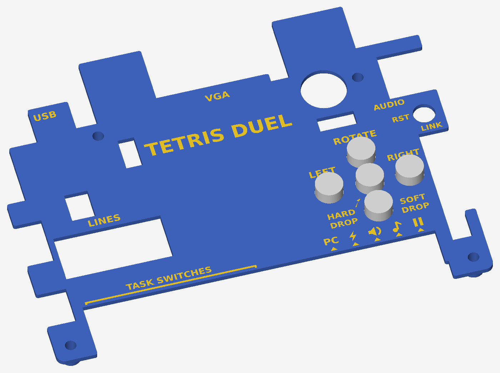

# Board cover (3D print)

A plate that sits over the EDGE Spartan-7 board on 4 legs (one on each
mounting hole), its top face 6 mm above the PCB. It works for `main` and for
`chaos`:

* **push buttons**: 5 printed extenders through round holes, labelled ROTATE,
  LEFT, RIGHT, HARD DROP (centre, also start) and SOFT DROP. Each is an 8.2 mm
  knob (8.4 mm hole, 0.1 mm gap) standing 4 mm above the plate, on a wide
  base that sits in a pocket under the plate, so it can't fall out. The base has flats on top and bottom (the buttons above
  and below the centre one are only 9.7 mm apart) and a 3.6 mm dimple that
  holds the 3.4 mm blue plunger so the extender can't slide off
* **slide switches**: one 105 x 17 mm opening for all 16, open to the bottom
  edge. Above it: TASK SWITCHES (the 8 on the left, chaos tasks) and icons
  for the settings, each with an "on" triangle:
  `PC` = PC link over USB (SW7), ⚡ = CHAOS (SW6), speaker = sound effects
  (SW5), ♪ = music (SW4), ❚❚ = pause (SW2)
* **openings**: 7-segment display (LINES, with a closed frame), VGA, audio,
  J5 link header, USB, power, reset (RST), and everything taller than the
  plate: buzzer (with a full ring around it), USB-A, temperature sensor, pin
  headers and jumpers. The LDR is covered
* everything else is hidden



## Files

| file | what |
|---|---|
| `make_cover.py` | generates everything; measured sizes and options are at the top |
| `out/cover.3mf` | **open this in OrcaSlicer / Bambu Studio**: plate + labels as one object with 2 parts |
| `out/cover_body.stl` | the plate alone (labels are engraved grooves) |
| `out/cover_labels.stl` | the label inlay alone |
| `out/button_caps.stl` | the 5 button extenders |
| `out/spacers_m3.stl` | 4 M3 spacers, 2 mm high (6 mm OD, 3.3 mm hole) |
| `out/template_1to1.pdf` | 1:1 paper template for a test fit |
| `out/check_overlay.png` | the plate drawn over the board photo (needs `ref/board_top.webp`) |
| `out/preview.png`, `out/preview_under.png` | 3D views |

## Measured on the real board

| | mm |
|---|---|
| PCB | 130 x 100 |
| bottom / top mounting holes, centre to centre | 120 / 77.5 |
| 16 slide switches, outer edge to outer edge | 103.5 |
| bottom-left hole -> leftmost switch / rightmost switch -> bottom-right hole | 7.5 / 9 |
| slide switch: metal frame / top of the knob | 6 / 12 |
| push button top | 4.5 |
| buzzer / USB-B / VGA | 10 / 11 / 11.7 |

The rest (where each part is) comes from a top-down photo scaled to the
board size. The plate is 1.6 mm thick with its top at 6 mm, so **everything
it covers must be lower than 4.4 mm**. The borderline part is the crystal Y1
(standing metal can near the FTDI chip, usually 3.5-4 mm): if the plate
rocks on it, set `OPEN_Y1 = True`. The strip between the 7-segment display
and the ADC header is 1.7 mm (that's all the room there is).

Change the numbers at the top of `make_cover.py` and run it again (Python 3 with `shapely`, `manifold3d`, `trimesh`,
`matplotlib`, `Pillow`):

```
python make_cover.py
```

**Test fit first:** print `out/template_1to1.pdf` at 100 % ("actual size", not
"fit to page"; the 50 mm line must measure 50 mm), cut it out and lay it on
the board. Every window should sit on its part and the 4 red circles on the
mounting holes.

## Printing

* Open `out/cover.3mf`. If the slicer asks, load it as **one object with
  multiple parts**. It is already upside down (top face on the bed, legs up),
  so it needs **no supports** and the top comes out smooth.
* Two colours: give the `cover_labels` part a second filament (AMS), or
  print one colour and the labels are 0.6 mm grooves.
* `out/button_caps.stl`: base down, no supports. A light colour looks good.
* `out/spacers_m3.stl`: flat, no supports. Height and count: `SPACER_H`, `SPACER_N`.
* PLA or PETG, 0.2 mm layers, 3 walls.

## Fitting

1. Put the 5 extenders on the buttons, base down, flats facing up and down:
   the dimple under the base sits over the button's blue plunger.
2. Lower the plate over them: the knobs go through the round holes and the
   bases into the pockets underneath.
3. Fix the legs with M3 screws through the board's mounting holes and a nut
   underneath (M3 x 10 or 12).

The extender base hangs 0.5 mm lower than the plunger top (`CAP_DIMPLE_H`). If
an extender sits on the button body instead of the plunger and the button
won't click, make the dimple shallower. If the dimple is too tight for the
plunger (printers shrink small holes a little), set `CAP_DIMPLE_D = 3.7`.

If a part hits the underside, open it up (`OPEN_Y1`, `OPEN_WIFI`, or add a
box to `WINDOWS`) or raise `PLATE_TOP`.
