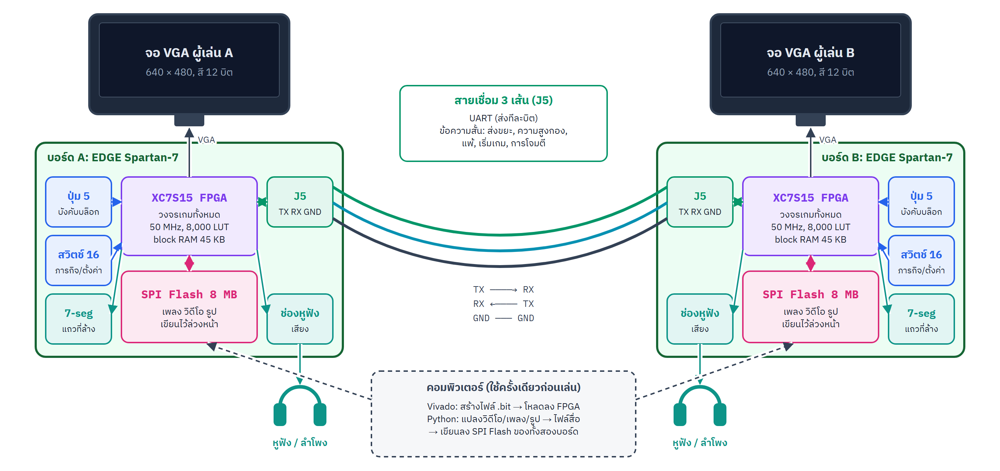
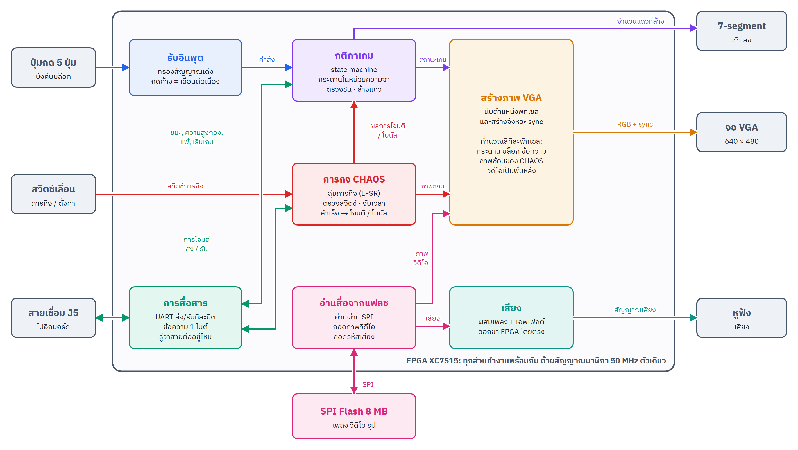

<!-- COVER: รายงานเสนอโครงงาน (Proposal) -->

## 1. ชื่อชิ้นงาน

**Tetris Duel: CHAOS Edition**: เกมเตตริสแบบต่อสู้ (versus) สำหรับผู้เล่น 2 คน บนบอร์ด EDGE Spartan-7 สองบอร์ดที่เชื่อมกันด้วยสายไฟ 3 เส้น
ทุกอย่างทำงานอยู่ภายในชิป FPGA ทั้งหมด ได้แก่ กติกาเกม ภาพ VGA เสียง การสื่อสารระหว่างบอร์ด และการเล่นวิดีโอ

## 2. ที่มาและความสำคัญ

เตตริส (Tetris) เป็นเกมที่ทุกคนรู้จัก กติกาเข้าใจง่าย แต่การทำให้เกมนี้ทำงานบน **ฮาร์ดแวร์ล้วน** โดยไม่มี CPU ไม่มีระบบปฏิบัติการ
และไม่มีโปรแกรมใดๆ ทำงานอยู่เลย ต้องใช้ความรู้เกือบทุกเรื่องในรายวิชา Digital System Fundamentals:

* **วงจรเชิงผสม (combinational logic)**: ตรวจการชนของบล็อก, คำนวณสีของแต่ละพิกเซล
* **วงจรเชิงลำดับและ state machine**: ลำดับขั้นของเกมตั้งแต่เกิดบล็อกจนถึงล้างแถว
* **ตัวนับ (counter) และ timing**: สัญญาณภาพ VGA, ความเร็วของบล็อกที่ตกลงมา
* **หน่วยความจำ**: กระดานเกม, block RAM สำหรับภาพ, หน่วยความจำแฟลชภายนอก
* **การสื่อสารแบบอนุกรม (serial)**: UART ระหว่างบอร์ด, SPI ไปยังชิปแฟลช
* **LFSR**: สุ่มบล็อกถัดไปและภารกิจ

กลุ่มของเราอยากทำชิ้นงานที่ **สนุกและเล่นได้จริงกับเพื่อน** แทนอุปกรณ์ที่ใช้งานคนเดียว จึงเลือกทำเตตริสแบบ "ดวล"
ที่ผู้เล่นสองคนใช้บอร์ดคนละบอร์ด ส่งแถวขยะ (garbage) ใส่กันได้ผ่านสายเชื่อม แล้วเพิ่มความแปลกใหม่ด้วย **โหมด CHAOS**:
ระหว่างเล่น ผู้เล่นต้องทำ "ภารกิจ" ด้วยสวิตช์บนบอร์ดไปพร้อมกัน (เช่น ตั้งเลขฐานสอง หรือกดสวิตช์ให้ตรงจังหวะ)
ถ้าทำสำเร็จจะได้ส่ง "การโจมตี" ไปป่วนจอของคู่แข่ง เช่น กลับจอ ซ่อนบล็อก หรือเปิดวิดีโอมีมเต็มจอของอีกฝ่าย
การโจมตีบางแบบมาพร้อมวิดีโอและเพลงที่เก็บไว้ในหน่วยความจำแฟลชของบอร์ด

## 3. วัตถุประสงค์

1. เพื่อออกแบบและสร้างระบบดิจิทัลขนาดใหญ่บน FPGA โดยแบ่งระบบเป็นโมดูลย่อยที่ออกแบบ ทดสอบ และประกอบรวมกันได้
2. เพื่อประยุกต์ความรู้เรื่อง state machine, ตัวนับ, หน่วยความจำ และการสื่อสารแบบอนุกรม ในชิ้นงานเดียว
3. เพื่อสร้างการสื่อสารระหว่างบอร์ด FPGA สองบอร์ดที่เชื่อถือได้ (รู้ว่าเชื่อมต่ออยู่หรือไม่ และตัดสินผลแพ้ชนะตรงกันทั้งสองฝั่ง)
4. เพื่อแสดงภาพและเสียงคุณภาพสูงจากหน่วยความจำแฟลช SPI ภายในข้อจำกัดของชิปขนาดเล็ก (8,000 LUT, block RAM 45 KB)
5. เพื่อฝึกการทดสอบอย่างเป็นระบบ: จำลอง (simulation) ด้วย testbench ก่อน แล้วทดสอบบนบอร์ดจริงทีละส่วน

## 4. ภาพรวมของชิ้นงาน

ผู้เล่นแต่ละคนมีบอร์ดหนึ่งบอร์ด จอ VGA หนึ่งจอ และหูฟังหรือลำโพง ปุ่มกด 5 ปุ่มบนบอร์ดใช้บังคับบล็อก
และสวิตช์เลื่อน 8 ตัวด้านซ้ายใช้ทำภารกิจ บอร์ดทั้งสองคุยกันผ่านสาย 3 เส้นที่ขา J5 (TX, RX, GND)

## 5. ขอบเขตของชิ้นงาน

**ก. ตัวเกมเตตริส**

1. กระดาน 10 × 20 ช่อง, บล็อก 7 แบบ (I O T S Z J L) สีต่างกัน, หมุนได้พร้อมการขยับหลบกำแพง (wall kick)
2. ปุ่มกด 5 ปุ่ม: ซ้าย, ขวา (กดค้างเพื่อเลื่อนต่อเนื่อง), หมุน, ตกช้า (soft drop), ตกทันที (hard drop)
3. สุ่มบล็อกแบบ 7-bag (ทุก 7 ชิ้นได้ครบทั้ง 7 แบบ ไม่ขาดไม่เกิน), แสดงบล็อกถัดไป (NEXT) และเงาจุดตก (ghost)
4. ล้างแถวเต็ม, นับจำนวนแถวที่ล้าง (แสดงบนจอและบน 7-segment), ความเร็วเพิ่มตามเลเวล
5. ภาพ VGA 640 × 480 สี 12 บิต, ข้อความบนจอ (ฟอนต์ที่ออกแบบเอง), เสียงเอฟเฟกต์

**ข. โหมดต่อสู้ (Versus) ระหว่าง 2 บอร์ด**

1. สื่อสารผ่าน UART บนสาย 3 เส้น โดยส่งข้อความสั้นขนาด 1 ไบต์ (เช่น เริ่มเกม, ส่งขยะ, แพ้, ความสูงกอง)
2. ล้าง 2 / 3 / 4 แถวพร้อมกัน → ส่งแถวขยะ 1 / 2 / 4 แถวให้คู่แข่ง (หักล้างกับแถวขยะที่กำลังจะเข้ามาหาเราก่อน)
3. แถบ RIVAL แสดงความสูงกองบล็อกของคู่แข่งแบบเรียลไทม์, สถานะ LINKED เมื่อเชื่อมต่อ
4. เริ่มเกมพร้อมกันทั้งสองบอร์ด, ตัดสิน WIN / LOSE / DRAW ตรงกันทั้งสองฝั่ง
5. เล่นคนเดียวได้เมื่อไม่มีบอร์ดที่สอง

**ค. โหมด CHAOS**

1. ภารกิจหลายแบบ สุ่มขึ้นมาเป็นระยะระหว่างเล่น ทำด้วยสวิตช์เลื่อน 8 ตัว ภายในเวลาจำกัด
2. ทำภารกิจสำเร็จ → สุ่มได้ **โจมตี** คู่แข่ง หรือได้ **โบนัส** ให้ตัวเอง

**ง. สื่อจากหน่วยความจำแฟลช (Media)**

1. เพลงประกอบระหว่างเล่น (บีบอัดแบบ ADPCM), เล่นต่อจากจุดเดิมหลังโดนโจมตี
2. การโจมตีแบบวิดีโอ (เช่น Bad Apple!!, OIIA OIIA, Jevil) เล่นเป็นพื้นหลังของจอคู่แข่งพร้อมเสียง
3. คลิปหรือรูปตอนชนะและตอนแพ้ (สุ่ม), ตัวละครลอยบนจอ (sprite) และรูปหน้าเพื่อนบนลูกบอลเด้ง
4. สื่อทั้งหมดต้องใส่ได้ในชิปแฟลช 8 MB บนบอร์ด (ร่วมกับไฟล์วงจร) แปลงและเขียนลงแฟลชด้วยโปรแกรม Python ที่กลุ่มเขียนเอง

## 6. อุปกรณ์ที่ใช้

| อุปกรณ์ | จำนวน | หน้าที่ |
|---|---|---|
| บอร์ด EDGE Spartan-7 (XC7S15-FTGB196) | 2 | สมองของเกม (บอร์ดใหม่ทั้ง 2 บอร์ด) |
| จอ VGA + สาย VGA | 2 | แสดงภาพ 640 × 480 |
| หูฟังหรือลำโพงที่มีไฟเลี้ยง | 2 | เพลงและเสียงเอฟเฟกต์ |
| สายจัมเปอร์ | 3 เส้น | เชื่อมบอร์ด (TX, RX, GND) |

## 7. หลักการทำงานโดยสรุป

วงจรในแต่ละบอร์ดแบ่งเป็นส่วนตามหน้าที่ ทุกส่วนทำงานพร้อมกันตลอดเวลาด้วยสัญญาณนาฬิกา 50 MHz ตัวเดียว:

1. **รับอินพุต**: ปุ่มกดผ่านวงจรกรองสัญญาณเด้ง (debounce) แล้วแปลงเป็นคำสั่ง ซ้าย ขวา หมุน ตก
   ถ้ากดค้างจะส่งคำสั่งซ้ำเป็นจังหวะ
2. **กติกาเกม**: state machine รับคำสั่ง ขยับบล็อก ตรวจการชน ล้างแถว และนับคะแนน
   กระดานเก็บในหน่วยความจำภายในชิป บล็อกถัดไปสุ่มด้วย LFSR
3. **การสื่อสาร**: เมื่อล้างหลายแถวพร้อมกัน ส่งข้อความผ่าน UART ไปอีกบอร์ดเพื่อเพิ่มแถวขยะ
   และรับข้อความจากอีกบอร์ด (ขยะ, ความสูงกอง, แพ้, เริ่มเกม) ถ้าไม่ได้รับข้อความเลยสักพัก แสดงว่าสายหลุด
4. **ภารกิจ CHAOS**: สุ่มภารกิจ ตรวจตำแหน่งสวิตช์และจับเวลา ทำสำเร็จแล้วสุ่มว่าจะได้โจมตีหรือโบนัส
   การโจมตีส่งไปอีกบอร์ดผ่านสายเดียวกัน
5. **สร้างภาพ VGA**: นับตำแหน่งพิกเซลตามจังหวะของจอ แล้วคำนวณสีของพิกเซลนั้นจากสถานะเกม
   ซ้อนด้วยภาพของ CHAOS และวิดีโอจากแฟลชเป็นพื้นหลัง
6. **อ่านสื่อจากแฟลช**: อ่านข้อมูลจากชิปแฟลชผ่าน SPI ถอดภาพวิดีโอลงหน่วยความจำภาพ และถอดรหัสเสียง
7. **เสียง**: ผสมเพลงกับเสียงเอฟเฟกต์ แล้วส่งออกขา FPGA ไปยังช่องหูฟังโดยตรง

การออกแบบใช้กระบวนการ **Top-Down**: เริ่มจากระบบทั้งหมด (2 บอร์ด) → วงจรในหนึ่งบอร์ด → ส่วนต่างๆ ตามภาพด้านบน
→ แบ่งแต่ละส่วนเป็นโมดูล VHDL ที่ทดสอบแยกกันได้ด้วย simulation ก่อนนำไปประกอบและทดสอบบนบอร์ดจริง
(รายละเอียดการออกแบบจริงอยู่ใน Design Document)

## 8. ประโยชน์ที่คาดว่าจะได้รับ

1. เข้าใจการออกแบบระบบดิจิทัลขนาดใหญ่ และการแบ่งงานเป็นโมดูล
2. ได้ประสบการณ์จริงกับโปรโตคอล UART และ SPI, หน่วยความจำ block RAM และแฟลช, การบีบอัดภาพและเสียง
3. ได้ฝึกการทดสอบด้วย simulation และการแก้ปัญหาบนฮาร์ดแวร์จริง
4. ได้เกมที่เล่นสนุกกับเพื่อนได้จริง และเป็นตัวอย่างให้รุ่นต่อไปเห็นว่า FPGA ทำอะไรได้บ้าง
   (ตั้งใจเขียนคำอธิบายในโค้ดและเอกสารประกอบอย่างละเอียด)
