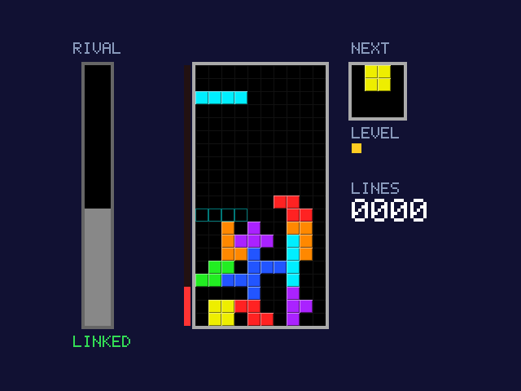
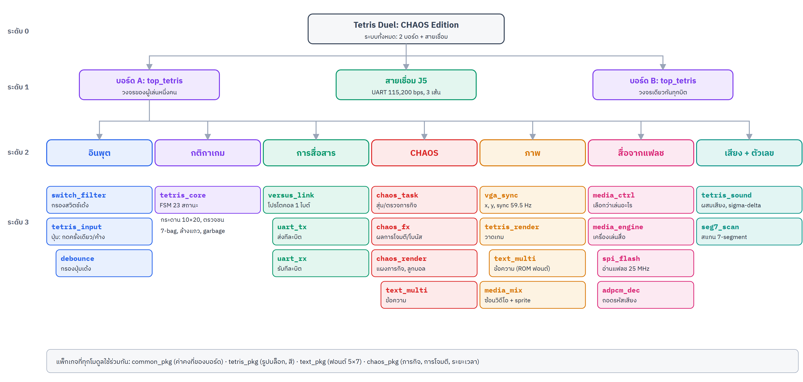

# Design Document: Tetris Duel CHAOS Edition

**เกมเตตริสต่อสู้สองผู้เล่นบนบอร์ด FPGA สองบอร์ด**

รายวิชา 01076113 Digital System Fundamentals ปีการศึกษา 2569
ภาควิชาวิศวกรรมคอมพิวเตอร์ คณะวิศวกรรมศาสตร์ สถาบันเทคโนโลยีพระจอมเกล้าเจ้าคุณทหารลาดกระบัง

**วีดีทัศน์แนะนำชิ้นงาน: [short link เช่น youtu.be/xxxxxxxxxxx]** ([QR code])

| ลำดับ | ชื่อ-นามสกุล | รหัสนักศึกษา |
|---|---|---|
| 1 | [ชื่อ-นามสกุล] | [รหัส] |
| 2 | [ชื่อ-นามสกุล] | [รหัส] |
| 3 | [ชื่อ-นามสกุล] | [รหัส] |
| 4 | [ชื่อ-นามสกุล] | [รหัส] |
| 5 | [ชื่อ-นามสกุล (ถ้ามี)] | [รหัส] |
| 6 | [ชื่อ-นามสกุล (ถ้ามี)] | [รหัส] |

[สารบัญ: ใน Google Docs ใช้ Insert → Table of contents]

## 1. บทนำ

### 1.1 ชิ้นงานคืออะไร

**Tetris Duel: CHAOS Edition** คือเกมเตตริสแบบต่อสู้สำหรับผู้เล่นสองคน ผู้เล่นแต่ละคนใช้บอร์ด EDGE Spartan-7
ของตัวเอง ต่อจอ VGA และหูฟัง บอร์ดทั้งสองเชื่อมกันด้วยสายไฟ 3 เส้น เมื่อผู้เล่นล้างหลายแถวพร้อมกัน
แถวขยะ (garbage) จะถูกส่งไปดันกองบล็อกของคู่แข่งขึ้นมา คนที่อยู่รอดคนสุดท้ายชนะ

ในโหมด **CHAOS** เกมจะสุ่ม "ภารกิจ" ให้ทำด้วยสวิตช์เลื่อนบนบอร์ดระหว่างที่ยังเล่นเตตริสอยู่
ทำสำเร็จแล้วจะได้โจมตีจอคู่แข่ง (กลับจอ, ซ่อนบล็อก, ลูกบอลเด้งบังจอ, ล็อกปุ่ม ฯลฯ) หรือได้โบนัส
และการโจมตีบางแบบจะเปิด **วิดีโอมีมพร้อมเสียง** (Bad Apple!!, OIIA OIIA, Jevil) เป็นพื้นหลังของจอคู่แข่ง
เกมยังมีเพลงประกอบ, คลิปตอนชนะ/แพ้ และตัวละครลอยบนจอ ทั้งหมดเก็บไว้ในชิปแฟลช 8 MB บนบอร์ดเอง

**ทุกอย่างทำงานอยู่ใน FPGA**: ไม่มี CPU, ไม่มีไมโครคอนโทรลเลอร์ และไม่มีโปรแกรมใดๆ รันอยู่
กติกาเกม ภาพ เสียง การสื่อสาร และเครื่องเล่นวิดีโอ เป็นวงจรดิจิทัลที่เขียนด้วย VHDL ทั้งหมด
(คอมพิวเตอร์ใช้เพียงตอนสร้างไฟล์และโหลดลงบอร์ดเท่านั้น)

### 1.2 ตัวเลขสำคัญ

| หัวข้อ | ค่า |
|---|---|
| บอร์ด | EDGE Spartan-7, ชิป Xilinx XC7S15-FTGB196 × 2 บอร์ด |
| สัญญาณนาฬิกา | 50 MHz ตัวเดียวทั้งระบบ |
| ภาพ | VGA 640 × 480 ที่ 59.5 Hz, สี 12 บิต (4,096 สี) |
| การเชื่อมบอร์ด | UART 115,200 bps บนสาย 3 เส้น, ข้อความ 1 ไบต์ 5 ชนิด |
| เสียง | IMA ADPCM 16 kHz → sigma-delta 12 บิต ออกช่องหูฟังโดยตรง |
| วิดีโอ | 160 × 120 พิกเซล (ขยาย 4 เท่า), 2-256 สี, 10-15 เฟรม/วินาที |
| สื่อในแฟลช | 6.86 MB จาก 8 MB, อ่านผ่าน SPI 25 MHz |
| โค้ด | VHDL 25 ไฟล์ ~5,700 บรรทัด, Python 10 ไฟล์ ~2,500 บรรทัด |
| ทรัพยากรที่ใช้ | LUT 6,797 / 8,000 (85 %), Slice 98 %, Block RAM 10 / 10 (100 %) |
| Timing | WNS +3.44 ns (ผ่าน: ทุกเส้นทางเร็วพอสำหรับ 50 MHz) |
| การทดสอบ | testbench 13 ชุด, วงจรทดสอบฮาร์ดแวร์ 6 ชุด, เล่นจริงบนบอร์ด 2 บอร์ด |

### 1.3 โครงสร้างของเอกสาร

เอกสารนี้เรียงตามขั้นตอนการทำงานจริง:

* **บทที่ 2 การหาข้อมูล**: เลือกหัวข้อ, ศึกษาบอร์ด เครื่องมือ และหลักการที่ต้องใช้
* **บทที่ 3 การออกแบบ** แบบ Top-Down: ตั้งแต่ระบบทั้งหมด → วงจรในหนึ่งบอร์ด → กลุ่มหน้าที่ → แต่ละโมดูล
* **บทที่ 4 การพัฒนา**: เครื่องมือ, ลำดับการสร้างเป็นชั้น, ปัญหาที่พบและวิธีแก้
* **บทที่ 5 การทดสอบ**: จำลอง, ทดสอบฮาร์ดแวร์, เล่นจริง และผลลัพธ์
* **บทที่ 6-8**: วิธีใช้งาน, สรุปผล และแหล่งอ้างอิง

## 2. กระบวนการหาข้อมูล

### 2.1 การเลือกหัวข้อ

กลุ่มเริ่มจากรวบรวมไอเดียหลายแบบแล้วเปรียบเทียบ ตามเกณฑ์ของงาน (ใช้ FPGA อย่างน้อย 2 บอร์ด,
งานหลักต้องอยู่ใน FPGA, ยากกว่าแลป) และความชอบของกลุ่ม (อยากได้งานที่สนุก เล่นกับเพื่อนได้ และมีมุกมีม)

| ไอเดีย | ข้อดี | ข้อเสีย | ผล |
|---|---|---|---|
| อุปกรณ์ IoT / เครื่องใช้ | มีประโยชน์จริง | งานหลักมักอยู่ที่ไมโครคอนโทรลเลอร์, ไม่สนุก | ไม่เลือก |
| เครื่องเล่นวิดีโอ (Bad Apple) | ท้าทายเรื่องหน่วยความจำ | ใช้บอร์ดเดียว, ดูอย่างเดียว | นำไปเป็นส่วนหนึ่ง |
| เกมยิง 3D แบบ Doom | น่าทึ่ง | ใหญ่เกิน 8,000 LUT มาก | ไม่เลือก |
| **เตตริสต่อสู้ 2 บอร์ด** | ใช้ 2 บอร์ดอย่างมีความหมาย, ทุกคนรู้กติกา, ขยายเพิ่มได้ทีละชั้น | ต้องออกแบบโปรโตคอลเอง | **เลือก** |

ข้อดีที่สำคัญที่สุดของเตตริสต่อสู้คือ **แบ่งเป็นชั้นได้**: ชั้นแรก (เกม + ต่อสู้) ทำเสร็จก็ส่งงานได้แล้ว
ชั้นต่อไป (CHAOS, สื่อจากแฟลช) เพิ่มทีละชั้นเมื่อมีเวลา ทำให้ความเสี่ยงต่ำแต่เพดานสูง

### 2.2 ศึกษาบอร์ด EDGE Spartan-7

ข้อมูลหลักมาจากคู่มือของบอร์ด (EDGE Spartan 7 FPGA Development Board User Manual) และไฟล์ข้อกำหนดขา
ในโปรแกรม FPGA Builder ของ TA จากนั้นยืนยันทุกขาด้วยวงจรทดสอบบนบอร์ดจริง (บทที่ 5) สิ่งที่ได้:

| อุปกรณ์บนบอร์ด | สิ่งที่ใช้ในชิ้นงาน |
|---|---|
| ชิป XC7S15: 8,000 LUT, 16,000 flip-flop, block RAM 10 ก้อน (45 KB), DSP 20 | วงจรทั้งหมด |
| นาฬิกา 50 MHz (ขา H11) | นาฬิกาเดียวของระบบ |
| VGA 12 บิต (R, G, B อย่างละ 4 บิต) | ภาพเกม |
| ปุ่มกด 5 ปุ่ม (เรียงเป็นรูปกากบาท) | บังคับบล็อก |
| สวิตช์เลื่อน 16 ตัว | ภารกิจ CHAOS (8 ตัว) และตั้งค่า |
| 7-segment 4 หลัก | จำนวนแถวที่ล้าง / เวลาที่เหลือ |
| ช่องหูฟัง (ต่อกับขา FPGA โดยตรง) + บัซเซอร์ | เพลงและเสียงเอฟเฟกต์ |
| หัวต่อ J5 (ขา I/O 16 ขา) | สายเชื่อมระหว่างบอร์ด |
| ชิปแฟลช SPI S25FL064L 8 MB | เก็บไฟล์ .bit และสื่อทั้งหมด |
| USB-UART (FT2232) | ใช้ทดสอบ: ให้คอมพิวเตอร์เล่นเป็นคู่แข่ง |

**สิ่งที่พบว่าไม่ตรงกับคู่มือ** (พบจากการทดสอบ ไม่ใช่จากการอ่าน):

* ขา TX/RX ของ USB-UART **สลับกัน** กับในคู่มือ (G1 = รับจาก PC, F2 = ส่งไป PC) พบด้วยวงจรทดสอบ 05
* ขาเลือกหลักของ 7-segment เป็น **active-high** (ไม่ใช่ active-low แบบตัวเลข)
* สวิตช์เลื่อน **เด้ง (bounce) รุนแรง** และลอย (floating) เมื่อโยกค้างครึ่งทาง ต้องมีวงจรกรองและเปิด pull-down

### 2.3 ศึกษาเครื่องมือ

* **Vivado 2025.2** (โหมด batch ผ่านสคริปต์ ไม่ต้องเปิดหน้าต่าง): synthesis, place & route, รายงาน timing และทรัพยากร
* **FPGA Builder ของ TA**: ใช้ Vivado ตัวเดียวกัน อ่านไฟล์เป็น VHDL-93 และโหลดบิตลงบอร์ดด้วย openFPGALoader
  กลุ่มเขียนสคริปต์ให้ใช้รายชื่อไฟล์ชุดเดียวกันได้ทั้งสองทาง
* **xsim** (simulator ใน Vivado): รัน testbench และบันทึกภาพหน้าจอจากการจำลองเป็นไฟล์ PNG
* **Python**: แปลงวิดีโอ/เพลง/รูปเป็นไฟล์สื่อ, โปรแกรมคู่แข่งจำลองผ่าน USB

### 2.4 ศึกษาหลักการที่ต้องใช้

| เรื่อง | ศึกษาอะไร | นำไปใช้ที่ |
|---|---|---|
| VGA timing | 640 × 480: 800 × 525 จุดต่อเฟรม (รวมช่วงซ่อน), พิกเซลละ 2 clock ของ 50 MHz → 840,000 clock ต่อเฟรม = 59.5 Hz | vga_sync |
| UART | start bit, 8 data bits (บิตต่ำก่อน), stop bit; อ่านกลางบิต | uart_tx, uart_rx, versus_link |
| SPI flash | คำสั่ง READ (03h) + ที่อยู่ 24 บิต แล้วอ่านต่อเนื่องได้ไม่จำกัด; ขานาฬิกาของแฟลชต้องผ่าน STARTUPE2 | spi_flash |
| กติกาเตตริสสมัยใหม่ | 7-bag randomizer, ghost piece, wall kick, lock delay 0.5 วินาที, ตารางขยะ | tetris_core |
| LFSR | ตัวสร้างเลขสุ่มเทียมจาก shift register + XOR | สุ่มบล็อก, ภารกิจ, ช่องขยะ |
| การบีบอัดภาพ | palette, delta (เก็บเฉพาะส่วนที่เปลี่ยน), run-length | make_game_media.py, media_engine |
| IMA ADPCM | เก็บเสียงเป็นผลต่าง 4 บิตต่อตัวอย่าง ด้วยขนาดก้าวที่ปรับตามเสียง (ตาราง 89 ค่า) | adpcm_dec |
| Sigma-delta | สร้างเสียงจากขาดิจิทัลขาเดียว โดยสลับ 0/1 เร็วๆ ให้ค่าเฉลี่ยเท่ากับระดับเสียง | tetris_sound |
| Block RAM | ขนาดก้อน 36 Kb / 18 Kb, รูปทรงที่เลือกได้, การเขียนโค้ดให้ Vivado สร้างเป็น block RAM | media_engine |

### 2.5 ข้อจำกัดที่กำหนดทิศทางการออกแบบ

1. **ไม่มี RAM ภายนอก** มีแค่ block RAM 45 KB ในชิป: ภาพ 640 × 480 เต็มจอต้องใช้ 450 KB
   จึงเก็บภาพทั้งจอไม่ได้ → ภาพเกม **คำนวณสดทุกพิกเซล** (ไม่มี frame buffer) และวิดีโอลดเป็น 160 × 120
2. **LUT 8,000 ตัว**: ทุกฟีเจอร์ต้องคุ้ม เช่น ใช้ตัวตรวจการชนตัวเดียวร่วมกันทุกขั้น, ใช้ ROM ฟอนต์ตัวเดียวร่วมกันทุกบรรทัดข้อความ
3. **แฟลช 8 MB** อ่านได้ประมาณ 3.1 MB/วินาที: พอสำหรับวิดีโอที่บีบอัดแล้ว แต่ไม่พอสำหรับภาพดิบ
4. **ไม่มีวงจรเสียง (DAC)** ต่อกับช่องหูฟัง: ใช้ sigma-delta แทน
5. **VHDL-93**: FPGA Builder ของ TA อ่านเป็น VHDL-93 จึงใช้ไวยากรณ์ใหม่บางอย่างไม่ได้ (เช่น `process(all)`)

## 3. การออกแบบ (Top-Down Design)

### 3.1 ข้อกำหนดของระบบ (Requirements)

| รหัส | ข้อกำหนด |
|---|---|
| R1 | เล่นเตตริสได้ครบตามกติกาสมัยใหม่ บนจอ VGA ด้วยปุ่มบนบอร์ด |
| R2 | สองบอร์ดเล่นต่อสู้กันได้: ส่งขยะ, เห็นสถานะคู่แข่ง, เริ่มพร้อมกัน, ตัดสินผลตรงกัน |
| R3 | รู้ได้ว่าสายเชื่อมต่ออยู่หรือไม่ และเล่นคนเดียวได้เมื่อไม่มีคู่ |
| R4 | โหมด CHAOS: ภารกิจด้วยสวิตช์ → การโจมตีหรือโบนัส |
| R5 | เพลงและเสียงเอฟเฟกต์ระหว่างเล่น |
| R6 | วิดีโอพร้อมเสียงจากแฟลช: การโจมตี, ฉากชนะ/แพ้, sprite |
| R7 | วงจรทั้งหมดใส่ในชิป XC7S15 ได้ และผ่าน timing ที่ 50 MHz |

### 3.2 ระดับ 0: ระบบทั้งหมด

ระบบประกอบด้วยบอร์ดสองบอร์ดที่ **โหลดวงจรเดียวกันทุกบิต** (ไฟล์ `top_tetris.bit` ไฟล์เดียว)
ไม่มีบอร์ดหลัก/บอร์ดรอง ทั้งสองบอร์ดเท่ากัน เหตุผล:

* ไม่ต้องสร้างและโหลดไฟล์สองแบบ ลดโอกาสผิดพลาด
* กติกาตัดสินถูกออกแบบให้ทั้งสองฝั่งคำนวณได้ผลเดียวกันเองโดยไม่ต้องถามกัน (ข้อ 3.6)

**สายเชื่อม**: TX ของบอร์ดหนึ่งไปยัง RX ของอีกบอร์ด (ไขว้กัน) และต่อกราวด์ร่วม
ใส่ตัวต้านทาน 330 Ω อนุกรมในสายสัญญาณ เพื่อจำกัดกระแสหากต่อผิดขาหรือบอร์ดหนึ่งยังไม่ได้เปิด

### 3.3 ระดับ 1: วงจรในหนึ่งบอร์ด แบ่งเป็นกลุ่มหน้าที่

วงจรบนบอร์ดหนึ่งคือ entity `top_tetris` ซึ่งแบ่งเป็น 7 กลุ่มหน้าที่ แต่ละกลุ่มแบ่งต่อเป็นโมดูล VHDL
ที่มีหน้าที่ชัดเจนเพียงอย่างเดียว ทดสอบแยกได้ และต่อกันผ่าน port เท่านั้น:

| กลุ่ม | โมดูล | หน้าที่ |
|---|---|---|
| อินพุต | `switch_filter`, `tetris_input` (+ `debounce`) | ทำให้ปุ่มและสวิตช์ "สะอาด" กลายเป็นพัลส์คำสั่ง |
| กติกาเกม | `tetris_core` | สมองของเกม: กระดาน, บล็อก, ตรวจชน, ล้างแถว, ขยะ |
| การสื่อสาร | `versus_link` (+ `uart_tx`, `uart_rx`) | แปลงเหตุการณ์ในเกมเป็นไบต์และกลับ |
| CHAOS | `chaos_task`, `chaos_fx`, `chaos_render` | ภารกิจ, ผลของการโจมตี, ภาพของ CHAOS |
| ภาพ | `vga_sync`, `tetris_render` (+ `text_multi`), `media_mix` | คำนวณสีของทุกพิกเซล |
| สื่อจากแฟลช | `media_ctrl`, `media_engine` (+ `spi_flash`, `adpcm_dec`) | เลือกและเล่นวิดีโอ/เพลง |
| เสียง + ตัวเลข | `tetris_sound`, `seg7_scan` | ผสมเสียงออกหูฟัง, แสดงตัวเลข |

ค่าที่หลายโมดูลใช้ร่วมกันเก็บไว้ใน package: `common_pkg` (ค่าคงที่ของบอร์ด), `tetris_pkg` (รูปทรงบล็อก, สี, ตารางความเร็ว),
`text_pkg` (ฟอนต์ 5 × 7 ที่ออกแบบเอง), `chaos_pkg` (รายการภารกิจ, การโจมตี, ช่วงเวลาสุ่ม)

### 3.4 ระดับ 2: การไหลของข้อมูลระหว่างโมดูล

อ่านแผนภาพจากซ้ายไปขวา:

1. **ปุ่ม → `tetris_input` → `tetris_core`**: ปุ่มที่กดกลายเป็นพัลส์ "ซ้าย / ขวา / หมุน / ตกช้า / ตกทันที"
2. **`tetris_core` → `tetris_render` → `media_mix` → จอ**: กระดานและบล็อกถูกวาดเป็นสี แล้วซ้อนกับวิดีโอ
3. **`tetris_core` ↔ `versus_link` ↔ สาย J5**: เหตุการณ์ในเกม (ขยะ, ความสูง, แพ้, เริ่ม) ส่งข้ามบอร์ด
4. **สวิตช์ → `chaos_task` → `versus_link`**: ทำภารกิจสำเร็จ → ส่งการโจมตี
5. **`versus_link` → `chaos_fx` → `tetris_core` / `tetris_render` / `chaos_render`**: การโจมตีที่ได้รับเปลี่ยนเกมหรือภาพ
6. **`media_ctrl` → `media_engine` ↔ แฟลช**: เลือกว่าจะเล่นอะไร แล้วอ่านภาพและเสียงจากแฟลช
7. **`media_engine` → `tetris_sound` → หูฟัง**: เสียงจากแฟลชผสมกับเสียงเอฟเฟกต์

`vga_sync` ส่งตำแหน่งพิกเซล (x, y) และพัลส์ `frame_tick` (60 ครั้งต่อวินาที) ให้ทุกโมดูล

### 3.5 กฎการออกแบบที่ใช้ทุกไฟล์

1. **นาฬิกาเดียว (50 MHz)**: สิ่งที่ช้ากว่าใช้ "enable pulse" ยาว 1 clock (เช่น `frame_tick`) แทนการหารนาฬิกา
   เหตุผล: นาฬิกาที่หารเองทำให้ Vivado วิเคราะห์ timing ไม่ได้ และข้ามโดเมนนาฬิกายาก
2. **ทุกอินพุตจากภายนอกผ่าน flip-flop 2 ตัว** (synchronizer) ก่อนใช้ เพื่อกัน metastability
   (ปุ่ม, สวิตช์, สาย RX, ขาข้อมูลจากแฟลช)
3. **VHDL-93 เท่านั้น** เพื่อให้ใช้กับ FPGA Builder ของ TA ได้
4. **ทุกไฟล์ขึ้นต้นด้วยคำอธิบาย** ว่าโมดูลทำอะไร ทำอย่างไร และใช้เวลากี่ clock

### 3.6 ระดับ 3: รายละเอียดแต่ละโมดูล

#### 3.6.1 `vga_sync`: ตำแหน่งพิกเซลและจังหวะเฟรม

* **อินพุต**: clk
* **เอาต์พุต**: x (0-799), y (0-524), video_on, hsync, vsync, frame_tick
* **หลักการ**: ตัวนับสองตัว ตัวแนวนอนนับทุก 2 clock (พิกเซลละ 40 ns = 25 MHz) ถึง 800 แล้วเริ่มใหม่
  และเพิ่มตัวนับแนวตั้ง ถึง 525 แล้วเริ่มใหม่ hsync/vsync เป็น 0 ในช่วงที่มาตรฐานกำหนด
  `frame_tick` เป็น 1 หนึ่ง clock เมื่อเริ่มเฟรมใหม่: 840,000 clock ต่อเฟรม = 59.52 ครั้งต่อวินาที
* **เหตุผล**: ใช้ enable 25 MHz จากนาฬิกา 50 MHz แทนการสร้างนาฬิกา 25 MHz ใหม่ (ตามกฎข้อ 1)

#### 3.6.2 อินพุต: `switch_filter`, `tetris_input`, `debounce`

* **`debounce`**: สัญญาณปุ่มต้องคงที่ต่อเนื่องระยะหนึ่งจึงยอมรับว่าเปลี่ยนจริง
* **`tetris_input`**: แปลงปุ่มเป็นพัลส์คำสั่ง 1 clock ซ้าย/ขวา/ตกช้า กดค้างได้:
  ซ้าย-ขวาเริ่มเลื่อนซ้ำหลัง 10 เฟรม แล้วซ้ำทุก 1-2 เฟรม (เหมือนเกมเตตริสจริง: DAS/ARR)
* **`switch_filter`**: ตัวกรองแบบ integrator สำหรับสวิตช์เลื่อน 16 ตัว (นับขึ้นเมื่ออ่านได้ 1, นับลงเมื่อ 0
  เปลี่ยนค่าเมื่อถึงขอบ) ร่วมกับ PULLDOWN ที่ขา เพราะทดสอบแล้วพบว่าสวิตช์เด้งรุนแรงและลอยเมื่อโยกครึ่งทาง

#### 3.6.3 `tetris_core`: กติกาเกม

นี่คือโมดูลที่ใหญ่ที่สุด (ประมาณ 3,000 LUT) เป็น **state machine ตัวเดียว 23 สถานะ**

**การเก็บกระดาน**: `occ` (มีบล็อกหรือไม่) 20 แถว × 10 ช่อง และ `colf` (สีของแต่ละช่อง 3 บิต) เก็บใน flip-flop
เพราะต้องอ่านหลายช่องพร้อมกันในหนึ่ง clock (ตรวจชน 4 ช่อง, เช็กแถวเต็มทั้งแถว) ซึ่ง block RAM ทำไม่ได้

**ตัวตรวจการชนตัวเดียว**: ทุกการ "ลอง" (หมุน, เลื่อน, ตก, หาเงา, เกิดบล็อกใหม่) ทำแบบเดียวกัน:
เขียนตำแหน่งที่ต้องการลองลงรีจิสเตอร์ `cand_*` แล้วอีก 1 clock สัญญาณ `collide` จะบอกว่าชนผนัง พื้น
หรือบล็อกอื่นหรือไม่ ถ้าไม่ชนก็คัดลอก `cand_*` ไปเป็นตำแหน่งจริง `cur_*`
**เหตุผล**: วงจรตรวจชน (อ่าน 16 ช่องของบล็อก × เทียบกับกระดาน) ใหญ่มาก สร้างตัวเดียวแล้วใช้ซ้ำทีละขั้นใน state machine
ประหยัดกว่าสร้าง 5 ตัวหลายเท่า ส่วนเวลาที่เสียไปมีแค่ไม่กี่ clock จาก 840,000 clock ต่อเฟรม

**ลำดับในแต่ละเฟรม** (`frame_tick`): ลองหมุน (ถ้าชน ลองขยับ 0, +1, −1, +2, −2 ช่อง = wall kick) → ลองเลื่อน
→ ลองตก (ตามความเร็วของเลเวล: เลเวล 0 ตก 1 ช่องทุก 48 เฟรม แล้วเร็วขึ้นทุก 10 แถวที่ล้าง) → หาเงา (ghost)
→ ถ้าวางบนพื้นครบ 0.5 วินาที (30 เฟรม) หรือกด hard drop ก็ล็อก

**เมื่อล็อก**: S_LOCK คัดลอกบล็อกลงกระดาน (4 clock, ทีละแถวของบล็อก) → S_CLEAR ลบแถวเต็ม (1 แถวต่อ clock)
→ S_SCORE นับแถว → S_ATTACK คำนวณขยะที่ส่ง/รับ → (S_HOLE เลือกช่องว่าง → S_GARB ดันกระดานขึ้นและเติมแถวขยะ)
→ S_PICK เลือกบล็อกถัดไป → S_SPAWN

**สุ่มแบบ 7-bag**: เก็บ "ถุง" 7 บิตว่าบล็อกไหนออกไปแล้ว LFSR สุ่มเลือกจากที่ยังเหลือ ครบ 7 ชิ้นแล้วเริ่มถุงใหม่
ทำให้ไม่มีบล็อกไหนหายไปนานเกิน 12 ชิ้น (ยุติธรรมกว่าสุ่มอิสระ)

#### 3.6.4 `versus_link`: โปรโตคอลระหว่างบอร์ด

**ทำไมใช้ข้อความ 1 ไบต์**: ข้อมูลที่ต้องส่งมีน้อยมาก (จำนวนแถว ≤ 31, ความสูง ≤ 20, หมายเลขการโจมตี ≤ 10)
แบ่งเป็นชนิด 3 บิต + ค่า 5 บิตก็พอ ไม่ต้องมีการต่อข้อความหลายไบต์ ไม่มีปัญหา "ข้อความขาดครึ่ง"
และ 1 ไบต์ส่งเสร็จใน 87 µs เร็วกว่าหนึ่งเฟรมภาพ (16,800 µs) มาก

**การรู้ว่าเชื่อมต่ออยู่ (LINKED)**: ทุกบอร์ดส่ง HEARTBEAT (พร้อมความสูงของกองบล็อก) ทุก 6 เฟรม
ถ้าไม่ได้รับไบต์ใดเลยนาน 30 เฟรม (0.5 วินาที) ถือว่าสายหลุด → เล่นแบบคนเดียว
ความสูงใน HEARTBEAT ยังใช้วาดแถบ RIVAL บนจออีกฝั่งด้วย (ได้สองอย่างในข้อความเดียว)

**การตัดสินผลโดยไม่มีบอร์ดหลัก**:

* ใครแพ้ก็ส่ง LOST ทันที
* ได้รับ LOST ขณะที่ตัวเองยังเล่นอยู่ → **ชนะ**
* ได้รับ LOST ภายใน 6 เฟรมหลังจากที่ตัวเองเพิ่งแพ้ → **เสมอ** (ทั้งสองฝั่งแพ้เกือบพร้อมกัน ข้อความสวนกันบนสาย)
  ทั้งสองบอร์ดใช้กติกาเดียวกันจึงสรุปผลตรงกันโดยไม่ต้องส่งข้อความเพิ่ม

**ขยะ (garbage)**: ล้าง 2 / 3 / 4 แถวพร้อมกัน → ส่ง 1 / 2 / 4 แถว แต่หักกับขยะที่รอจะเข้ามาหาเราก่อน (ป้องกันได้)
ขยะที่รอแสดงเป็นแถบสีแดงข้างกระดาน และเข้ามาได้ครั้งละ 3-5 แถว (สุ่ม) ต่อบล็อกที่ล็อกโดยไม่ได้ล้างแถว
แต่ละแถวขยะมีช่องว่าง 1 ช่องตามตำแหน่งที่สุ่ม

`uart_tx` / `uart_rx`: บิตละ 434 clock (115,200 bps) ฝั่งรับรอขอบลงของ start bit แล้วอ่านแต่ละบิตตรงกลาง
และสาย RX มี PULLUP เพื่อให้เป็น "ว่าง" (1) เมื่อไม่ได้ต่อสาย

#### 3.6.5 CHAOS: `chaos_task`, `chaos_fx`, `chaos_render`

* **`chaos_task`**: นับเวลาสุ่ม 10-17 วินาที แล้วสุ่มภารกิจ 1 ใน 7 แบบ ตั้งเป้าหมาย (เช่น เลขที่ต้องตั้ง) และเวลาจำกัด
  ตรวจสวิตช์ 8 ตัวทุกเฟรม ถ้าสำเร็จ สุ่มต่อว่าจะเป็น **การโจมตี (5/8)** หรือ **โบนัส (3/8)**
  (โจมตีได้เฉพาะเมื่อ LINKED) การโจมตีส่งผ่าน `versus_link` เป็นข้อความ ATTACK
* **`chaos_fx`**: รับการโจมตีจากอีกบอร์ดหรือโบนัสของตัวเอง แล้วนับเวลาของแต่ละผล (ทุกระยะเวลาเป็นช่วงสุ่ม)
  ส่งสัญญาณไปยังโมดูลที่เกี่ยวข้อง: `fx_freeze`, `fx_speed`, SINK, CURSED, LOCK → `tetris_core`;
  MIRROR, FLIP, BLIND → `tetris_render`; BOUNCERS → `chaos_render`; การโจมตีวิดีโอ → `media_ctrl`
* **`chaos_render`**: วาดแผงภารกิจ (ข้อความ, สวิตช์ 8 ตัว, แถบเวลา), แบนเนอร์ "INCOMING: ..." และลูกบอลเด้ง 5-10 ลูก
  ลูกบอลขยับทีละลูกต่อ clock (ไม่ใช่ทุกลูกพร้อมกัน) เพื่อใช้วงจรบวก/เทียบชุดเดียว

**กติกาพิเศษ**: ผู้ส่งการโจมตีวิดีโอ (ยาว 40-84 วินาที) ต้องรอจนวิดีโอจบ + 10 วินาที จึงส่งวิดีโอได้อีก
(ส่งการโจมตีแบบอื่นได้ตามปกติ) เพื่อไม่ให้อีกฝ่ายดูแต่วิดีโอทั้งเกม

#### 3.6.6 ภาพ: `tetris_render`, `text_multi`, `media_mix`

**ไม่มี frame buffer สำหรับภาพเกม**: สำหรับทุกพิกเซลที่ (x, y) วงจรคำนวณว่า "ตรงนี้คืออะไร" ใหม่ทุกครั้ง
เช่น ถ้า x, y อยู่ในกระดาน ก็หาว่าเป็นช่องไหน (หารด้วยขนาดช่อง 16 พิกเซล = เลื่อนบิต) แล้วอ่านสีจาก `colf`
เหตุผล: frame buffer 640 × 480 × 12 บิตต้องใช้ 450 KB แต่ชิปมี block RAM แค่ 45 KB

**pipeline**: การคำนวณสีหนึ่งพิกเซลยาวเกินกว่าจะเสร็จใน 1 clock (20 ns) จึงแบ่งเป็นขั้น ขั้นละ 1 clock
ฝั่งเกมใช้ 3 clock, ฝั่งสื่อใช้ 3 clock และ hsync/vsync ถูกหน่วงให้ตรงกัน ภาพจึงไม่เลื่อน
(Vivado รายงานว่าทุกเส้นทางยังเหลือเวลา 3.44 ns)

**`text_multi`**: ข้อความทุกบรรทัดบนจอ (NEXT, LINES, LINKED, WIN!, ข้อความภารกิจ) ใช้ **ROM ฟอนต์ตัวเดียว**
ร่วมกัน เพราะในแต่ละพิกเซล ตำแหน่ง (x, y) อยู่ในข้อความได้แค่บรรทัดเดียว การแก้นี้ลด LUT ได้หลายร้อยตัว
และทำให้วงจรใส่ชิปได้ (ดูบทที่ 4.3)

**`media_mix`**: รวมสีเกมกับวิดีโอตามโหมดของสื่อที่เล่น:

| โหมด | ใช้กับ | วิธีผสม |
|---|---|---|
| bg | การโจมตีวิดีโอ | วิดีโอหรี่แสง (1/2 หรือ 3/4) อยู่หลังเกม บล็อกและข้อความยังทึบ |
| full | คลิปชนะ/แพ้ | วิดีโอเต็มจอ มีแถบผลการแข่งด้านล่าง |
| over | jump scare | สี palette 0 = โปร่งใส ที่เหลือทับเกม |
| panel | รูปตอนชนะ/แพ้ | รูป 96 × 88 ขยาย 2 เท่าในกรอบด้านขวา |

นอกจากนี้ยังวาด sprite Jevil (8 ท่า, 48 × 50 พิกเซล ขยาย 2 เท่า) ที่ลอยเป็นเส้นโค้ง Lissajous ทั่วจอ
(คำนวณด้วยตาราง sine 1/4 รอบ + ตัวคูณ DSP 1 ตัว) และหน้าเพื่อนบนลูกบอลเด้ง

#### 3.6.7 สื่อจากแฟลช: `spi_flash`, `media_engine`, `adpcm_dec`, `media_ctrl`

**รูปแบบไฟล์ "TDM2"** (ออกแบบเอง):

* **header** บอกว่ารายการเพลง/การโจมตี/แพ้/ชนะ เริ่มที่ไหนและมีกี่รายการ, **directory** 16 ไบต์ต่อรายการ
  (ที่อยู่, จำนวน record, โหมดแสดงผล, ความเร็ว, palette)
* **record** = ข้อมูล 1 ช่วงเวลา (เช่น 0.1 วินาทีของวิดีโอ 10 fps): header 8 ไบต์ (ที่อยู่และความยาวของภาพ,
  สถานะ ADPCM ตอนเริ่ม) + เสียง 800 ไบต์
* **ภาพ** เก็บแยก ใช้ซ้ำได้ (เช่น ฉากหลัง Jevil ที่วนซ้ำ 34 ภาพ แต่เสียงยาว 40 วินาที)
* ภาพแต่ละเฟรมเก็บแบบ **delta + run-length**: เฟรมแรกเก็บทั้งภาพ เฟรมต่อไปเก็บเฉพาะพิกเซลที่เปลี่ยน
  ด้วยไบต์ควบคุม 3 แบบ (SKIP / FILL / COPY) เพราะ frame buffer ยังเก็บภาพก่อนหน้าไว้ การ SKIP จึงไม่ต้องทำอะไรเลย

**`spi_flash`**: ส่งคำสั่ง READ (03h) + ที่อยู่ 24 บิต แล้วอ่านต่อเนื่องทีละไบต์ ที่ SCLK 25 MHz (3.1 MB/วินาที)
ขานาฬิกาของแฟลชเป็นขาพิเศษที่ใช้ตอนบูต จึงต้องขับผ่าน primitive `STARTUPE2`
มีสัญญาณ `hold` ให้ผู้ใช้หยุดการอ่านชั่วคราวได้

**`media_engine`**: เครื่องเล่นสื่อ เป็น state machine อ่าน header → directory → palette → record ทีละอัน:

* **ภาพ**: ไบต์ไปที่ตัวถอด run-length ซึ่งเขียนลง frame buffer **1 พิกเซลต่อ clock**
  แต่ COPY/FILL หนึ่งครั้งยาวได้ 128 พิกเซล ขณะที่ไบต์จากแฟลชมาทุก 17 clock จึงใช้ `hold` หยุดแฟลชไว้ก่อน
  จนตัวถอดตามทัน
* **frame buffer** 160 × 120 × 8 บิต = 19,200 ไบต์ ต้องแบ่งเป็น 5 ก้อนก้อนละ 4,096 ไบต์ด้วยมือ
  (ถ้าเขียนเป็น array เดียว Vivado ใช้ 8 ก้อน เกินงบ)
* **เสียง**: ไบต์ไปที่ **sound ring** (block RAM 2,048 ไบต์) ที่เขียนเป็นช่วงๆ แต่อ่านสม่ำเสมอทุก 3,125 clock
  (16,000 ตัวอย่างต่อวินาที, 4 บิตต่อตัวอย่าง) ไปที่ `adpcm_dec`
* **ภาพกับเสียงตรงกัน**: record ถัดไปจะถูกโหลดเมื่อเริ่มเฟรมใหม่ **และ** เสียงใน ring ต่ำกว่าระดับที่กำหนด
  เสียงจึงเป็นตัวกำหนดความเร็ว ภาพตามเสียงเสมอ ไม่มีวันเลื่อนห่างกัน (วิดีโอ 10 fps โหลดทุก 6 เฟรมจอ บางครั้ง 5)

**`adpcm_dec`**: ถอดรหัส IMA ADPCM: แต่ละรหัส 4 บิต = เครื่องหมาย 1 บิต + ขนาด 3 บิตในหน่วย 1/4 ของ "ก้าว" (step)
บวกลบกับค่าที่ทำนายไว้ (pred) แล้วปรับขนาดก้าวตามตาราง 89 ค่า (ก้าวโตเร็วเมื่อเสียงเปลี่ยนแรง และค่อยๆ เล็กลงเมื่อเสียงนิ่ง)
ได้เสียง 16 บิตจากข้อมูลเพียง 4 บิต (บีบอัด 4 เท่า) ใช้ 3 clock ต่อตัวอย่าง ตาราง step เก็บใน block RAM

**`media_ctrl`**: state machine 4 สถานะ (C_IDLE, C_MUSIC, C_ATTACK, C_END) ตัดสินว่าตอนนี้ควรเล่นอะไร:
เพลงระหว่างเล่น (สลับ 2 เพลง), วิดีโอเมื่อโดนโจมตี, คลิปเมื่อชนะ/แพ้ (สุ่ม) เมื่อวิดีโอโจมตีจบ เพลงจะ **เล่นต่อจากจุดเดิม**
(เริ่มก่อนจุดที่หยุด 2 record เพื่อให้สถานะ ADPCM ใน header ถูกต้อง)

#### 3.6.8 `tetris_sound` และ `seg7_scan`

* **`tetris_sound`**: ผสมเสียงจากแฟลช (16 บิต) กับเสียงเอฟเฟกต์ของเกม (หมุน, ล็อก, ล้างแถว, ขยะ, ชนะ, แพ้ ฯลฯ)
  แล้วแปลงเป็นบิตเดียวด้วย **sigma-delta 12 บิต**: ตัวสะสมบวกค่าเสียงทุก clock และส่งบิตทดออกขา
  ค่าเฉลี่ยของบิตที่ออก (50 ล้านครั้งต่อวินาที) เท่ากับระดับเสียง หูฟังทำหน้าที่กรองให้เรียบเอง ไม่ต้องมีวงจร DAC
  บัซเซอร์ใช้เฉพาะเสียงเอฟเฟกต์ สวิตช์ SW4/SW5 เปิดปิดเพลงและเอฟเฟกต์
* **`seg7_scan`**: แสดงตัวเลข 4 หลัก โดยเปิดทีละหลักเร็วๆ (สแกน) จำนวนแถวที่ล้างนับเป็น BCD จึงไม่ต้องหารด้วย 10

### 3.7 การจัดสรรทรัพยากร

**Block RAM (10 ก้อน = 20 ครึ่งก้อน) ใช้ครบทุกก้อน**:

| ใช้ทำอะไร | ขนาด | จำนวน |
|---|---|---|
| frame buffer วิดีโอ | 5 × 4,096 × 8 บิต | 5 × RAMB36 |
| หน้าเพื่อน 4 รูป | 4,096 × 8 บิต | 1 × RAMB36 |
| Jevil 8 ท่า | 5 × 4,096 × 4 บิต | 5 × RAMB18 |
| sound ring | 2,048 × 8 บิต | 1 × RAMB18 |
| palette | 512 × 12 บิต | 1 × RAMB18 |
| ตาราง step ของ ADPCM | 89 × 15 บิต | 1 × RAMB18 |
| **รวม** | | **20 / 20 ครึ่งก้อน** |

## 4. การพัฒนา

### 4.1 เครื่องมือและขั้นตอน

กลุ่มเขียนสคริปต์ให้ทุกขั้นตอนสั่งจาก Command Prompt ได้ด้วยคำสั่งเดียว:

| คำสั่ง | ทำอะไร |
|---|---|
| `tools\build.bat game` | สร้าง `game\build\top_tetris.bit` (synthesis, place, route) และพิมพ์ WNS |
| `tools\program.bat game` | โหลดบิตลงบอร์ด |
| `tools\sim.bat tb_versus` | รัน testbench แล้วดูผล TEST PASSED |
| `python tools\make_game_media.py` | สร้างไฟล์สื่อ `game_media.bin` จากรายการใน `media_plan.py` |
| `tools\flash_media.bat media\game_media.bin` | เขียนไฟล์สื่อลงแฟลช (ครั้งเดียวต่อบอร์ด) |
| `tools\load_into_builder.bat game` | ใส่รายชื่อไฟล์และขาลงใน FPGA Builder ของ TA |

ทุกการออกแบบ (ตัวเกมและวงจรทดสอบแต่ละชุด) อธิบายด้วยไฟล์ข้อความ 2 ไฟล์: `project.txt` (entity บนสุด + ไฟล์ VHDL ตามลำดับ)
และ `pins.xdc` (ขาของแต่ละ port) สคริปต์ทุกตัวอ่านจากไฟล์ชุดเดียวกัน ใช้ git เก็บประวัติทุกการแก้ไข

### 4.2 พัฒนาเป็นชั้น

| ชั้น | เพิ่มอะไร | LUT | ผลบนบอร์ดจริง |
|---|---|---|---|
| 0. วงจรทดสอบ | VGA, หาขา J5, UART, เชื่อมบอร์ด, ตรวจขา UART | - | ผ่าน (15-16 ต.ค.) |
| 1. main | เกม + โหมดต่อสู้ | 3,496 (44 %) | เล่น 2 บอร์ดกับเพื่อนได้ (19 ต.ค.) |
| 2. chaos | ภารกิจ, การโจมตี, โบนัส | 6,200 (78 %) | เล่นได้ ปรับตามความเห็น 2 รอบ |
| 3. media | ทดสอบ 06 อ่านแฟลช → สื่อในเกม | 6,797 (85 %) | ทำงานครบ (21 ต.ค.) |

แต่ละชั้นทำเสร็จและทดสอบบนบอร์ดก่อนเริ่มชั้นถัดไป ถ้าชั้นใหม่มีปัญหาก็ยังมีชั้นก่อนหน้าที่ใช้งานได้เสมอ
(เก็บแยกเป็น branch ของ git: `main`, `chaos`, `media`)

### 4.3 ปัญหาที่พบและวิธีแก้

| ปัญหา | สาเหตุ | วิธีแก้ |
|---|---|---|
| UART จาก PC ไม่ทำงานตามคู่มือ | ขา TX/RX ในคู่มือสลับกัน | สร้างวงจรทดสอบ 05 ลองทั้งสองแบบ → สลับขา |
| สวิตช์โยกครั้งเดียวนับหลายครั้ง และค่าเปลี่ยนเองเมื่อโยกค้างครึ่งทาง | สวิตช์เด้ง, ขาลอย | `switch_filter` แบบ integrator + PULLDOWN ทุกขา |
| เริ่มเกมใหม่ทันทีโดยไม่ตั้งใจหลังจบเกม | ยังกดปุ่มค้างจากเกมก่อน | เวลาพัก 1.5 วินาทีหลังจบเกม (`can_start`) |
| ใส่สื่อแล้ววงจรวางไม่ลงชิป (7,566 LUT = 95 %) | ข้อความแต่ละบรรทัดมี ROM ฟอนต์ของตัวเอง | `text_multi`: ROM ฟอนต์ตัวเดียวต่อตัววาด, ลูกบอลขยับทีละลูก → 6,972 LUT |
| frame buffer 19,200 ไบต์ ใช้ block RAM 8 ก้อน | Vivado แบ่ง array ขนาดนี้ไม่ประหยัด | แบ่งเป็น 5 ก้อนก้อนละ 4,096 ไบต์ด้วยมือ + attribute `ram_style = block` |
| ภาพวิดีโอขาดเป็นช่วง | run ยาว 128 พิกเซลแต่ไบต์มาทุก 17 clock | สัญญาณ `hold` หยุดแฟลชระหว่างที่ตัวถอดยังไม่ว่าง |
| testbench ของวงจรทั้งหมดรันไม่จบ | โมเดลจำลองของ `STARTUPE2` ไม่หยุดเอง | generic `USE_STARTUP => false` ใน testbench |
| สคริปต์เขียนแฟลชเงียบและไม่ทำอะไร | วงเล็บในข้อความ echo ภายใน `if ( ... )` ของ batch file | escape เป็น `^(` `^)` |
| Jump scare Foxy เล็กกลางจอ | วิดีโอ 4:3 อยู่ในกรอบ 16:9 | ตั้งค่า `crop` ตัดเฉพาะส่วน 4:3 ก่อนย่อ |
| เต็มชิปอีกครั้งหลังแก้หลายรอบ | ฟีเจอร์ที่ไม่ใช้แล้วยังกินวงจร | ลบการโจมตีแมว ROM เดิม และโน้ตที่ไม่ใช้ → 6,797 LUT (85 %) |

### 4.4 การปรับตามความเห็นของผู้เล่น

หลังเล่น CHAOS บนบอร์ดจริงรอบแรก กลุ่มรวบรวมความเห็นแล้วแก้:

| ความเห็น | สิ่งที่เปลี่ยน |
|---|---|
| ตัวนับเวลา "ภารกิจถัดไป" ทำให้ไม่ลุ้น | ซ่อนแผงจนกว่าจะมีภารกิจ ไม่แสดงเวลานับถอยหลัง |
| อยากได้ภารกิจเลขฐานสิบหกด้วย | เพิ่มภารกิจ HEX |
| โซนเขียวกว้างเท่าเดิมทุกครั้ง | สุ่มความกว้างทุกภารกิจ |
| ทุกอย่างที่มีเวลาควรสุ่ม | ทุกระยะเวลาเป็นช่วงสุ่ม (`rand_range`) |
| ไม่ทำภารกิจเลย เล่นเตตริสอย่างเดียวก็ได้ | เพิ่มการโจมตี LOCK: ล็อกปุ่มจนกว่าจะทำภารกิจ |
| ขยะเข้ามา 8 แถวพร้อมกันโหดเกิน | รับได้ครั้งละ 3-5 แถว |
| FREEZE นานเกิน, ลูกบอลน้อยเกิน, BLIND ยังเห็นบล็อกสีเทา | ปรับเวลา 3-5 วิ, ลูกบอล 5-10 ลูก, ไม่วาดบล็อกเลย |

## 5. การทดสอบ

### 5.1 แนวทาง: ออกแบบจากบนลงล่าง ทดสอบจากล่างขึ้นบน

ทุกโมดูลถูกทดสอบด้วย **simulation** ก่อนโหลดลงบอร์ดเสมอ (การ build หนึ่งครั้งใช้หลายนาที
แต่ simulation เห็นสัญญาณทุกเส้นในทุก clock) จากนั้นทดสอบฮาร์ดแวร์ทีละส่วนด้วยวงจรทดสอบเล็กๆ
และสุดท้ายเล่นจริงกับเพื่อน

### 5.2 Testbench (การจำลอง)

testbench ทุกตัว **ตรวจผลเอง** และพิมพ์ `TEST PASSED` หรือบอกว่าผิดตรงไหน (ไม่ต้องนั่งดูกราฟสัญญาณ)

| testbench | ทดสอบอะไร | ผล |
|---|---|---|
| `tb_uart_loop` | uart_tx ต่อตรงเข้า uart_rx: ไบต์ที่ส่งออกมาเหมือนเดิมทุกไบต์ | ผ่าน |
| `tb_vga_frame` | จังหวะ VGA ครบเฟรม + บันทึกภาพเป็น PNG | ผ่าน |
| `tb_uart_probe` | วงจรทดสอบ 05 กับการต่อสายทั้งสองแบบ | ผ่าน |
| `tb_switch_filter` | ตัวกรองสวิตช์กับสัญญาณเด้ง | ผ่าน |
| `tb_tetris_core` | หุ่นยนต์เล่นทั้งเกมจนแพ้; ตรวจว่าจำนวนช่องบนกระดานไม่หาย/ไม่เกินทุกครั้งที่ล็อกและล้าง | ผ่าน |
| `tb_versus` | สองบอร์ด (core + link) เล่นกันโดยหุ่นยนต์สองตัว: START ข้ามบอร์ด, ขยะ, WIN/LOSE, LINKED, เวลาพักหลังจบเกม | ผ่าน |
| `tb_tetris_frame` | วงจรทั้งหมด; บันทึกภาพหน้าจอเกมและหน้าจอ WIN! | ผ่าน |
| `tb_chaos` | ทำภารกิจ → การโจมตีข้ามสาย → ผลบนอีกบอร์ด, LOCK | ผ่าน |
| `tb_chaos_core` | FREEZE, SPEED, CURSED, I-PIECE, SINK | ผ่าน |
| `tb_chaos_frame` | ภาพหน้าจอแผงภารกิจ, FLIP, ลูกบอล | ผ่าน |
| `tb_flash_read` | วงจรทดสอบ 06 กับแฟลชจำลอง | ผ่าน |
| `tb_media_engine` | เครื่องเล่นสื่อ: เสียง, ภาพ delta, โหมด panel, sprite | ผ่าน |
| `tb_media_ctrl` | ลำดับการเล่น: เพลง, การโจมตี, ชนะ/แพ้, เล่นเพลงต่อ | ผ่าน |

### 5.3 วงจรทดสอบฮาร์ดแวร์

ก่อนเขียนเกม กลุ่มสร้างวงจรเล็กๆ 6 ชุด แต่ละชุดทดสอบฮาร์ดแวร์อย่างเดียว ถ้าเกมมีปัญหาภายหลัง
ก็รู้ว่าไม่ใช่ที่ขาหรือสาย

| วงจรทดสอบ | ทดสอบอะไร | ผลบนบอร์ดจริง |
|---|---|---|
| 01 vga_bars | แถบสี, ไล่ระดับสี, ตาราง, สี่เหลี่ยมเด้ง | ผ่าน: สีครบ 4,096 สี, ขอบภาพตรง |
| 02 j5_pin_finder | ขา FPGA ใดอยู่ที่ขาไหนของ J5 | ผ่าน: แผนที่ขา J5 ครบ 16 ขา |
| 03 uart_echo | คุยกับ PC ผ่าน USB | ผ่าน (หลังสลับขา) |
| 04 board_link | สองบอร์ดคุยกันผ่านสายจัมเปอร์ | ผ่าน (เป็นพื้นฐานของ versus_link) |
| 05 uart_probe | ขา USB-UART ขาไหน TX ขาไหน RX | พบว่าคู่มือสลับขา |
| 06 flash_read | อ่านภาพ แอนิเมชัน และเสียงจากแฟลช | ผ่าน: อ่าน ID ได้, ตรวจข้อมูล 0 ไบต์ผิด ใน 83 ms, เสียงไม่ขาด, ภาพกับเสียงตรงกัน |

### 5.4 การทดสอบเล่นจริง

| วันที่ | ทดสอบ | ผล |
|---|---|---|
| 19 ต.ค. 2569 | โหมดต่อสู้บน 2 บอร์ดกับเพื่อน | เชื่อมต่อทันที (LINKED), ขยะ/ชนะ/แพ้ถูกต้อง |
| 19 ต.ค. 2569 | CHAOS รอบ 1 และ 2 | เล่นได้ทุกภารกิจ ปรับตามความเห็น (ข้อ 4.4) |
| 20 ต.ค. 2569 | วงจรทดสอบ 06 | ผ่านทุกข้อ |
| 21 ต.ค. 2569 | สื่อในเกม | เพลง, วิดีโอโจมตี, ฉากแพ้ชนะ, sprite ทำงานครบ; แก้ 4 จุด (ข้อ 4.3) |

[ใส่รูปถ่ายจริง: บอร์ดสองบอร์ดต่อสาย, จอขณะเล่น, จอขณะวิดีโอโจมตี]

### 5.5 ผลการ build สุดท้าย

* **ทรัพยากร**: LUT 6,797 / 8,000 (85 %), Slice 1,962 / 2,000 (98 %), flip-flop 3,045 (19 %),
  Block RAM 10 / 10 (100 %), DSP 3 / 20
* **Timing**: WNS = +3.441 ns, TNS = 0: ทุกเส้นทางทำงานได้ที่ 50 MHz และยังเหลือเวลาอีก 3.4 ns จาก 20 ns
* **ไฟล์สื่อ**: 6.86 MB จากที่ว่าง 7 MB, โปรแกรมสร้างไฟล์ถอดรหัสทุกไฟล์กลับมาตรวจก่อนเขียนแฟลช

## 6. วิธีใช้งาน

### 6.1 การติดตั้ง

1. เขียนไฟล์สื่อลงแฟลชของทั้งสองบอร์ด (ครั้งเดียว): `tools\flash_media.bat media\game_media.bin`
2. โหลด `game\build\top_tetris.bit` ลงทั้งสองบอร์ด (ไฟล์เดียวกัน)
3. ต่อสาย J5: ขา 5 (TX) → 330 Ω → ขา 6 (RX) ของอีกบอร์ด ทั้งสองทิศ และต่อขา 2 (GND) เข้าด้วยกัน
4. ต่อจอ VGA และหูฟังของแต่ละบอร์ด ภายในครึ่งวินาทีจอจะขึ้น **LINKED**
5. กด **SW18** (ปุ่มกลาง) เพื่อเริ่ม ทั้งสองบอร์ดเริ่มพร้อมกัน

### 6.2 การควบคุม

| ปุ่ม | หน้าที่ |
|---|---|
| SW14 / SW20 | เลื่อนซ้าย / ขวา (กดค้างได้) |
| SW16 | หมุน |
| SW23 | ตกช้า (กดค้าง) |
| SW18 | ตกทันที / เริ่มเกม |

| สวิตช์เลื่อน (ขึ้น = เปิด) | หน้าที่ |
|---|---|
| SW2 | พักเกม |
| SW4 | เพลงและเสียงของสื่อ |
| SW5 | เสียงเอฟเฟกต์ |
| SW6 | เปิดโหมด CHAOS (เปิดทั้งสองบอร์ด) |
| SW7 | เชื่อมกับ PC ผ่าน USB แทนสาย J5 |
| SW22 SW21 SW19 SW17 SW15 SW13 SW12 SW11 | สวิตช์ภารกิจ 8 ตัว (ซ้ายสุด) |

7-segment แสดงจำนวนแถวที่ล้าง หรือวินาทีที่เหลือขณะมีภารกิจ

## 7. สรุปผล

### 7.1 ผลที่ได้เทียบกับข้อกำหนด

| ข้อกำหนด | ผล |
|---|---|
| R1 เตตริสครบกติกา | ทำได้: 7-bag, ghost, wall kick, lock delay, เลเวล, เลื่อนค้าง |
| R2 ต่อสู้ 2 บอร์ด | ทำได้: ขยะ, แถบ RIVAL, เริ่มพร้อมกัน, ชนะ/แพ้/เสมอตรงกัน |
| R3 รู้สถานะการเชื่อมต่อ | ทำได้: LINKED ภายใน 0.5 วินาที, เล่นคนเดียวได้ |
| R4 CHAOS | ทำได้: ภารกิจ 7 แบบ, การโจมตี 11 แบบ, โบนัส 3 แบบ |
| R5 เพลงและเสียง | ทำได้: เพลง 2 เพลง, เสียงเอฟเฟกต์ |
| R6 วิดีโอจากแฟลช | ทำได้: วิดีโอโจมตี 3 แบบ, คลิป/รูปแพ้ชนะ, sprite 2 แบบ |
| R7 ใส่ชิปได้และผ่าน timing | ทำได้: 85 % LUT, 100 % block RAM, WNS +3.4 ns |

### 7.2 สิ่งที่ได้เรียนรู้

* การออกแบบแบบ Top-Down ทำให้แบ่งงานได้ชัด และเมื่อมีปัญหาก็ไล่หาได้ทีละระดับ
* simulation ที่ตรวจผลเองช่วยประหยัดเวลามาก เพราะการ build หนึ่งครั้งใช้หลายนาที
* ฮาร์ดแวร์จริงไม่ตรงกับเอกสารเสมอไป ต้องมีวงจรทดสอบเล็กๆ เพื่อยืนยัน
* ทรัพยากรของ FPGA มีจำกัดจริง ต้องเลือกโครงสร้างที่ประหยัด (ใช้วงจรร่วมกัน, ทำงานทีละขั้นแทนพร้อมกัน)

### 7.3 ข้อจำกัดและแนวทางพัฒนาต่อ

* ชิปเต็มแล้ว (slice 98 %, block RAM 100 %): ฟีเจอร์ใหม่ต้องลดของเดิมก่อน หรือใช้ชิปที่ใหญ่กว่า
* วิดีโอมีความละเอียดเพียง 160 × 120 เพราะไม่มี RAM ภายนอก
* แนวทางต่อไป: มินิเกมเพิ่ม, เล่นได้มากกว่า 2 คน (ต่อสายแบบวง), ใช้คีย์บอร์ด PS/2

## 8. แหล่งอ้างอิง

1. EDGE Spartan 7 FPGA Development Board User Manual
2. AMD/Xilinx, *7 Series FPGAs Memory Resources User Guide* (UG473): block RAM
3. AMD/Xilinx, *7 Series FPGAs Configuration User Guide* (UG470): STARTUPE2 และการบูตจากแฟลช
4. Infineon (Cypress), *S25FL064L 64-Mbit SPI Flash Datasheet*
5. Interactive Multimedia Association, *Recommended Practices for Enhancing Digital Audio Compatibility* (IMA ADPCM), 1992
6. VGA Signal 640 × 480 @ 60 Hz Timing (tinyvga.com)
7. Tetris Guideline: 7-bag, lock delay, garbage (tetris.wiki)
8. เอกสารและแลปของรายวิชา Digital System Fundamentals in Practice

**สื่อที่ใช้ในเกม** (ใช้เพื่อการศึกษาเท่านั้น ลิขสิทธิ์เป็นของเจ้าของ):
[รายการเพลงและวิดีโอพร้อมเจ้าของ: TETORIS (Hiiragi Magnetite), Tetris theme (Korobeiniki), Bad Apple!! (Touhou / Alstroemeria Records), OIIA OIIA cat, Jevil / THE WORLD REVOLVING (Toby Fox, Deltarune), Rick Astley - Never Gonna Give You Up, FNaF 2 (Scott Cawthon), yippee cat ฯลฯ]

## ภาคผนวก ก. รายชื่อไฟล์

| โฟลเดอร์ | ไฟล์ |
|---|---|
| `game\` | `top_tetris.vhd` (บนสุด), `project.txt`, `pins.xdc`, `build\top_tetris.bit` |
| `src\common\` | `common_pkg`, `debounce`, `switch_filter`, `seg7_scan`, `vga_sync`, `uart_tx`, `uart_rx` |
| `src\game\` | `tetris_pkg`, `text_pkg`, `chaos_pkg`, `tetris_input`, `tetris_core`, `versus_link`, `chaos_task`, `chaos_fx`, `text_multi`, `chaos_render`, `tetris_render`, `tetris_sound` |
| `src\media\` | `spi_flash`, `adpcm_dec`, `media_engine`, `media_ctrl`, `media_mix` |
| `tests\01..06\` | วงจรทดสอบฮาร์ดแวร์ 6 ชุด |
| `sim\` | testbench 13 ชุด |
| `tools\` | สคริปต์ build / program / sim และโปรแกรม Python สร้างไฟล์สื่อ |
| `docs\learn\` | เอกสารอธิบายโค้ดทุกบรรทัด 9 บท + หน้าเว็บอธิบายแบบโต้ตอบ |

[ลิงก์ซอร์สโค้ด: GitHub (ถ้าเปิดสาธารณะ) หรือ "อยู่ในสื่อบันทึกข้อมูล โฟลเดอร์ Source_Code"]
