<!-- COVER: รายงานการออกแบบและพัฒนาชิ้นงาน (Design Document) -->

# คำนำ

รายงานฉบับนี้จัดทำขึ้นเป็นส่วนหนึ่งของรายวิชา 01076113 Digital System Fundamentals เพื่ออธิบายการออกแบบและพัฒนา
ชิ้นงาน **Tetris Duel: CHAOS Edition** ซึ่งเป็นเกมเตตริสต่อสู้สำหรับผู้เล่นสองคนบนบอร์ด FPGA สองบอร์ด
ครอบคลุมตั้งแต่กระบวนการหาข้อมูล การออกแบบด้วยกระบวนการ Top-Down การพัฒนา การทดสอบ จนถึงวิธีสร้างชิ้นงานซ้ำ

เนื้อหาเริ่มจากพื้นฐานที่จำเป็น แล้วลงรายละเอียดทีละระดับจนถึงโค้ดของแต่ละโมดูล พร้อมเหตุผลของการตัดสินใจออกแบบในแต่ละขั้น
เพื่อให้ผู้อ่าน แม้ไม่เคยใช้ FPGA มาก่อน เข้าใจหลักการและสร้างชิ้นงานนี้ได้เองโดยไม่ต้องสอบถามผู้พัฒนา
ตัวเลขทุกค่าในรายงานมาจากโค้ดจริง ผลการจำลอง (simulation) และรายงานการ build ของ Vivado

คณะผู้จัดทำหวังว่ารายงานฉบับนี้จะเป็นประโยชน์แก่ผู้ที่สนใจการออกแบบระบบดิจิทัลบน FPGA
หากมีข้อผิดพลาดประการใด คณะผู้จัดทำขออภัยมา ณ ที่นี้

<!-- RIGHT: คณะผู้จัดทำ -->
<!-- RIGHT: ตุลาคม 2569 -->

<!-- PAGEBREAK -->

# บทคัดย่อ

Tetris Duel: CHAOS Edition เป็นเกมเตตริสแบบต่อสู้สำหรับผู้เล่นสองคน ทำงานบนบอร์ด EDGE Spartan-7 (ชิป XC7S15) สองบอร์ด
ที่เชื่อมกันด้วยสายไฟ 3 เส้น ทุกส่วนของเกม ได้แก่ กติกา ภาพ VGA 640 × 480 เสียง การสื่อสารระหว่างบอร์ด และเครื่องเล่นวิดีโอ
เป็นวงจรดิจิทัลที่เขียนด้วยภาษา VHDL และทำงานใน FPGA ทั้งหมด โดยไม่มี CPU

บอร์ดทั้งสองโหลดวงจรเดียวกันและสื่อสารกันด้วย UART 115,200 bps ผ่านข้อความขนาด 1 ไบต์ เพื่อส่งแถวขยะ ความสูงกอง
การเริ่มเกม และผลแพ้ชนะ ในโหมด CHAOS ผู้เล่นต้องทำภารกิจด้วยสวิตช์เลื่อน 7 แบบระหว่างเล่น เมื่อสำเร็จจะสุ่มได้การโจมตี
จอคู่แข่ง 11 แบบ (โอกาส 62.5 %) หรือโบนัส 3 แบบ (โอกาส 37.5 %) เพลง วิดีโอ และภาพทั้งหมด 6.86 MB เก็บในชิปแฟลช SPI
บนบอร์ด เสียงบีบอัดแบบ IMA ADPCM 16 kHz และภาพวิดีโอ 160 × 120 พิกเซลบีบอัดแบบ delta + run-length

การออกแบบใช้กระบวนการ Top-Down แบ่งวงจรเป็นโมดูล VHDL 25 ไฟล์ (5,705 บรรทัด) ทดสอบด้วย testbench 13 ชุด
และวงจรทดสอบบนฮาร์ดแวร์ 6 ชุด ผลการ build ใช้ LUT 85 % และ block RAM 100 % ของชิป ผ่าน timing ที่ 50 MHz
(WNS +3.441 ns) และเล่นต่อสู้บนบอร์ดจริงสองบอร์ดได้ครบทุกฟังก์ชัน

**คำสำคัญ**: FPGA, Top-Down Design, VHDL, เตตริส, UART, SPI Flash, VGA, ADPCM

**วีดีทัศน์แนะนำชิ้นงาน**: https://youtu.be/YtPQ8QKf48c

{w=3.5,nonum}

**ซอร์สโค้ดทั้งหมด (GitHub)**: https://github.com/anakom-suvonvorn/FPGA-Tetris

<!-- PAGEBREAK -->

# สารบัญ

<!-- TOC -->

## 1. บทนำ

### 1.1 ชิ้นงานคืออะไร

**Tetris Duel: CHAOS Edition** คือเกมเตตริสแบบต่อสู้สำหรับผู้เล่นสองคน ผู้เล่นแต่ละคนใช้บอร์ด EDGE Spartan-7
ของตัวเอง ต่อจอ VGA และหูฟัง บอร์ดทั้งสองเชื่อมกันด้วยสายไฟ 3 เส้น เมื่อผู้เล่นล้างหลายแถวพร้อมกัน
แถวขยะ (garbage) จะถูกส่งไปดันกองบล็อกของคู่แข่งขึ้นมา คนที่อยู่รอดคนสุดท้ายชนะ

ในโหมด **CHAOS** เกมจะสุ่ม "ภารกิจ" ให้ทำด้วยสวิตช์เลื่อนบนบอร์ดระหว่างที่ยังเล่นเตตริสอยู่
ทำสำเร็จแล้วสุ่มต่อ: **โอกาส 62.5 % (5 ใน 8)** ได้โจมตีจอคู่แข่ง (กลับจอ, ซ่อนบล็อก, ลูกบอลเด้งบังจอ, ล็อกปุ่ม ฯลฯ)
และ **โอกาส 37.5 % (3 ใน 8)** ได้โบนัสให้ตัวเอง การโจมตีบางแบบจะเปิด **วิดีโอมีมพร้อมเสียง** (Bad Apple!!, OIIA OIIA, Jevil)
เป็นพื้นหลังของจอคู่แข่ง เกมยังมีเพลงประกอบ, คลิปตอนชนะ/แพ้ และตัวละครลอยบนจอ ทั้งหมดเก็บไว้ในชิปแฟลช 8 MB บนบอร์ดเอง

**ทุกอย่างทำงานอยู่ใน FPGA**: ไม่มี CPU, ไม่มีไมโครคอนโทรลเลอร์ และไม่มีโปรแกรมใดๆ รันอยู่
กติกาเกม ภาพ เสียง การสื่อสาร และเครื่องเล่นวิดีโอ เป็นวงจรดิจิทัลที่เขียนด้วยภาษา VHDL ทั้งหมด
(คอมพิวเตอร์ใช้เพียงตอนสร้างไฟล์และโหลดลงบอร์ดเท่านั้น)

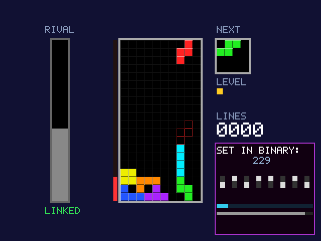

### 1.2 ตัวเลขสำคัญ

| หัวข้อ | ค่า |
|---|---|
| บอร์ด | EDGE Spartan-7, ชิป Xilinx XC7S15-FTGB196 × 2 บอร์ด |
| สัญญาณนาฬิกา | 50 MHz ตัวเดียวทั้งระบบ |
| ภาพ | VGA 640 × 480 ที่ 59.52 Hz, สี 12 บิต (4,096 สี) |
| การเชื่อมบอร์ด | UART 115,200 bps บนสาย 3 เส้น, ข้อความ 1 ไบต์ 5 ชนิด |
| เสียง | IMA ADPCM 16 kHz → sigma-delta 12 บิต ออกช่องหูฟังโดยตรง |
| วิดีโอ | 160 × 120 พิกเซล (ขยาย 4 เท่า), 2-256 สี, 10 ภาพต่อวินาที |
| สื่อในแฟลช | 6,863,360 ไบต์ (6.86 MB) เริ่มที่ 1 MB ของชิป 8 MB, อ่านผ่าน SPI 25 MHz |
| โค้ด | VHDL 25 ไฟล์ 5,705 บรรทัด + สคริปต์ Python สร้างไฟล์สื่อ (ทั้งหมดอยู่บน GitHub และในสื่อบันทึกข้อมูล) |
| ทรัพยากรที่ใช้ | LUT 6,797 / 8,000 (85 %), Slice 1,962 / 2,000 (98 %), Block RAM 10 / 10 (100 %) |
| Timing | WNS +3.441 ns (ผ่าน: ทุกเส้นทางเร็วพอสำหรับ 50 MHz) |
| การทดสอบ | testbench 13 ชุด, วงจรทดสอบฮาร์ดแวร์ 6 ชุด, เล่นจริงบนบอร์ด 2 บอร์ด |

### 1.3 วิธีอ่านเอกสารนี้

เอกสารนี้เขียนให้ **คนที่ไม่เคยใช้ FPGA มาก่อน อ่านแล้วเข้าใจและสร้างชิ้นงานนี้ซ้ำได้เอง** จึงเริ่มจากพื้นฐาน
แล้วค่อยๆ ลงรายละเอียด:

* **บทที่ 2 พื้นฐานที่ต้องรู้**: FPGA คืออะไร, วงจรดิจิทัลที่ใช้, ภาษา VHDL, เครื่องมือ, บอร์ด และหลักการทุกเรื่องที่ใช้ในงาน
* **บทที่ 3 การหาข้อมูล**: เลือกหัวข้ออย่างไร และข้อจำกัดที่กำหนดการออกแบบ
* **บทที่ 4 การออกแบบแบบ Top-Down**: จากระบบทั้งหมด → วงจรในหนึ่งบอร์ด → การต่อสายระหว่างโมดูล → **ทุกโมดูลทีละตัว**
  พร้อมโค้ดจริงที่อธิบายทีละส่วน และ schematic ที่ Vivado สร้างจากโค้ด
* **บทที่ 5 การพัฒนา** และ **บทที่ 6 การทดสอบ**: ทำอะไรตามลำดับไหน พบปัญหาอะไร แก้อย่างไร ทดสอบอย่างไร
* **บทที่ 7 วิธีสร้างชิ้นงานซ้ำทีละขั้น**: ตั้งแต่ติดตั้งโปรแกรมจนเล่นได้บนบอร์ดสองบอร์ด
* **บทที่ 8-9**: วิธีเล่น และสรุปผล ตามด้วยเอกสารอ้างอิง
* **ภาคผนวก ก** รายชื่อไฟล์, **ภาคผนวก ข** schematic จาก Vivado ของทุกโมดูล

**โค้ดในเอกสาร**: กล่องสีเทาคือโค้ดจริงที่ดึงมาจากไฟล์โดยอัตโนมัติ เลขด้านซ้ายคือเลขบรรทัดในไฟล์นั้น
ซึ่งตรงกับเลขบรรทัดในไฟล์จริง อ่านโค้ดเต็มได้ที่ https://github.com/anakom-suvonvorn/FPGA-Tetris (branch `media` คือฉบับสมบูรณ์)
หรือในสื่อบันทึกข้อมูล โฟลเดอร์ `Source_Code`
คำอธิบายในโค้ด (comment หลัง `--`) เป็นภาษาอังกฤษ ส่วนคำอธิบายในเอกสารเป็นภาษาไทย

## 2. พื้นฐานที่ต้องรู้

### 2.1 FPGA คืออะไร

คอมพิวเตอร์ทั่วไป (และไมโครคอนโทรลเลอร์ เช่น Arduino) มี CPU ที่ **ทำคำสั่งทีละคำสั่ง** ตามโปรแกรม
ส่วน **FPGA (Field-Programmable Gate Array)** ไม่มี CPU และไม่ทำคำสั่ง แต่เป็นชิปที่มี "ชิ้นส่วนวงจร" เปล่าๆ จำนวนมาก
และสายไฟที่เลือกต่อได้ เมื่อโหลดไฟล์ตั้งค่า (เรียกว่า **bitstream**, ไฟล์ `.bit`) ลงไป ชิ้นส่วนเหล่านั้นจะถูกต่อกันเป็น
**วงจรดิจิทัลตามที่เราออกแบบ** ทุกส่วนของวงจรทำงานพร้อมกันตลอดเวลา เหมือนสร้างชิปขึ้นมาใหม่เอง

ชิ้นส่วนหลักในชิป XC7S15 ที่ใช้:

| ชิ้นส่วน | คืออะไร | มีกี่ตัว | ในงานนี้ใช้ทำอะไร |
|---|---|---|---|
| LUT (Look-Up Table) | ตารางความจริงขนาดเล็ก 6 อินพุต 1 เอาต์พุต: ทำวงจร AND/OR/XOR/บวก/เปรียบเทียบ ได้ทุกแบบ | 8,000 | วงจรตรรกะทั้งหมด |
| Flip-flop (FF) | หน่วยความจำ 1 บิต เปลี่ยนค่าเฉพาะตอนขอบขาขึ้นของนาฬิกา | 16,000 | ตัวนับ, รีจิสเตอร์, กระดานเกม |
| Slice | กลุ่มของ 4 LUT + 8 FF | 2,000 | (หน่วยที่ Vivado ใช้วางวงจร) |
| Block RAM | หน่วยความจำขนาด 36 Kb (แบ่งเป็น 18 Kb ได้ 2 ก้อน) | 10 ก้อน (45 KB) | frame buffer วิดีโอ, sprite, เสียง |
| DSP48 | ตัวคูณ 25 × 18 บิตสำเร็จรูป | 20 | ตัวคูณใน chaos_task, chaos_fx (สุ่มช่วงเวลา) และ media_engine: ใช้ 3 ตัว |
| I/O pin | ขาของชิปที่ต่อกับอุปกรณ์บนบอร์ด | 100 | ปุ่ม, สวิตช์, จอ, สาย, แฟลช |

### 2.2 วงจรดิจิทัลที่ใช้ในงานนี้

**สัญญาณนาฬิกา (clock)**: บอร์ดมีออสซิลเลเตอร์ 50 MHz คือสัญญาณที่สลับ 0/1 วินาทีละ 50 ล้านรอบ
(หนึ่งรอบ = 20 ns) ทุก flip-flop ในงานนี้เปลี่ยนค่าพร้อมกันที่ **ขอบขาขึ้น** ของนาฬิกาตัวนี้ตัวเดียว
เรียกการออกแบบแบบนี้ว่า **synchronous design**

**วงจรสองแบบ**:

* **Combinational** (วงจรเชิงผสม): เอาต์พุตขึ้นกับอินพุต ณ ตอนนั้นเท่านั้น เช่น ตัวบวก, ตัวเปรียบเทียบ, mux
  สร้างจาก LUT ต้องคำนวณเสร็จภายใน 1 รอบนาฬิกา (20 ns) ไม่อย่างนั้นวงจรจะผิด
* **Sequential** (วงจรเชิงลำดับ): มีหน่วยความจำ (flip-flop) ค่าใหม่ = ฟังก์ชันของค่าเดิมและอินพุต
  เปลี่ยนทีละขั้นที่ขอบนาฬิกา เช่น ตัวนับ (counter), shift register, state machine

**ตัวนับ (counter)**: รีจิสเตอร์ที่บวก 1 ทุกรอบนาฬิกา ใช้วัดเวลาได้ทุกช่วง เช่น นับ 434 รอบ = 8.68 µs = เวลา 1 บิตของ UART
หรือนับ 840,000 รอบ = 16.8 ms = เวลา 1 เฟรมภาพ

**Enable pulse**: แทนที่จะสร้างนาฬิกาช้าลง (เช่นหารนาฬิกาด้วย flip-flop) งานนี้ใช้นาฬิกา 50 MHz ตัวเดียวทั้งหมด
แล้วสร้างสัญญาณ "enable" ที่เป็น 1 เพียง 1 รอบนาฬิกา เป็นจังหวะ เช่น `frame_tick` เป็น 1 หนึ่งรอบในทุกๆ 840,000 รอบ
วงจรที่ต้องทำงานเฟรมละครั้งจะทำงานเฉพาะรอบที่ `frame_tick = '1'` (เหตุผลอยู่ในข้อ 4.6)

**State machine (FSM)**: วงจรที่มีรีจิสเตอร์ "สถานะ" (state) หนึ่งตัว ในแต่ละรอบนาฬิกาดูสถานะปัจจุบันและอินพุต
แล้วตัดสินว่าจะทำอะไร และรอบหน้าจะไปสถานะไหน ใช้ทำงานที่ต้องทำ "ทีละขั้น" เช่น ส่ง UART ทีละบิต
หรือกติกาเตตริส (ลองหมุน → ลองเลื่อน → ลองตก → ...) งานนี้มี FSM หลายตัว ตัวใหญ่สุดคือ `tetris_core` 23 สถานะ

**Metastability และ synchronizer**: สัญญาณจากภายนอก (ปุ่ม, สวิตช์, สายจากอีกบอร์ด, ข้อมูลจากแฟลช) เปลี่ยนเมื่อไรก็ได้
ไม่ตรงกับนาฬิกาของเรา ถ้าเปลี่ยนพอดีตอนที่ flip-flop เก็บค่า flip-flop อาจค้างอยู่ "ครึ่งทาง" ชั่วขณะ (metastable)
วิธีแก้มาตรฐานคือ **ส่งผ่าน flip-flop 2 ตัวต่อกัน** ก่อนใช้งาน ตัวที่สองจะได้ค่าที่นิ่งแล้วเกือบแน่นอน

**LFSR (Linear Feedback Shift Register)**: shift register 16 บิตที่บิตใหม่ = XOR ของบางบิต
ให้ลำดับตัวเลขที่ดูสุ่ม (ซ้ำรอบทุก 65,535 ครั้ง) ใช้ LUT น้อยมาก งานนี้ใช้สุ่มบล็อก ภารกิจ ช่องว่างของขยะ ฯลฯ
และเพราะ LFSR เดินทุกรอบนาฬิกา แต่ถูกอ่านตอนผู้เล่นกดปุ่ม ลำดับจึงไม่ซ้ำกันในแต่ละเกม

### 2.3 ภาษา VHDL

**VHDL** เป็นภาษาบรรยายวงจร (Hardware Description Language): สิ่งที่เขียนไม่ใช่คำสั่งให้ CPU ทำทีละบรรทัด แต่เป็น **คำบรรยายวงจร**
ที่ Vivado แปลงเป็น LUT และ flip-flop แต่ละไฟล์คือ "กล่องวงจร" หนึ่งกล่อง (`entity` บอกขาเข้า/ออก, `architecture` บอกข้างใน)
และกล่องใหญ่วางกล่องย่อยแล้วต่อสายถึงกันด้วย `port map` แบบเดียวกับการต่อวงจรบนกระดาษ

**จุดที่ต่างจากการเขียนโปรแกรม**: ทุกส่วนของโค้ดทำงาน **ขนานกันตลอดเวลา** และค่าใน `process` ที่ขึ้นกับ `rising_edge(clk)`
เปลี่ยนพร้อมกันทั้งหมดที่ขอบนาฬิกา ไม่ใช่ทีละบรรทัด

งานนี้ใช้ **VHDL-93** เท่านั้น (ไม่ใช้ของใหม่ใน VHDL-2008 เช่น `process(all)`) เพราะ FPGA Builder ของ TA
อ่านไฟล์เป็น VHDL-93 โค้ดจึงใช้ได้ทั้งกับ Vivado และ FPGA Builder

### 2.4 เครื่องมือ: จากโค้ดถึงบอร์ด

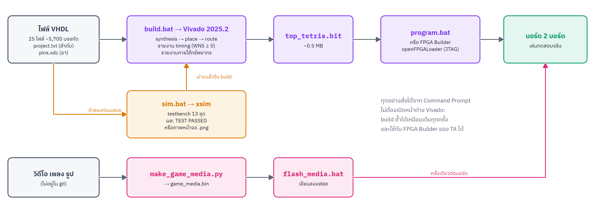

1. **เขียนโค้ด VHDL** (ไฟล์ `.vhd`) และไฟล์ **constraints** (`pins.xdc`) ที่บอกว่า port ไหนอยู่ขาไหนของชิป
2. **Simulation** (xsim ใน Vivado): รัน **testbench** ซึ่งเป็นไฟล์ VHDL ที่สร้างนาฬิกาและอินพุตปลอม แล้วตรวจเอาต์พุต
   เห็นสัญญาณทุกเส้นในทุกรอบนาฬิกา โดยยังไม่ต้องมีบอร์ด
3. **Synthesis**: Vivado แปลงโค้ดเป็นวงจรของ LUT, flip-flop, block RAM (ดูภาพ schematic ที่ Vivado สร้างได้ในบทที่ 4 และภาคผนวก ข)
4. **Implementation** (place & route): วางวงจรลงตำแหน่งจริงในชิปและเดินสาย แล้ว **ตรวจ timing**:
   ทุกเส้นทางจาก flip-flop ถึง flip-flop ต้องเร็วกว่า 20 ns ค่าที่เหลือเรียก **WNS (Worst Negative Slack)** ต้อง ≥ 0
5. **Bitstream**: สร้างไฟล์ `.bit`
6. **Program**: โหลด `.bit` ลงชิปผ่านสาย USB (JTAG) ด้วย openFPGALoader (ใน FPGA Builder ของ TA หรือสคริปต์ `program.bat`)

### 2.5 บอร์ด EDGE Spartan-7

ข้อมูลหลักมาจากคู่มือของบอร์ด (EDGE Spartan 7 FPGA Development Board User Manual) และไฟล์ข้อกำหนดขา
ในโปรแกรม FPGA Builder ของ TA จากนั้นยืนยันทุกขาด้วยวงจรทดสอบบนบอร์ดจริง (บทที่ 6)

| อุปกรณ์บนบอร์ด | สิ่งที่ใช้ในชิ้นงาน |
|---|---|
| ชิป XC7S15: 8,000 LUT, 16,000 flip-flop, block RAM 10 ก้อน (45 KB), DSP 20 | วงจรทั้งหมด |
| นาฬิกา 50 MHz (ขา H11) | นาฬิกาเดียวของระบบ |
| ช่อง VGA 12 บิต (R, G, B อย่างละ 4 บิต) | ภาพเกม |
| ปุ่มกด 5 ปุ่ม เรียงเป็นรูปกากบาท (SW14, SW16, SW18, SW20, SW23) | บังคับบล็อก |
| สวิตช์เลื่อน 16 ตัว (ใช้ 13 ตัว) | ภารกิจ CHAOS 8 ตัว และตั้งค่า 5 ตัว |
| 7-segment 4 หลัก | จำนวนแถวที่ล้าง / วินาทีที่เหลือของภารกิจ |
| ช่องหูฟัง (ต่อกับขา FPGA โดยตรง ไม่มี DAC) + บัซเซอร์ | เพลงและเสียงเอฟเฟกต์ |
| หัวต่อ J5 (ขา I/O 16 ขา + ไฟเลี้ยง/กราวด์) | สายเชื่อมระหว่างบอร์ด |
| ชิปแฟลช SPI S25FL064L 8 MB | เก็บไฟล์ .bit และสื่อทั้งหมด |
| USB-UART (FT2232) | ทดสอบ: ให้คอมพิวเตอร์เล่นเป็นคู่แข่ง |

**ขาทั้งหมดที่ใช้** (จากไฟล์ `game/pins.xdc` ทุกขาเป็น LVCMOS33 = สัญญาณ 3.3 V):

| port ในโค้ด | ขาชิป | อุปกรณ์ |
|---|---|---|
| `clk` | H11 | ออสซิลเลเตอร์ 50 MHz |
| `btn_left` / `btn_rot` / `btn_hard` / `btn_soft` / `btn_right` | J14 / J13 / J12 / L13 / J11 | ปุ่ม SW14 ซ้าย / SW16 บน / SW18 กลาง / SW23 ล่าง / SW20 ขวา |
| `sw_pause` / `sw_music` / `sw_sfx` / `sw_chaos` / `sw_usb` | K11 / M11 / N14 / P12 / N10 | สวิตช์ SW2 / SW4 / SW5 / SW6 / SW7 (PULLDOWN) |
| `sw_task[0..7]` | L2, P3, N1, M2, L1, J3, K3, J1 | สวิตช์ SW11, SW12, SW13, SW15, SW17, SW19, SW21, SW22 (PULLDOWN) |
| `link_tx` / `link_rx` | L14 / M13 | J5 ขา 5 / ขา 6 (rx มี PULLUP) |
| `usb_tx` / `usb_rx` | F2 / G1 | USB-UART ไป PC / จาก PC (rx มี PULLUP) |
| `audio_l` / `audio_r` / `buzzer` | A13 / B13 / B14 | ช่องหูฟังซ้าย / ขวา, บัซเซอร์ (ต้องเสียบจัมเปอร์ J6) |
| `flash_cs_n` / `flash_mosi` / `flash_miso` / `flash_wp_n` / `flash_hold_n` | C11 / B11 / B12 / D10 / C10 | ชิปแฟลช (นาฬิกาของแฟลชออกทาง STARTUPE2 ไม่มีใน xdc) |
| `vga_r[0..3]` | B6, D3, C3, A4 | VGA สีแดง |
| `vga_g[0..3]` | A3, B3, A2, B5 | VGA สีเขียว |
| `vga_b[0..3]` | A5, B2, B1, C5 | VGA สีน้ำเงิน |
| `vga_hs` / `vga_vs` | C4 / E4 | VGA HSYNC / VSYNC |
| `seg_n[0..7]` | L3, P4, P2, M3, M1, J4, K4, J2 | 7-segment a, b, c, d, e, f, g, จุด (active-low) |
| `dig[0..3]` | H1, H2, H3, H4 | เลือกหลักขวาสุด → ซ้ายสุด (active-high) |

**สิ่งที่พบว่าไม่ตรงกับคู่มือ** (พบจากการทดสอบ ไม่ใช่จากการอ่าน):

* ขา TX/RX ของ USB-UART **สลับกัน** กับในคู่มือ (G1 = รับจาก PC, F2 = ส่งไป PC) พบด้วยวงจรทดสอบ 05
* ขาเลือกหลักของ 7-segment เป็น **active-high** (1 = หลักนั้นติด) ส่วนขา segment เป็น active-low
* สวิตช์เลื่อน **เด้ง (bounce) รุนแรง** และลอย (floating) เมื่อโยกค้างครึ่งทาง ต้องมีวงจรกรองและเปิด PULLDOWN
* ขา J5 ในคู่มือใช้ชื่อของชิป Spartan-6 รุ่นเก่า ชื่อขาที่ถูกต้องสำหรับ Spartan-7 หาได้จากวงจรทดสอบ 02 (J5 ขา 5..20 =
  L14, M13, H14, H13, F11, G11, C14, D14, E13, F13, F14, G14, D13, D12, E12, F12)

### 2.6 หลักการที่ใช้ (สรุปพร้อมตัวเลข)

**VGA 640 × 480**: จอวาดภาพทีละจุดจากซ้ายไปขวา ทีละบรรทัดจากบนลงล่าง วงจรไม่ได้ส่ง "ภาพ" แต่ส่ง **สีของจุดที่กำลังวาดอยู่ ณ ตอนนั้น**
ทางสาย R, G, B และพัลส์ HSYNC (จบบรรทัด) VSYNC (จบเฟรม) หนึ่งบรรทัดมี 800 ช่วงพิกเซล (มองเห็น 640 + ช่วงซ่อน 160)
หนึ่งเฟรมมี 525 บรรทัด (มองเห็น 480 + ซ่อน 45) พิกเซลละ 2 รอบนาฬิกา (25 MHz) จึงได้ 800 × 525 × 2 = **840,000 รอบต่อเฟรม**
= 50,000,000 / 840,000 = **59.52 เฟรมต่อวินาที**

**UART 8N1 115,200 bps**: สายว่างเป็น 1 → start bit 0 → 8 บิตข้อมูล (บิตต่ำก่อน) → stop bit 1 = 10 บิตต่อไบต์
บิตละ 50,000,000 / 115,200 = **434 รอบ** (8.68 µs) ไบต์ละ 87 µs ฝั่งรับไม่มีสายนาฬิกา จึงจับขอบลงของ start bit
แล้วรอครึ่งบิต (217 รอบ) เพื่ออ่านตรงกลางบิต จากนั้นอ่านทุก 434 รอบ

**SPI flash**: 4 สาย (CS_N, SCLK, MOSI, MISO) ส่งคำสั่ง READ `03h` + ที่อยู่ 24 บิต แล้วชิปส่งข้อมูลออกมาเรื่อยๆ
ทีละบิต (บิตสูงก่อน) ตราบที่ยังให้นาฬิกา ที่ SCLK 25 MHz ได้ 25 / 8 = **3.1 MB ต่อวินาที**

**IMA ADPCM**: เก็บเสียงเป็น "ผลต่าง" 4 บิตต่อตัวอย่าง แทน 16 บิต (เล็กลง 4 เท่า) ดูรายละเอียดในข้อ 4.7.16

**Sigma-delta**: ขา FPGA ออกได้แค่ 0 V หรือ 3.3 V แต่เสียงต้องมีหลายระดับ วิธีคือสลับขาเปิด/ปิดเร็วมาก (50 ล้านครั้งต่อวินาที)
ให้สัดส่วนเวลาที่เปิดเท่ากับระดับเสียง หูฟังตอบสนองไม่ทันจึงได้ยินเป็นค่าเฉลี่ย ดูข้อ 4.7.19

**การบีบอัดภาพ**: palette (เก็บเลขสีแทนสี), delta (เก็บเฉพาะจุดที่เปลี่ยนจากภาพก่อน), run-length (จุดสีเดียวกันติดกันเก็บเป็น "n จุด สี c")

**กติกาเตตริสสมัยใหม่** (Tetris Guideline): 7-bag randomizer, ghost piece, wall kick, lock delay 0.5 วินาที, ตารางขยะ

## 3. กระบวนการหาข้อมูล

### 3.1 การเลือกหัวข้อ

กลุ่มเริ่มจากรวบรวมไอเดียหลายแบบแล้วเปรียบเทียบ ตามเกณฑ์ของงาน (ใช้ FPGA อย่างน้อย 2 บอร์ด,
งานหลักต้องอยู่ใน FPGA, ยากกว่าแลป) และความชอบของกลุ่ม (อยากได้งานที่สนุก เล่นกับเพื่อนได้ และมีมุกมีม)

| ไอเดีย | ข้อดี | ข้อเสีย | ผล |
|---|---|---|---|
| อุปกรณ์ IoT / เครื่องใช้ | มีประโยชน์จริง | งานหลักมักอยู่ที่ไมโครคอนโทรลเลอร์, ไม่สนุก | ไม่เลือก |
| เครื่องเล่นวิดีโอ (Bad Apple) | ท้าทายเรื่องหน่วยความจำ | ใช้บอร์ดเดียว, ดูอย่างเดียว | นำไปเป็นส่วนหนึ่ง |
| เกมยิง 3D แบบ Doom | น่าทึ่ง | ใหญ่เกิน 8,000 LUT มาก | ไม่เลือก |
| **เตตริสต่อสู้ 2 บอร์ด** | ใช้ 2 บอร์ดอย่างมีความหมาย, ทุกคนรู้กติกา, ขยายเพิ่มได้ทีละชั้น | ต้องออกแบบโปรโตคอลเอง | **เลือก** |

ข้อดีที่สำคัญที่สุดของเตตริสต่อสู้คือ **แบ่งเป็นชั้นได้**: ชั้นแรก (เกม + ต่อสู้) ทำเสร็จก็ส่งงานได้แล้ว
ชั้นต่อไป (CHAOS, สื่อจากแฟลช) เพิ่มทีละชั้นเมื่อมีเวลา ทำให้ความเสี่ยงต่ำแต่เพดานสูง

### 3.2 แหล่งข้อมูลที่ศึกษา

| เรื่อง | ศึกษาจาก | นำไปใช้ที่ |
|---|---|---|
| ขาและอุปกรณ์ของบอร์ด | คู่มือบอร์ด, ไฟล์ขาใน FPGA Builder, วงจรทดสอบ 01-05 | `pins.xdc` |
| VGA timing | มาตรฐาน 640 × 480 @ 60 Hz (tinyvga.com) | `vga_sync` |
| UART | หลักการ 8N1, แลปของรายวิชา | `uart_tx`, `uart_rx` |
| SPI flash, STARTUPE2 | datasheet S25FL064L, เอกสาร 7 Series Configuration (UG470) | `spi_flash` |
| Block RAM | 7 Series Memory Resources (UG473) | `media_engine` |
| กติกาเตตริส | Tetris Guideline (tetris.wiki) | `tetris_core` |
| IMA ADPCM | เอกสารมาตรฐาน IMA (1992) | `adpcm_dec`, `make_game_media.py` |
| VHDL และ Vivado | เอกสารและแลปของรายวิชา | ทุกไฟล์ |

### 3.3 ข้อจำกัดที่กำหนดทิศทางการออกแบบ

1. **ไม่มี RAM ภายนอก** มีแค่ block RAM 45 KB ในชิป: ภาพ 640 × 480 เต็มจอ (12 บิต) ต้องใช้ 450 KB
   จึงเก็บภาพทั้งจอไม่ได้ → ภาพเกม **คำนวณสดทุกพิกเซล** (ไม่มี frame buffer) และวิดีโอลดเป็น 160 × 120
2. **LUT 8,000 ตัว**: ทุกฟีเจอร์ต้องคุ้ม เช่น ใช้ตัวตรวจการชนตัวเดียวร่วมกันทุกขั้น, ใช้ ROM ฟอนต์ตัวเดียวร่วมกันทุกบรรทัดข้อความ
3. **แฟลช 8 MB** อ่านได้ประมาณ 3.1 MB/วินาที: พอสำหรับวิดีโอที่บีบอัดแล้ว แต่ไม่พอสำหรับภาพดิบ
4. **ไม่มีวงจรเสียง (DAC)** ต่อกับช่องหูฟัง: ใช้ sigma-delta แทน
5. **VHDL-93**: FPGA Builder ของ TA อ่านเป็น VHDL-93 จึงใช้ไวยากรณ์ใหม่บางอย่างไม่ได้

## 4. การออกแบบ (Top-Down Design)

**Top-Down** คือเริ่มออกแบบจากภาพรวมก่อน แล้วแบ่งเป็นส่วนย่อยทีละระดับ จนแต่ละส่วนเล็กพอจะเขียนเป็นโมดูล VHDL
ที่ทำงานเดียวและทดสอบแยกได้ แต่ละระดับมองเป็น "กล่อง" ที่มีขาเข้าและขาออก แล้วเปิดกล่องดูว่าข้างในมีกล่องย่อยอะไรบ้าง
ต่อกันอย่างไร บทนี้เรียงตามระดับ:

* **ระดับ 0** ระบบทั้งหมด: บอร์ดสองบอร์ดและสายเชื่อม
* **ระดับ 1** วงจรในหนึ่งบอร์ด `top_tetris` มองเป็นกล่องเดียว: มีขาเข้า/ออกอะไรบ้าง
* **ระดับ 2** ข้างใน `top_tetris`: โมดูลย่อย 14 ตัวและสายที่ต่อระหว่างกัน
* **ระดับ 3** ข้างในแต่ละโมดูล และ **ระดับ 4** โมดูลย่อยชั้นล่างสุด (เช่น `debounce`, `uart_tx`)

### 4.1 ข้อกำหนดของระบบ (Requirements)

| รหัส | ข้อกำหนด |
|---|---|
| R1 | เล่นเตตริสได้ครบตามกติกาสมัยใหม่ บนจอ VGA ด้วยปุ่มบนบอร์ด |
| R2 | สองบอร์ดเล่นต่อสู้กันได้: ส่งขยะ, เห็นสถานะคู่แข่ง, เริ่มพร้อมกัน, ตัดสินผลตรงกัน |
| R3 | รู้ได้ว่าสายเชื่อมต่ออยู่หรือไม่ และเล่นคนเดียวได้เมื่อไม่มีคู่ |
| R4 | โหมด CHAOS: ภารกิจด้วยสวิตช์ → การโจมตีหรือโบนัส |
| R5 | เพลงและเสียงเอฟเฟกต์ระหว่างเล่น |
| R6 | วิดีโอพร้อมเสียงจากแฟลช: การโจมตี, ฉากชนะ/แพ้, sprite |
| R7 | วงจรทั้งหมดใส่ในชิป XC7S15 ได้ และผ่าน timing ที่ 50 MHz |

### 4.2 ระดับ 0: ระบบทั้งหมด

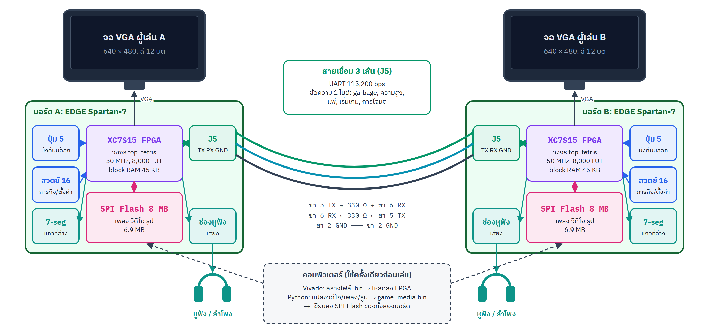

ระบบประกอบด้วยบอร์ดสองบอร์ดที่ **โหลดวงจรเดียวกันทุกบิต** (ไฟล์ `top_tetris.bit` ไฟล์เดียว)
ไม่มีบอร์ดหลัก/บอร์ดรอง ทั้งสองบอร์ดเท่ากัน เหตุผล:

* ไม่ต้องสร้างและโหลดไฟล์สองแบบ ลดโอกาสผิดพลาด
* กติกาตัดสินถูกออกแบบให้ทั้งสองฝั่งคำนวณได้ผลเดียวกันเองโดยไม่ต้องถามกัน (ข้อ 4.7.6)

**สายเชื่อม**: ใช้สายจัมเปอร์ตัวเมีย-ตัวเมีย 3 เส้น **ต่อตรงจากขาถึงขา** ไม่มีอุปกรณ์อื่นคั่น
(ขาของทั้งสองบอร์ดเป็นสัญญาณ 3.3 V เหมือนกัน เอาต์พุตของบอร์ดหนึ่งจึงขับอินพุตของอีกบอร์ดได้โดยตรง):

| บอร์ด A | | บอร์ด B |
|---|---|---|
| J5 ขา 5 (L14, `link_tx`) | → | J5 ขา 6 (M13, `link_rx`) |
| J5 ขา 6 (M13, `link_rx`) | ← | J5 ขา 5 (L14, `link_tx`) |
| J5 ขา 2 (GND) | — | J5 ขา 2 (GND) |

สาย TX ของบอร์ดหนึ่งต้องไปที่ RX ของอีกบอร์ด (ไขว้กัน) ห้ามต่อ TX ชน TX และต้องต่อกราวด์ร่วมกัน
เพราะแรงดัน "0" กับ "1" วัดเทียบกับกราวด์ ถ้าไม่ต่อกราวด์ ฝั่งรับจะแยก 0 กับ 1 ไม่ออก

### 4.3 ระดับ 1: `top_tetris` มองเป็นกล่องเดียว

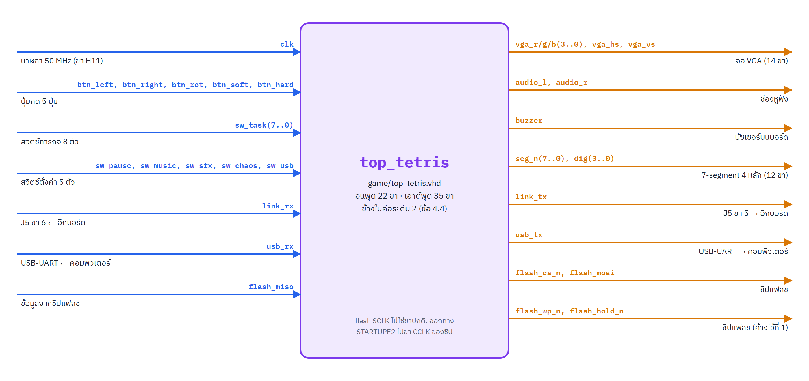

ที่ระดับนี้ยังไม่สนใจว่าข้างในทำงานอย่างไร สนใจเพียงว่ากล่องนี้ต้อง **รับอะไรเข้า** และ **ส่งอะไรออก**
ซึ่งก็คือ port ของ entity `top_tetris` ในไฟล์ `game/top_tetris.vhd` แต่ละ port ผูกกับขาจริงของชิปในไฟล์ `game/pins.xdc`
(ตารางขาทั้งหมดอยู่ในข้อ 2.5) รวม 57 ขา: อินพุต 22 ขา และเอาต์พุต 35 ขา

<!-- CODE: game/top_tetris.vhd | ^entity top_tetris | ^end entity -->

ข้อกำหนดของขาที่ส่งผลต่อการออกแบบข้างใน:

* อินพุตจากภายนอกทุกขา (ปุ่ม, สวิตช์, `link_rx`, `usb_rx`, `flash_miso`) ไม่ได้เปลี่ยนตามจังหวะนาฬิกาของเรา
  จึงต้องผ่าน synchronizer ก่อนใช้ (ข้อ 4.6)
* `vga_*` ต้องเปลี่ยนค่าทุกพิกเซล (25 ล้านพิกเซลต่อวินาที) วงจรสร้างภาพจึงต้องคำนวณสีให้ทันทุก 2 รอบนาฬิกา
* `link_tx` / `link_rx` คือสาย 2 เส้นจาก 3 เส้นของระดับ 0 (เส้นที่ 3 คือ GND)
* ขานาฬิกาของชิปแฟลช (SCLK) เป็นขาเดียวกับที่ชิป FPGA ใช้ตอนโหลดตัวเองจากแฟลช จึงกำหนดเป็น port ปกติไม่ได้
  ต้องขับผ่าน primitive `STARTUPE2` ที่อยู่ใน `top_tetris`

### 4.4 ระดับ 2: ข้างใน `top_tetris`

เปิดกล่องของระดับ 1 ออก ข้างในคือ **โมดูลย่อย 14 ตัว** (instance) ที่ต่อกันด้วยสัญญาณภายใน
และวงจรเล็กๆ ที่เขียนไว้ใน `top_tetris` เอง (ตัวกรองปุ่ม, ตัวเลือกสาย J5/USB, ตัวเลือกตัวเลขของ 7-segment และ `STARTUPE2`)
แต่ละโมดูลมีหน้าที่เดียว ทดสอบแยกได้ และคุยกับโมดูลอื่นผ่าน port เท่านั้น:

| instance | โมดูล (ไฟล์) | หน้าที่ |
|---|---|---|
| `u_sync` | `vga_sync` (`src/common/vga_sync.vhd`) | ตำแหน่งพิกเซล x, y, สัญญาณ sync และ `frame_tick` |
| `u_input` | `tetris_input` (`src/game/tetris_input.vhd`) | ปุ่ม 5 ปุ่ม → คำสั่ง 1 รอบนาฬิกา (กดค้าง = ซ้ำ) |
| `u_sw` | `switch_filter` (`src/common/switch_filter.vhd`) | กรองสวิตช์เลื่อน 13 ตัว |
| `u_core` | `tetris_core` (`src/game/tetris_core.vhd`) | กติกาเกม: กระดาน, บล็อก, ตรวจชน, ล้างแถว, ขยะ |
| `u_link` | `versus_link` (`src/game/versus_link.vhd`) | เหตุการณ์ของเกม ↔ ไบต์บนสาย |
| `u_task` | `chaos_task` (`src/game/chaos_task.vhd`) | สุ่มและตรวจภารกิจ, สุ่มการโจมตี/โบนัส |
| `u_fx` | `chaos_fx` (`src/game/chaos_fx.vhd`) | ผลของการโจมตีและโบนัส พร้อมจับเวลา |
| `u_crender` | `chaos_render` (`src/game/chaos_render.vhd`) | ภาพซ้อนของ CHAOS: แผงภารกิจ, ลูกบอล, แบนเนอร์ |
| `u_render` | `tetris_render` (`src/game/tetris_render.vhd`) | คำนวณสีของเกมทุกพิกเซล |
| `u_mctrl` | `media_ctrl` (`src/media/media_ctrl.vhd`) | เลือกว่าจะเล่นสื่อรายการไหนเมื่อไร |
| `u_media` | `media_engine` (`src/media/media_engine.vhd`) | อ่านแฟลช, ถอดภาพและเสียง, sprite |
| `u_mix` | `media_mix` (`src/media/media_mix.vhd`) | ซ้อนภาพเกมกับวิดีโอและ sprite → จอ |
| `u_sound` | `tetris_sound` (`src/game/tetris_sound.vhd`) | ผสมเพลงกับเสียงเอฟเฟกต์ → หูฟัง |
| `u_seg` | `seg7_scan` (`src/common/seg7_scan.vhd`) | สแกน 7-segment ทีละหลัก |

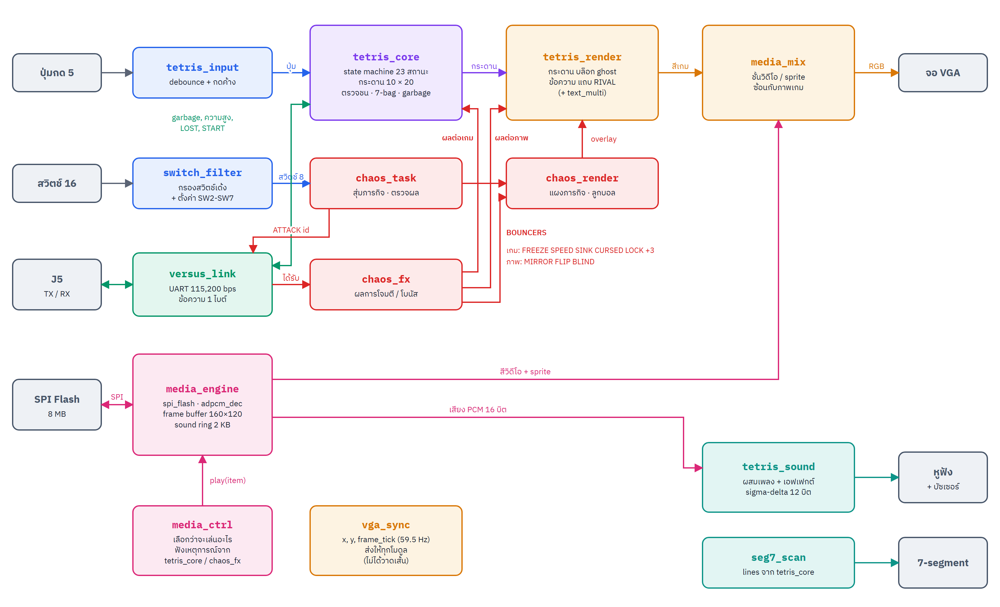

อ่านแผนภาพจากซ้าย (อินพุต) ไปขวา (เอาต์พุต) เป็น 3 แถว:

1. **แถวบน (เกม)**: ปุ่ม → `tetris_input` → ตัวกรองปุ่ม (MIRROR/LOCK) → `tetris_core` → `tetris_render` → `media_mix` → จอ
2. **แถวกลาง (CHAOS)**: สวิตช์ → `switch_filter` → `chaos_task` → `chaos_fx` → `chaos_render` → (overlay เข้า `tetris_render`)
   โดย `chaos_fx` ส่งผลของการโจมตีขึ้นไปที่ `tetris_core` (ผลต่อเกม), `tetris_render` (FLIP, BLIND) และตัวกรองปุ่ม (MIRROR, LOCK)
3. **แถวล่าง (สาย + สื่อ)**: `versus_link` คุยกับอีกบอร์ดผ่าน J5 และส่ง/รับเหตุการณ์กับ `tetris_core`, `chaos_task`, `chaos_fx`, `tetris_render`
   ส่วน `media_ctrl` สั่ง `media_engine` ให้อ่านแฟลช แล้วส่งภาพไป `media_mix` และเสียงไป `tetris_sound`

**ตารางการต่อสายทั้งหมด** (จาก `port map` ใน `game/top_tetris.vhd` บรรทัด 208-432):

| จาก | ไป | สัญญาณ | ความหมาย |
|---|---|---|---|
| `vga_sync` | เกือบทุกโมดูล | `x`, `y`, `frame_tick` | ตำแหน่งพิกเซลที่กำลังวาด, พัลส์ต้นเฟรม |
| `vga_sync` | `tetris_render` | `video_on`, `hs`, `vs` | ช่วงที่มองเห็น, พัลส์ sync |
| ปุ่ม 5 ตัว | `tetris_input` | `btns(4..0)` | hard, soft, rot, right, left |
| `tetris_input` | ตัวกรองปุ่ม (ใน top) | `a_left` ... `a_hard` | พัลส์คำสั่ง |
| ตัวกรองปุ่ม | `tetris_core` | `g_left` ... `g_hard` | คำสั่งหลังสลับซ้าย-ขวา (MIRROR) และหลังปิดปุ่ม (LOCK) |
| ตัวกรองปุ่ม | `chaos_task` | `touch` | มีการกดปุ่มใดๆ (ภารกิจ HANDS) |
| สวิตช์ 13 ตัว | `switch_filter` | `sw_raw(12..0)` | task × 8, chaos, usb, sfx, music, pause |
| `switch_filter` | `tetris_core`, `chaos_task`, `chaos_fx`, `tetris_render` | `pause_s` | พักเกม (SW2) |
| `switch_filter` | `chaos_task`, `chaos_render` | `task_sw(7..0)` | สวิตช์ภารกิจ 8 ตัว |
| `switch_filter` | `chaos_render`; (AND `playing`) → `chaos_task`, `chaos_fx` | `chaos_s`, `chaos_en` | เปิด CHAOS (SW6) |
| `switch_filter` | ตัวเลือกสาย RX | `usb_s` | SW7: ฟังจาก USB แทน J5 |
| `switch_filter` | `tetris_sound` | `music_s`, `sfx_s` | SW4, SW5 |
| `tetris_core` | `tetris_render` | `occ`, `colf`, `cur_*`, `ghost_y`, `next_*`, `playing`, `can_start`, `game_over`, `lines_bcd`, `level`, `result`, `pending` | ทุกอย่างที่ต้องวาด |
| `tetris_core` | `versus_link` | `start_out`, `lost_out`, `garb_out`, `garb_out_n`, `height` | สิ่งที่ต้องบอกอีกบอร์ด |
| `versus_link` | `tetris_core` | `got_start`, `got_lost`, `got_garb`/`got_n` (OR กับ `fx_garb` = +3), `link_ok` | สิ่งที่อีกบอร์ดบอกมา |
| `versus_link` | `tetris_render` | `opp_height`, `link_ok` | แถบ RIVAL, ข้อความ LINKED |
| `versus_link` | `chaos_fx` | `got_att`, `got_att_id` | การโจมตีจากคู่แข่ง |
| `versus_link` | `chaos_task` | `link_ok` (ชื่อ port `versus`) | โจมตีได้เฉพาะเมื่อเชื่อมต่อ |
| `chaos_task` | `versus_link` | `t_send`, `t_att_id` | ส่งการโจมตี |
| `chaos_task` | `chaos_fx` | `t_send`, `t_att_id`, `t_bonus`, `t_bonus_id`, `t_ok`, `t_fail` | ผลของภารกิจ |
| `chaos_task` | `chaos_render` | `t_active`, `t_task`, `t_sel`, `t_target`, `t_count`, `t_meter`, `t_zlo`, `t_zhi`, `t_prog`, `t_secs`, `t_offsecs` | ข้อมูลแผงภารกิจ |
| `chaos_task` | `tetris_sound` | `t_start`, `t_ok`, `t_fail`, `t_send` | เสียงเอฟเฟกต์ของภารกิจ |
| `chaos_task` | 7-segment (ผ่านตัวเลือกใน top) | `t_secs` | วินาทีที่เหลือ |
| `chaos_fx` | `tetris_core` | `fx_freeze`, `fx_speed`, `fx_next_bad`, `fx_next_i`, `fx_sink`, `fx_garb` | ผลต่อเกม |
| `chaos_fx` | `tetris_render` | `fx_flip`, `fx_blind` | ผลต่อภาพ |
| `chaos_fx` | ตัวกรองปุ่ม, `chaos_task`, `chaos_render` | `fx_mirror`, `fx_locked` | สลับปุ่ม, ล็อกปุ่ม (+ ให้ภารกิจมาทันที) |
| `chaos_fx` | `chaos_render` | `fx_bounce`, `fx_nbounce`, `ban_on`, `ban_id` | ลูกบอล, แบนเนอร์ |
| `chaos_fx` | `media_ctrl` | `media_hit`, `media_id` | การโจมตีวิดีโอ |
| `chaos_fx` | `tetris_sound` | `fx_hit` | เสียงโดนโจมตี |
| `chaos_render` | `tetris_render` | `ov_on`, `ov_rgb` | ภาพซ้อน (overlay) |
| `chaos_render` | `media_engine` | `face_addr` (+ `face_en` AND `m_spr`) | พิกเซลของหน้าเพื่อนบนลูกบอล |
| `tetris_render` | `media_mix` | `r_r`, `r_g`, `r_b`, `r_hs`, `r_vs`, `see_bg`, `keep` | ภาพเกม + จุดที่วิดีโอแสดงผ่านได้ |
| `tetris_core` | `media_ctrl`, `tetris_sound` | `playing`, `result` | เริ่มเกม, ผลแพ้ชนะ |
| `tetris_core` | `tetris_sound` | `clear_evt`, `clear_n` (+ `garb_in`) | เสียงล้างแถว / ขยะเข้า |
| `tetris_core` | 7-segment | `lines_bcd` | จำนวนแถวที่ล้าง |
| `media_ctrl` | `media_engine` | `m_play`, `m_item`, `m_from`, `m_stop` | สั่งเล่นรายการไหน เริ่มที่ record ไหน |
| `media_engine` | `media_ctrl` | `m_ready`, `m_musf` ... `m_winn`, `m_busy`, `m_snd`, `m_pos` | สถานะและสารบัญของไฟล์สื่อ |
| `media_engine` | `chaos_task` | `m_ready` (ชื่อ port `media_ok`) | มีไฟล์สื่อหรือไม่ (ไม่มี = ไม่สุ่มการโจมตีวิดีโอ) |
| `media_ctrl` | `media_mix` | `show`, `jev`, `c_won` (AND `m_picok`, `m_spr`) | แสดงภาพ, Jevil ลอย, กรอบสีชนะ/แพ้ |
| `media_engine` | `media_mix` | `m_rgb`, `m_see`, `m_zone`, `m_mode`, `m_dimh`, `s_on`, `s_rgb` | สีวิดีโอ/sprite ของพิกเซลนี้ |
| `media_mix` | `media_engine` | `j_en`, `j_addr` | ขอพิกเซลของ Jevil |
| `media_engine` | `tetris_sound` | `pcm` | เสียง 16 บิต |
| `media_engine` | แฟลช (ผ่าน `STARTUPE2`) | `sclk`, `cs_n`, `mosi`, `miso` | SPI |
| `media_mix` | จอ | `vga_r/g/b`, `vga_hs`, `vga_vs` | สัญญาณ VGA |
| `tetris_sound` | หูฟัง, บัซเซอร์ | `audio_l`, `audio_r`, `buzzer` | เสียง |
| `seg7_scan` | 7-segment | `seg_n`, `dig` | ตัวเลข |

**schematic ที่ Vivado สร้างจากโค้ด**

เพื่อยืนยันว่าวงจรที่สังเคราะห์ได้ต่อกันตรงตามการออกแบบ กลุ่มเปิดโปรเจกต์ใน Vivado แล้วสั่ง
**Open Elaborated Design → Schematic** ซึ่งวาดวงจรจากโค้ด VHDL โดยตรง (ก่อนการปรับให้เล็กลง)
แล้วบันทึกเป็น PDF ทีละโมดูล (คลิกขวา → Export to PDF) ภาพด้านล่างคือระดับบนสุด `top_tetris`
ซึ่งตรงกับแผนภาพด้านบน: กล่องสีฟ้าแต่ละกล่องคือ instance (`u_core`, `u_render`, ...) ที่มีชื่อ port ตรงกับโค้ด
และสายสีเขียวคือสัญญาณที่ต่อระหว่างกัน (เส้นหนา = bus หลายบิต)

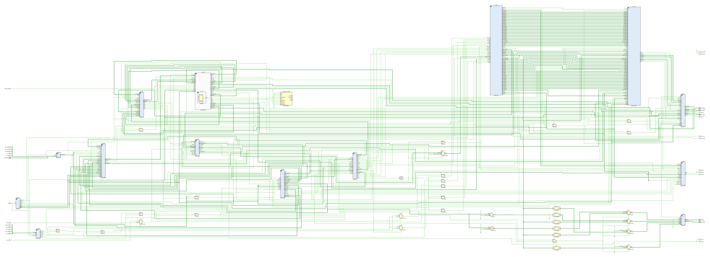

วิธีอ่าน schematic ของ Vivado:

* **กล่องฟ้ามีเครื่องหมาย +** = instance ของโมดูลย่อย (ดับเบิลคลิกใน Vivado เพื่อดูข้างใน)
* **RTL_REG** (สี่เหลี่ยมเหลือง) = flip-flop/รีจิสเตอร์, **RTL_MUX** (สี่เหลี่ยมคางหมู) = ตัวเลือก (จาก `if`/`case`),
  **RTL_ADD / RTL_SUB** (วงกลม +/−) = ตัวบวก/ตัวลบ, **RTL_EQ / RTL_LT** = ตัวเปรียบเทียบ, **RTL_AND / RTL_OR** = เกต,
  **RTL_ROM / RTL_RAM** = ตาราง/หน่วยความจำ
* ขอบสีน้ำเงินรอบภาพของโมดูลย่อยชั้นที่สอง (เช่น `u_rx` ใน `u_link`) คือกล่องของโมดูลแม่ที่ Vivado วาดล้อมไว้
* ภาพของทุกโมดูลอยู่ในภาคผนวก ข และไฟล์ PDF ต้นฉบับ (ซูมได้ไม่จำกัด) อยู่ในโฟลเดอร์ `vivado_schematics` ของสื่อบันทึกข้อมูล

**ลำดับชั้นทั้งหมด** (ระดับ 2 → 3 → 4 ตามชื่อ instance ในโค้ด):

```
top_tetris
├── u_sync     : vga_sync
├── u_input    : tetris_input
│   └── u_db   : debounce  (× 5)
├── u_sw       : switch_filter
├── u_core     : tetris_core
├── u_link     : versus_link
│   ├── u_tx   : uart_tx
│   └── u_rx   : uart_rx
├── u_task     : chaos_task
├── u_fx       : chaos_fx
├── u_crender  : chaos_render
│   └── u_text : text_multi
├── u_render   : tetris_render
│   └── u_text : text_multi
├── u_mctrl    : media_ctrl
├── u_media    : media_engine
│   ├── u_spi  : spi_flash
│   └── u_dec  : adpcm_dec
├── u_mix      : media_mix
├── u_sound    : tetris_sound
├── u_seg      : seg7_scan
└── u_startup  : STARTUPE2  (primitive ของ Xilinx: ขานาฬิกาของแฟลช)
```

ค่าที่หลายโมดูลใช้ร่วมกันเก็บไว้ใน **package** 4 ไฟล์: `common_pkg` (ค่าคงที่ของบอร์ด เช่น CLKS_PER_BIT = 434, ฟอนต์ 7-segment),
`tetris_pkg` (ขนาดกระดาน, รูปทรงบล็อก 7 แบบ × 4 การหมุน, สี, ตารางความเร็ว), `text_pkg` (ฟอนต์ 5 × 7 ที่ออกแบบเอง 64 ตัวอักษร),
`chaos_pkg` (รายการภารกิจ, การโจมตี, ช่วงเวลาสุ่ม, ข้อความแบนเนอร์)

### 4.5 ระดับ 3: ข้างในโมดูล

เปิดกล่องของระดับ 2 ต่ออีกชั้น โมดูล 5 ตัวมีโมดูลย่อยอยู่ข้างใน (ระดับ 4) ภาพด้านล่างแสดงข้างในของทั้ง 5 ตัว
**กล่องสีฟ้า** คือโมดูลย่อย (instance ของไฟล์อื่น) และ **กล่องสีเทา** คือวงจรที่เขียนอยู่ในโมดูลนั้นเอง
เส้นที่เข้ามาจากซ้ายและออกไปทางขวาคือ port ของโมดูล (ต่อกับโมดูลไหนในระดับ 2 เขียนกำกับไว้)
โมดูลที่เหลือ 9 ตัวไม่มีโมดูลย่อย ข้างในอธิบายพร้อมโค้ดในข้อ 4.7 (เช่น state machine ของ `tetris_core` ในข้อ 4.7.7)

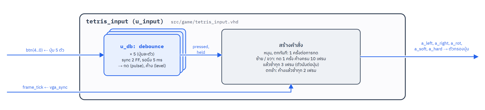

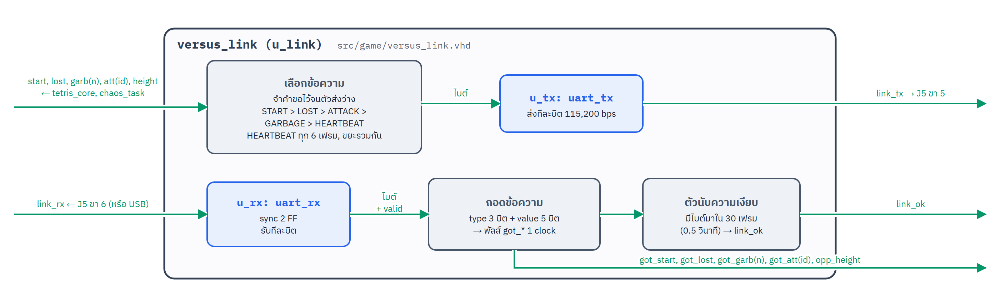

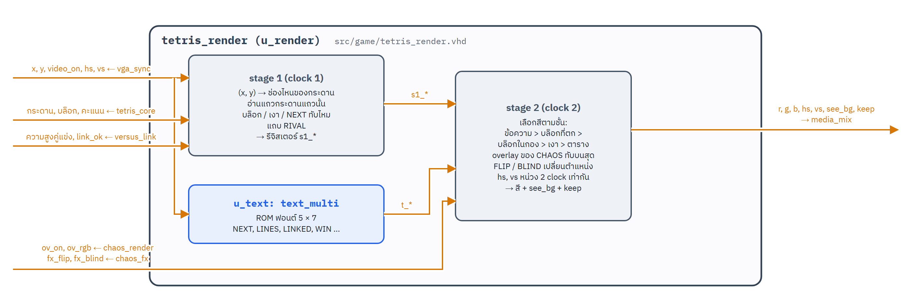

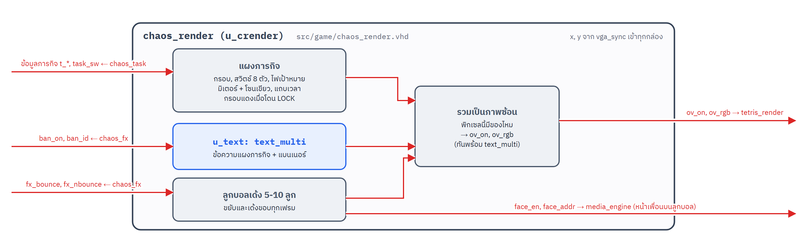

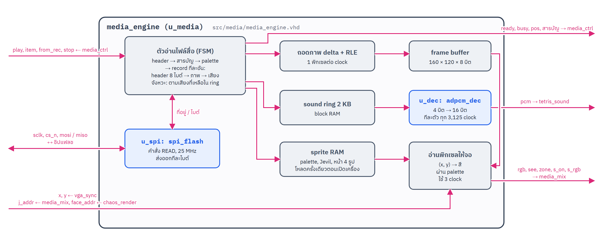

### 4.6 กฎการออกแบบที่ใช้ทุกไฟล์

1. **นาฬิกาเดียว (50 MHz)**: สิ่งที่ช้ากว่าใช้ "enable pulse" ยาว 1 รอบนาฬิกา (เช่น `frame_tick`) แทนการหารนาฬิกา
   เหตุผล: นาฬิกาที่หารเองทำให้ Vivado วิเคราะห์ timing ไม่ได้ และข้ามโดเมนนาฬิกายาก
2. **ทุกอินพุตจากภายนอกผ่าน flip-flop 2 ตัว** (synchronizer) ก่อนใช้ เพื่อกัน metastability
   (ปุ่ม, สวิตช์, สาย RX, ขาข้อมูลจากแฟลช)
3. **ไม่มี reset แยก**: ทุกรีจิสเตอร์มีค่าเริ่มต้นใน `signal ... := ...` ซึ่ง FPGA โหลดให้ตอนเปิดเครื่อง
4. **VHDL-93 เท่านั้น** เพื่อให้ใช้กับ FPGA Builder ของ TA ได้
5. **ทุกไฟล์ขึ้นต้นด้วยคำอธิบาย** ว่าโมดูลทำอะไร ทำอย่างไร และใช้เวลากี่รอบนาฬิกา

### 4.7 รายละเอียดแต่ละโมดูล (ระดับ 3 และ 4)

แต่ละหัวข้อมี: หน้าที่, port ที่สำคัญ, วิธีทำงานทีละขั้น, โค้ดจริงพร้อมคำอธิบาย และ schematic จาก Vivado
(โค้ดเต็มทุกบรรทัดอยู่บน GitHub: https://github.com/anakom-suvonvorn/FPGA-Tetris และในสื่อบันทึกข้อมูล)

#### 4.7.1 `vga_sync`: ตำแหน่งพิกเซลและจังหวะเฟรม

**หน้าที่**: บอกทุกโมดูลว่า "ตอนนี้จอกำลังวาดพิกเซลไหน" (x, y) และสร้างพัลส์ HSYNC, VSYNC ให้จอ

| port | ทิศ | ความหมาย |
|---|---|---|
| `clk` | in | 50 MHz |
| `x` (0-799), `y` (0-524) | out | ตำแหน่งปัจจุบัน (รวมช่วงซ่อน) |
| `video_on` | out | 1 เมื่อ x < 640 และ y < 480 (นอกนั้นต้องส่งสีดำ) |
| `hsync`, `vsync` | out | พัลส์ sync (active-low) |
| `frame_tick` | out | 1 หนึ่งรอบนาฬิกาต่อเฟรม ตอนวาดส่วนที่มองเห็นเสร็จ |

**วิธีทำงาน**:

1. `half` สลับ 0/1 ทุกรอบนาฬิกา ตัวนับเดินเฉพาะรอบที่ `half = '1'` จึงได้อัตรา 25 MHz โดยไม่ต้องสร้างนาฬิกาใหม่
2. `hc` นับ 0 ถึง 799 แล้วกลับเป็น 0 ทุกครั้งที่กลับเป็น 0 `vc` เพิ่ม 1 (นับ 0 ถึง 524)
3. hsync เป็น 0 ขณะ `hc` อยู่ในช่วง 656-751 (640 + 16 ถึง 640 + 16 + 96 − 1) vsync เป็น 0 ขณะ `vc` = 490-491
4. `frame_tick` เป็น 1 เมื่อบรรทัดที่ 479 (บรรทัดสุดท้ายที่มองเห็น) จบ ซึ่งเป็นต้นช่วงซ่อนแนวตั้ง
   เกมจึงอัปเดตสถานะในช่วงที่จอไม่ได้วาด ภาพไม่ขาดกลางเฟรม

<!-- CODE: src/common/vga_sync.vhd | ^begin | frame_tick <= tick -->

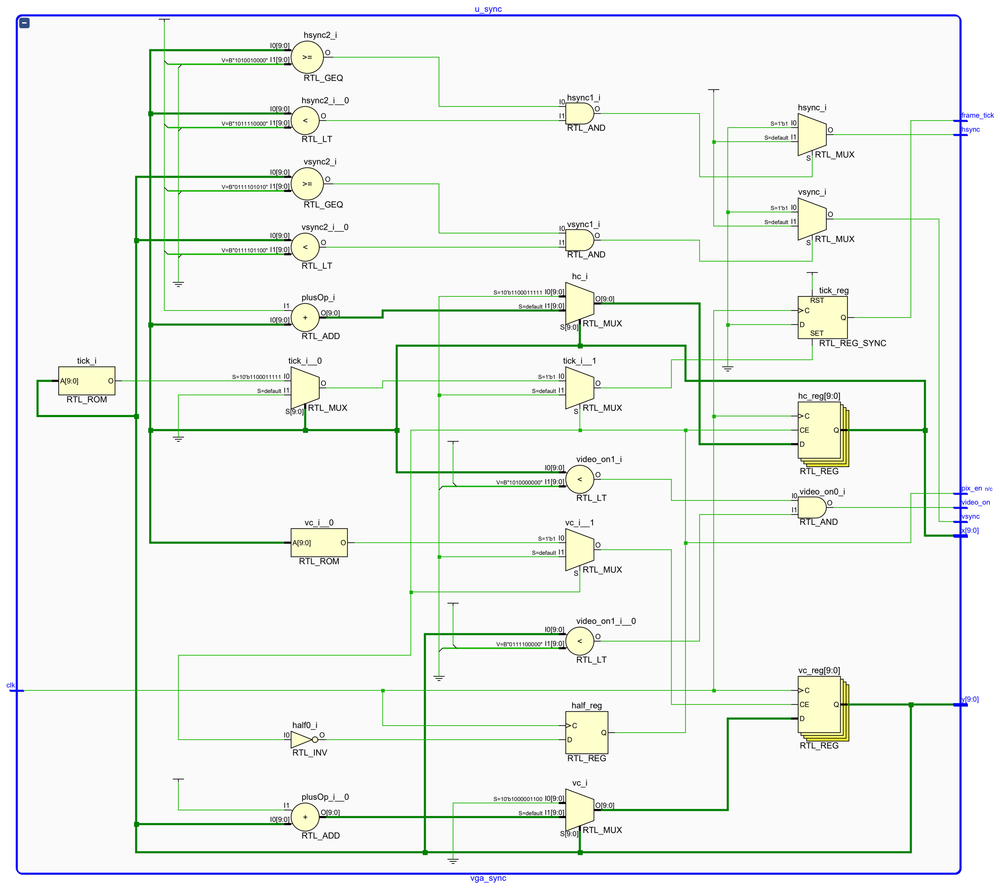

#### 4.7.2 `debounce` และ `tetris_input`: ปุ่มกด → คำสั่ง

**ปัญหาของปุ่มจริง 3 อย่าง** และวิธีแก้ใน `debounce`:

1. ปุ่มเปลี่ยนเมื่อไรก็ได้ ไม่ตรงกับนาฬิกา → ผ่าน flip-flop 2 ตัว (`sync1`, `sync2`)
2. หน้าสัมผัสโลหะเด้ง (bounce) เปิดปิดรัวๆ หลายมิลลิวินาที → ยอมรับค่าใหม่เมื่อค่าคงที่ต่อเนื่อง `STABLE_CYCLES` รอบ
   (top ตั้งไว้ 250,000 รอบ = 5 ms)
3. ต้องการ "กด 1 ครั้ง = 1 คำสั่ง" → `pressed` เป็น 1 หนึ่งรอบนาฬิกาเมื่อค่าที่กรองแล้วเปลี่ยนจาก 0 เป็น 1

<!-- CODE: src/common/debounce.vhd | ^begin | pressed <= pulse -->

**`tetris_input`** วาง `debounce` 5 ตัว (ใช้ `for ... generate`) แล้วเพิ่ม **การกดค้าง (auto-repeat)** แบบเกมเตตริสจริง:

| ปุ่ม | กดครั้งแรก | กดค้าง |
|---|---|---|
| ซ้าย / ขวา | ทำทันที | หลัง 10 เฟรม (DAS) ทำซ้ำทุก 3 เฟรม (ARR) |
| ตกช้า | ทำทันที | ทำซ้ำทุก 2 เฟรม |
| หมุน / ตกทันที | ทำทันที | ไม่ทำซ้ำ (ต้องกดใหม่) |

`held(i)` นับจำนวนเฟรมที่กดค้าง เมื่อถึง `DAS - 1` ก็ส่งคำสั่งแล้วตั้ง `held` เป็น `DAS - ARR` เพื่อให้ครั้งต่อไปมาอีกใน ARR เฟรม

<!-- CODE: src/game/tetris_input.vhd | constant REPEATS | ^end architecture -->

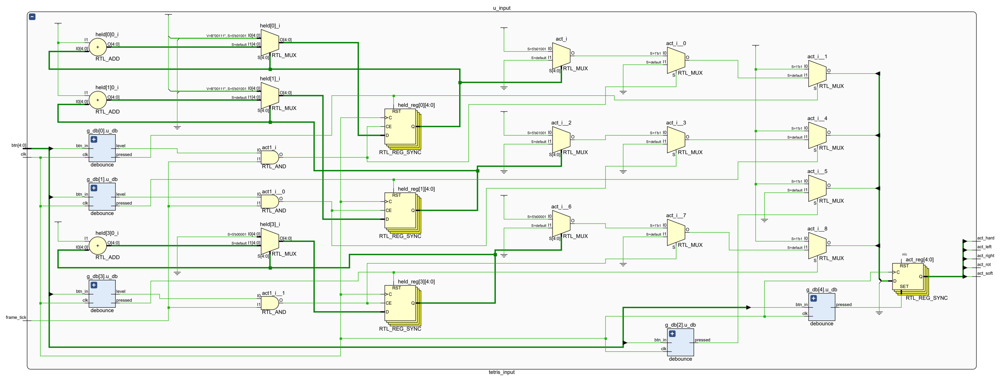

#### 4.7.3 `switch_filter`: กรองสวิตช์เลื่อน

**ปัญหาที่พบจากการทดสอบ**: สวิตช์เลื่อนบนบอร์ดเด้งรุนแรงกว่าปุ่ม และถ้าโยกค้างครึ่งทาง ขาจะลอย (ไม่ได้ต่อทั้ง 0 และ 1) อ่านค่ามั่วได้
ภารกิจ FLIP ("โยกสวิตช์ 10 ครั้ง") จึงนับผิด

**วิธีแก้ 2 ชั้น**:

1. ใน `pins.xdc` ตั้ง `PULLDOWN true` ทุกขาสวิตช์: ขาที่ลอยจะถูกดึงลงเป็น 0 อย่างนิ่ง
2. วงจร **integrator** ต่อสวิตช์: ทุก 1 ms (`TICK_CYCLES` = 50,000) สุ่มอ่านสวิตช์ ตัวนับ 0..10 **นับขึ้นถ้าอ่านได้ 1 นับลงถ้าได้ 0**
   เอาต์พุตเปลี่ยนเป็น 1 เมื่อตัวนับถึง 10 และเป็น 0 เมื่อถึง 0 การเด้งสั้นๆ แค่ทำให้ตัวนับขยับขึ้นลงนิดหน่อย
   ค่าใหม่ผ่านไปได้หลังอ่านค่าเดิมต่อเนื่องประมาณ 10 ms ซึ่งคนไม่รู้สึก

<!-- CODE: src/common/switch_filter.vhd | ^begin | sw_out <= q -->

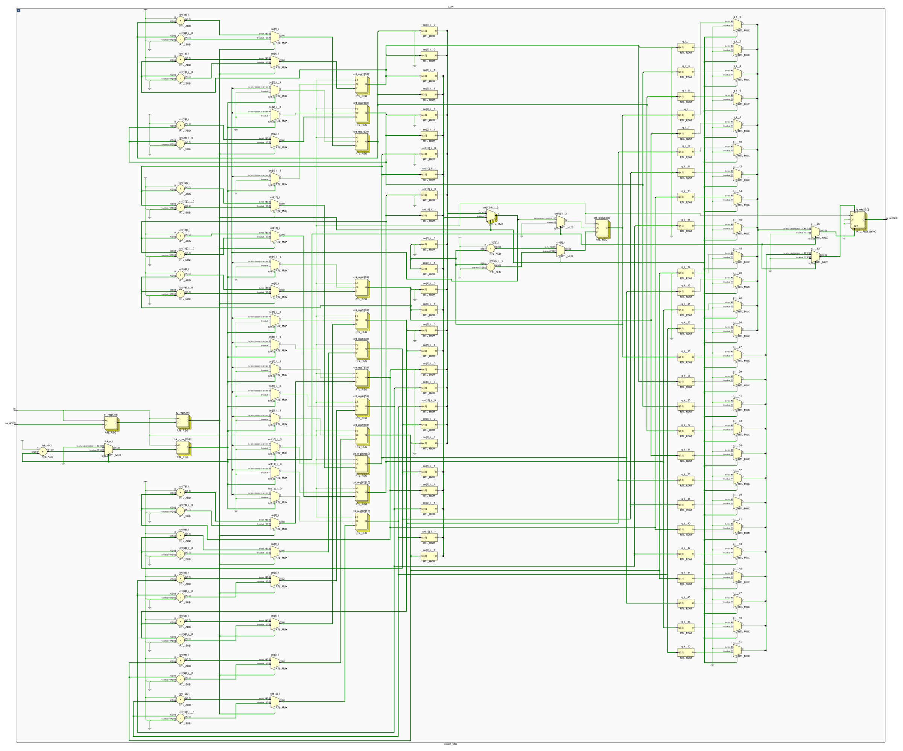

#### 4.7.4 ตัวกรองปุ่มใน `top_tetris`: MIRROR และ LOCK

วงจรเล็กๆ นี้เขียนตรงใน `top_tetris` ระหว่าง `tetris_input` กับ `tetris_core`: การโจมตี **MIRROR** สลับคำสั่งซ้ายกับขวา
และการโจมตี **LOCK** ปิดทุกปุ่ม (AND กับ `not fx_locked`) จนกว่าจะทำภารกิจสำเร็จ
ส่วน `touch` (มีการกดปุ่มใดๆ) ไปที่ `chaos_task` เสมอ ใช้ในภารกิจ HANDS ("ห้ามแตะปุ่ม")

<!-- CODE: game/top_tetris.vhd | -- chaos MIRROR | garb_in_n <= -->

#### 4.7.5 `uart_tx` และ `uart_rx`: ส่ง/รับทีละบิต

**`uart_tx`**: เมื่อได้ `start` เก็บ 10 บิตลงรีจิสเตอร์ `frame = stop & data & start` แล้วส่ง `frame(0)` ออกขา
ทุก 434 รอบนาฬิกาเลื่อน `frame` ไปทางขวา 1 บิต ครบ 10 บิตก็หยุด `busy` เป็น 1 ตลอดการส่ง (87 µs)

<!-- CODE: src/common/uart_tx.vhd | ^begin | busy <= sending -->

**`uart_rx`**: FSM 4 สถานะ

1. **S_IDLE**: รอสายตกเป็น 0 (start bit เริ่ม)
2. **S_START**: รอครึ่งบิต (217 รอบ) ถึงกลาง start bit ถ้ายังเป็น 0 จริงก็ไปต่อ (ถ้าไม่ใช่ = สัญญาณรบกวน กลับ S_IDLE)
3. **S_DATA**: รอทีละ 434 รอบ 8 ครั้ง แต่ละครั้งตรงกลางบิตข้อมูลพอดี เลื่อนบิตเข้าจากด้านซ้ายของ `shreg`
   (บิตต่ำมาก่อน หลัง 8 บิตจึงเรียงถูกที่)
4. **S_STOP**: รออีก 1 บิต ถ้าเป็น 1 (stop bit ถูกต้อง) ส่งไบต์ออกพร้อม `valid = '1'` 1 รอบ ถ้าไม่ใช่ทิ้งไบต์นั้น

<!-- CODE: src/common/uart_rx.vhd | ^begin | end process -->

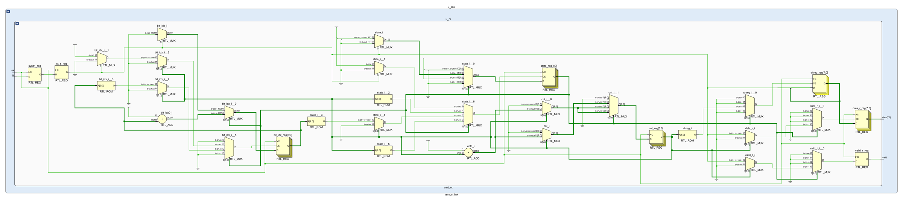

#### 4.7.6 `versus_link`: โปรโตคอลระหว่างบอร์ด

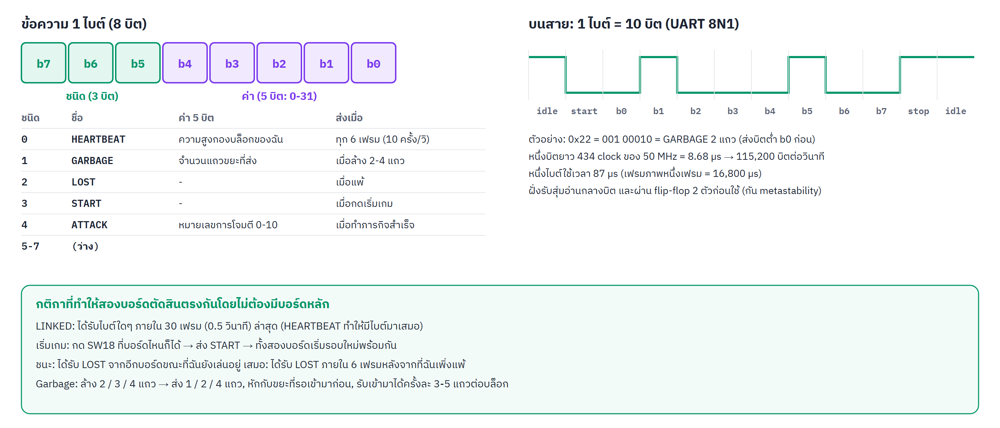

**ทำไมใช้ข้อความ 1 ไบต์**: ข้อมูลที่ต้องส่งมีน้อยมาก (จำนวนแถว ≤ 31, ความสูง ≤ 20, หมายเลขการโจมตี ≤ 10)
แบ่งเป็นชนิด 3 บิต + ค่า 5 บิตก็พอ ไม่ต้องมีการต่อข้อความหลายไบต์ ไม่มีปัญหา "ข้อความขาดครึ่ง"
และ 1 ไบต์ส่งเสร็จใน 87 µs เร็วกว่าหนึ่งเฟรมภาพ (16,800 µs) มาก

| ชนิด (บิต 7-5) | ชื่อ | ค่า (บิต 4-0) | ส่งเมื่อ |
|---|---|---|---|
| 000 | HEARTBEAT | ความสูงกองบล็อกของฉัน 0-20 | ทุก 6 เฟรม (10 ครั้งต่อวินาที) |
| 001 | GARBAGE | จำนวนแถวขยะ 1-31 | ล้าง 2-4 แถวพร้อมกัน |
| 010 | LOST | - | ฉันแพ้ (ล้นจอ) |
| 011 | START | - | ฉันกดเริ่มเกม |
| 100 | ATTACK | หมายเลขการโจมตี 0-10 | ทำภารกิจสำเร็จและสุ่มได้การโจมตี |

**ฝั่งส่ง**: คำขอส่ง (`send_*`) อาจมาพร้อมกันหลายอย่าง จึงจำไว้ในรีจิสเตอร์ `*_p` แล้วส่งทีละไบต์เมื่อ `uart_tx` ว่าง
ตามลำดับความสำคัญ **START > LOST > ATTACK > GARBAGE > HEARTBEAT** ขยะที่รอส่งรวมกันได้ (2 + 4 = ส่ง "6" ครั้งเดียว)

**ฝั่งรับ**: ทุกไบต์ที่รับได้ ดูบิต 7-5 แล้วสร้างพัลส์ `got_*` 1 รอบนาฬิกา และตั้งตัวนับ `silence = 0`
ทุกเฟรมที่ไม่มีไบต์มา `silence` เพิ่ม 1 **`link_ok = 1` เมื่อ `silence` < 30** (มีไบต์มาภายใน 0.5 วินาทีล่าสุด)
HEARTBEAT ทำให้มีไบต์มาเสมอ ถ้าถอดสาย `link_ok` จะตกภายในครึ่งวินาทีและเกมเล่นแบบคนเดียว
ความสูงใน HEARTBEAT ยังใช้วาดแถบ RIVAL บนจออีกฝั่งด้วย (ได้สองอย่างในข้อความเดียว)

<!-- CODE: src/game/versus_link.vhd | -- send the most important one | link_ok     <= -->

**การตัดสินผลโดยไม่มีบอร์ดหลัก** (เขียนใน `tetris_core` ข้อ 4.7.7):

* ใครแพ้ก็ส่ง LOST ทันที
* ได้รับ LOST ขณะที่ตัวเองยังเล่นอยู่ → **ชนะ**
* ได้รับ LOST ภายใน 6 เฟรมหลังจากที่ตัวเองเพิ่งแพ้ → **เสมอ** (ทั้งสองฝั่งแพ้เกือบพร้อมกัน ข้อความสวนกันบนสาย)
  ทั้งสองบอร์ดใช้กติกาเดียวกันจึงสรุปผลตรงกันโดยไม่ต้องส่งข้อความเพิ่ม
* กดเริ่มที่บอร์ดไหนก็ได้: บอร์ดนั้นเริ่มและส่ง START อีกบอร์ดได้ START ก็เริ่มด้วย ทั้งสองจอเริ่มพร้อมกัน

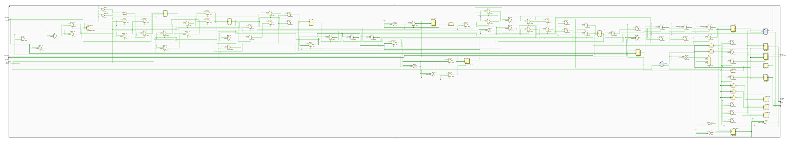

#### 4.7.7 `tetris_core`: กติกาเกม

นี่คือโมดูลที่ใหญ่ที่สุด (2,882 LUT, 1,048 flip-flop) เป็น **state machine ตัวเดียว 23 สถานะ**

**สิ่งที่เก็บไว้**:

| สัญญาณ | ขนาด | ความหมาย |
|---|---|---|
| `occ_r` | 20 แถว × 10 บิต | ช่องไหนมีบล็อก (1 = มี) |
| `col_r` | 20 แถว × 30 บิต | สีของแต่ละช่อง (3 บิต: 0-6 = I O T S Z J L, 7 = เทา/ขยะ) |
| `cur_p`, `cur_rot`, `cur_sh` | | ชนิดบล็อกที่กำลังตก, การหมุน, รูปทรง (16 บิต = กล่อง 4 × 4) |
| `cur_xr`, `cur_yr` | | ตำแหน่งของกล่อง 4 × 4 |
| `ghost_r` | | แถวที่บล็อกจะตกถึง (เงา) |
| `cand_*` | | ตำแหน่ง/รูปทรงที่ "กำลังลอง" |
| `next_p`, `bag` | | บล็อกถัดไป, ถุง 7-bag |
| `lines_r`, `level_r` | | จำนวนแถว (BCD 4 หลัก), เลเวล 0-15 |
| `pending_r` | 0-31 | ขยะที่รอเข้ามาหาเรา (มิเตอร์แดง) |

**ทำไมเก็บกระดานใน flip-flop ไม่ใช่ block RAM**: ต้องอ่านหลายแถวพร้อมกันในรอบนาฬิกาเดียว (ตรวจชน 4 แถว, เช็กแถวเต็ม,
`tetris_render` อ่านแถวใดก็ได้ทุกพิกเซล) block RAM อ่านได้ครั้งละ 1-2 ตำแหน่งเท่านั้น
และการล้างแถว/ดันขยะต้องเลื่อนทุกแถวในรอบเดียว

**ตัวตรวจการชนตัวเดียว**: ทุกการ "ลอง" (หมุน, เลื่อน, ตก, หาเงา, เกิดบล็อกใหม่) ทำแบบเดียวกัน:
เขียนตำแหน่งที่ต้องการลองลงรีจิสเตอร์ `cand_*` แล้วรอบนาฬิกาถัดไป (สถานะ `_CHK`) ดูสัญญาณ `collide`
ว่าชนผนัง พื้น หรือบล็อกอื่นหรือไม่ ถ้าไม่ชนก็คัดลอก `cand_*` ไปเป็นตำแหน่งจริง `cur_*`

ฟังก์ชัน `collides` สร้าง "แถวกว้าง" 16 บิตสำหรับแต่ละแถวของกล่อง 4 × 4: ผนัง 3 บิต + แถวกระดาน 10 บิต + ผนัง 3 บิต
(ใต้พื้น = 1 ทั้งแถว) แล้วดูว่าช่องของบล็อกตรงกับ 1 ตัวไหนหรือไม่ วงจรนี้ใหญ่ (เลือกแถวจาก 20 แถว × 4 และบิตจาก 16 บิต × 16)
**สร้างตัวเดียวแล้วใช้ซ้ำทีละขั้น** ประหยัดกว่าสร้าง 5 ตัวหลายเท่า เวลาที่เสียไปคือไม่กี่รอบนาฬิกาจาก 840,000 รอบต่อเฟรม

<!-- CODE: src/game/tetris_core.vhd | function collides | end function; -->
<!-- CODE: src/game/tetris_core.vhd | -- the one collision checker | collide <= collides -->

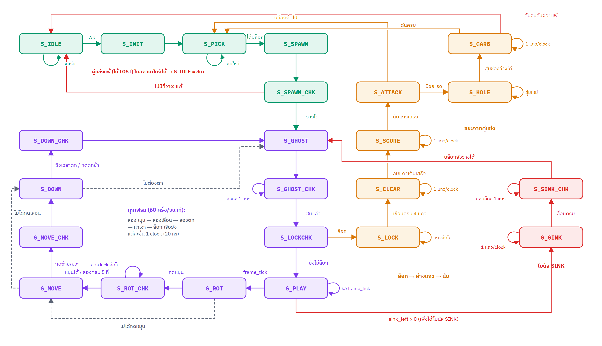

**ลำดับในแต่ละเฟรม** (รอบที่ `frame_tick = '1'`):

1. **S_PLAY**: รอ `frame_tick` เมื่อมาถึง คัดลอกคำสั่งปุ่มที่สะสมไว้ (`req_*`) ไปที่ `w_*` และนับเวลาตกตามความเร็ว
   (เลเวล 0 ตก 1 ช่องทุก 48 เฟรม, เลเวล 9 ทุก 6 เฟรม, เลเวล 15 ทุก 2 เฟรม; เลเวลขึ้นทุก 10 แถวที่ล้าง)
   ถ้าโบนัส FREEZE ทำงานก็ไม่ตก ถ้าโดน SPEED ใช้ความเร็วของเลเวล +6
2. **S_ROT → S_ROT_CHK**: ถ้ากดหมุน ลองรูปทรงถัดไป ถ้าชนลองขยับ 0, +1, −1, +2, −2 ช่อง (**wall kick**) ทีละรอบนาฬิกา
3. **S_MOVE → S_MOVE_CHK**: ถ้ากดซ้ายหรือขวา ลองขยับ 1 ช่อง
4. **S_DOWN → S_DOWN_CHK**: ถ้าถึงเวลาตกหรือกดตกช้า ลองลง 1 แถว
5. **S_GHOST → S_GHOST_CHK**: หาเงา: ลองลงไปทีละแถว (1 แถวต่อรอบนาฬิกา) จนชน แถวสุดท้ายที่ยังไม่ชนคือ `ghost_r`
6. **S_LOCKCHK**: ถ้ากด hard drop → ย้ายไปที่เงาแล้วล็อกทันที ถ้าบล็อกวางบนอะไรอยู่ (`ghost_r = cur_yr`) นับ `lock_cnt`
   ครบ 30 เฟรม (0.5 วินาที, **lock delay**) จึงล็อก การหมุน/เลื่อนรีเซ็ตเวลานี้ได้ไม่เกิน 15 ครั้งต่อบล็อก

<!-- CODE: src/game/tetris_core.vhd | when S_PLAY => | state <= S_ROT; -->
<!-- CODE: src/game/tetris_core.vhd | when S_ROT_CHK => | can't turn here -->

**เมื่อล็อก**:

1. **S_LOCK** (4 รอบนาฬิกา): OR แถวของบล็อกลงในกระดานทีละแถว พร้อมเขียนสี
2. **S_CLEAR** (1 แถวต่อรอบนาฬิกา): เดินจากแถวล่างขึ้นบนด้วยตัวชี้อ่าน `rd` และตัวชี้เขียน `wr` แถวที่เต็มถูกข้าม (ไม่คัดลอก)
   แถวอื่นถูกคัดลอกลงไปที่ `wr` ของที่อยู่ข้างบนจึงตกลงมาเอง แถวที่เหลือด้านบนถูกล้างเป็นว่าง
3. **S_SCORE**: บวกจำนวนแถวแบบ BCD (เลขฐานสิบ 4 หลัก จึงแสดงบน 7-segment ได้โดยไม่ต้องหารด้วย 10) และนับเลเวล
4. **S_ATTACK**: คำนวณขยะ: ล้าง 2 / 3 / 4 แถว = โจมตี 1 / 2 / 4 แถว **หักกับขยะที่รอเข้ามาหาเราก่อน** เหลือเท่าไรจึงส่ง
   ถ้าล็อกโดยไม่ได้ล้างแถวและมีขยะรอ ขยะเข้ามาครั้งละ 3-5 แถว (สุ่ม) ส่วนที่เหลือรอบล็อกถัดไป
5. **S_HOLE → S_GARB**: สุ่มคอลัมน์ช่องว่าง (สุ่มจนได้ 0-9) แล้วดันทั้งกระดานขึ้น 1 แถวต่อรอบนาฬิกา เติมแถวเทาที่มีช่องว่าง 1 ช่อง
   ถ้าแถวบนสุดมีบล็อกอยู่แล้ว = ถูกดันล้นจอ = **แพ้**
6. **S_PICK → S_SPAWN → S_SPAWN_CHK**: เลือกบล็อกถัดไปและวางที่ด้านบน ถ้าวางไม่ได้ = **แพ้**

<!-- CODE: src/game/tetris_core.vhd | -- Walk up from the bottom | state      <= S_SCORE; -->
<!-- CODE: src/game/tetris_core.vhd | when S_ATTACK => | state <= S_PICK; -->

**สุ่มแบบ 7-bag** (S_PICK): เก็บ "ถุง" 7 บิตว่าบล็อกไหนออกไปแล้ว ทุกรอบนาฬิกาอ่าน LFSR 3 บิต (0-7)
ถ้าได้ 7 หรือได้บล็อกที่ออกไปแล้ว ลองใหม่รอบถัดไป ครบ 7 ชิ้นแล้วเริ่มถุงใหม่ ทำให้บล็อกทุกแบบออกบ่อยเท่ากัน
และไม่มีบล็อกไหนหายไปนานเกิน 12 ชิ้น (ยุติธรรมกว่าสุ่มอิสระ)

<!-- CODE: src/game/tetris_core.vhd | when S_PICK => | when S_SPAWN => -->

**โบนัส SINK** (S_SINK, S_SINK_CHK): ตรงข้ามกับ S_GARB: ทุกแถวรับค่าจากแถว **ข้างบน** แถวล่างสุดจึงหายไป
เกิดขึ้น **ทันทีที่ได้โบนัส** (S_PLAY ตรวจ `sink_left > 0` ทุกรอบ ไม่ต้องรอให้บล็อกล็อก) บล็อกที่กำลังตกยังอยู่ที่เดิมบนจอ
แล้ว S_SINK_CHK ตรวจว่าบล็อกยังวางได้ไหม (กรณีหายาก: ถ้ามีบล็อกเลื่อนลงมาทับ ยกบล็อกขึ้นทีละแถว)

<!-- CODE: src/game/tetris_core.vhd | when S_SINK => | end case; -->

**ผลแพ้ชนะ**: โค้ดส่วนนี้อยู่หลัง `case` จึงทำงานได้ในทุกสถานะและ "ชนะ" การกำหนดค่าใน `case` เพราะอยู่บรรทัดหลัง

<!-- CODE: src/game/tetris_core.vhd | -- the other board lost | pending_r <= p; -->

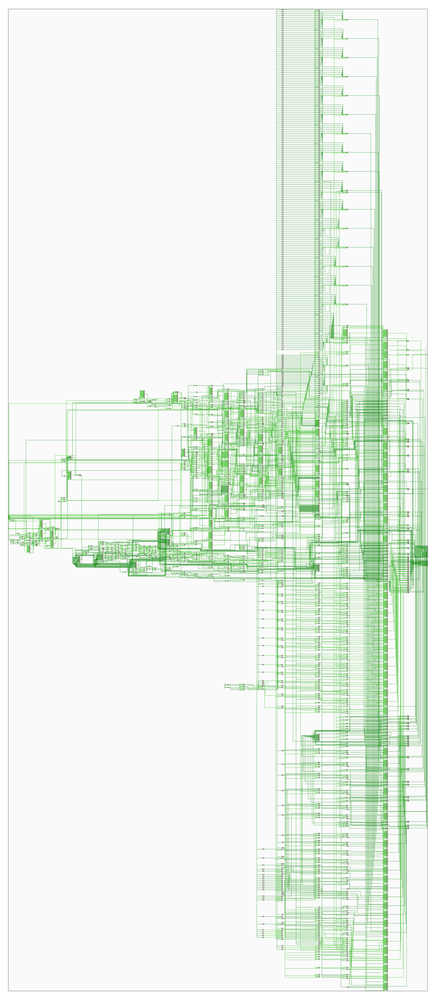

#### 4.7.8 `chaos_task`: ภารกิจด้วยสวิตช์

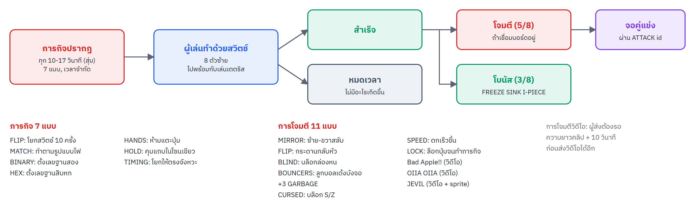

**หน้าที่**: นับเวลาสุ่ม แล้วสุ่มภารกิจ ตรวจว่าผู้เล่นทำสำเร็จหรือไม่ และตัดสินรางวัล
มี 2 สภาวะ: **WAIT** นับถอยหลัง 10-17 วินาที (สุ่ม, ไม่แสดงให้เห็นเพื่อให้ลุ้น) และ **RUN** มีภารกิจหนึ่งอย่างกำลังทำ

| ภารกิจ | ต้องทำอะไร | เวลาที่ให้ |
|---|---|---|
| FLIP | โยกสวิตช์ที่กำหนด 10 ครั้ง | 7-9 วินาที |
| MATCH | ตั้งสวิตช์ 8 ตัวให้ตรงกับไฟบนจอ | 10-13 วินาที |
| BINARY | ตั้งเลขฐานสิบที่โจทย์ให้ เป็นเลขฐานสองบนสวิตช์ 8 ตัว | 13-17 วินาที |
| HEX | ตั้งเลขฐานสิบหก 2 หลัก บนสวิตช์ 8 ตัว | 11-14 วินาที |
| HANDS | ห้ามแตะปุ่มใดๆ นาน 3-5 วินาที | 9-12 วินาที |
| HOLD | โยกสวิตช์ขึ้น-ลงเพื่อคุมแถบให้อยู่ในโซนเขียว 3-4 วินาที | 13-16 วินาที |
| TIMING | โยกสวิตช์ตอนเครื่องหมายอยู่ในโซนเขียว 3 ครั้งติด | 10-13 วินาที |

**การตรวจ**: ทุกรอบนาฬิกาเทียบสวิตช์กับค่าเมื่อรอบก่อน (`sw xor sw_d`) เพื่อจับการโยก (ภารกิจ FLIP, TIMING)
ส่วน MATCH, BINARY, HEX เทียบสวิตช์ทั้ง 8 ตัวกับเป้าหมาย HOLD จำลอง "แรงโน้มถ่วง" ของแถบด้วยความเร็ว `vel`

<!-- CODE: src/game/chaos_task.vhd | -- RUN the task | -- a new zone -->

**รางวัลเมื่อสำเร็จ** (ตัวเลขคือ **โอกาส** ไม่ใช่จำนวนแบบ):

* ถ้าเชื่อมบอร์ดอยู่ อ่าน LFSR 3 บิต (0-7): ได้ 0-4 = **การโจมตี (โอกาส 5 ใน 8 = 62.5 %)** สุ่ม 1 ใน 11 แบบเท่าๆ กัน
  ถ้าสุ่มได้การโจมตีวิดีโอแต่ยังอยู่ในช่วงพัก (ความยาวคลิป + 10 วินาที) หรือไม่มีไฟล์สื่อ จะสุ่มใหม่จาก 8 แบบที่ไม่ใช่วิดีโอ
* ได้ 5-7 = **โบนัส (โอกาส 3 ใน 8 = 37.5 %)**: อ่าน LFSR 2 บิต: 0 หรือ 3 = FREEZE, 1 = SINK, 2 = I-PIECE
* ถ้าไม่ได้เชื่อมบอร์ด ได้โบนัสเสมอ

<!-- CODE: src/game/chaos_task.vhd | if success then | bon_id <= b; -->

ทุกช่วงเวลาสุ่มด้วยฟังก์ชัน `rand_range(lo, hi, r) = lo + r × (hi − lo + 1) / 256` (r = เลขสุ่ม 0-255)
การคูณนี้ทำให้ Vivado ใช้ตัวคูณ DSP 1 ตัว

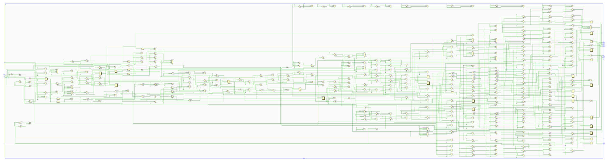

#### 4.7.9 `chaos_fx`: ผลของการโจมตีและโบนัส

**หน้าที่**: รับการโจมตีจากคู่แข่ง (`got_attack` จาก `versus_link`) และโบนัสของตัวเอง (`bonus` จาก `chaos_task`)
แล้วบอกโมดูลอื่นว่าตอนนี้มีผลอะไรอยู่บ้าง และควรแสดงแบนเนอร์อะไร

| การโจมตี | ผล | นานเท่าไร | ไปที่ |
|---|---|---|---|
| MIRROR | ปุ่มซ้าย-ขวาสลับกัน | 8-12 วินาที | ตัวกรองปุ่ม |
| FLIP | กระดานกลับหัว | 6-10 วินาที | `tetris_render` |
| BLIND | บล็อกที่วางแล้วล่องหน | 5-8 วินาที | `tetris_render` |
| BOUNCERS | ลูกบอล 5-10 ลูกเด้งบังจอ | 8-12 วินาที | `chaos_render` |
| +3 GARBAGE | ขยะ 3 แถวเข้าคิว | ทันที | `tetris_core` |
| CURSED | บล็อกถัดไปเป็น S หรือ Z | ทันที | `tetris_core` |
| SPEED | ตกเร็วขึ้น (เลเวล +6) | 8-12 วินาที | `tetris_core` |
| LOCK | ทุกปุ่มใช้ไม่ได้ จนกว่าจะทำภารกิจสำเร็จ (ภารกิจมาทันที) | จนทำสำเร็จ | ตัวกรองปุ่ม, `chaos_task` |
| Bad Apple!! / OIIA OIIA / JEVIL | วิดีโอพร้อมเสียงเป็นพื้นหลังจอ | ตามความยาวคลิป (40-84 วินาที) | `media_ctrl` |

| โบนัส | ผล |
|---|---|
| FREEZE | หยุดแรงโน้มถ่วง 3-5 วินาที |
| SINK | ลบแถวล่างสุด 2 แถว และยกเลิกขยะที่รออยู่ |
| I-PIECE | บล็อกถัดไปเป็น I (ตัวยาว) |

ผลที่มีเวลาใช้ตัวนับเฟรมต่อผล: ตั้งเป็นค่าสุ่มเมื่อเริ่ม ลดลง 1 ทุกเฟรม (ไม่ลดขณะพักเกม) ผลทำงานขณะตัวนับ > 0
ผลที่เกิดทันทีเป็นพัลส์ 1 รอบนาฬิกาไปที่ `tetris_core` แบนเนอร์ (INCOMING / SENT / BONUS / TASK FAILED) แสดง 150 เฟรม (2.5 วินาที)

<!-- CODE: src/game/chaos_fx.vhd | -- the rival hit me | -- banners for my own task results -->

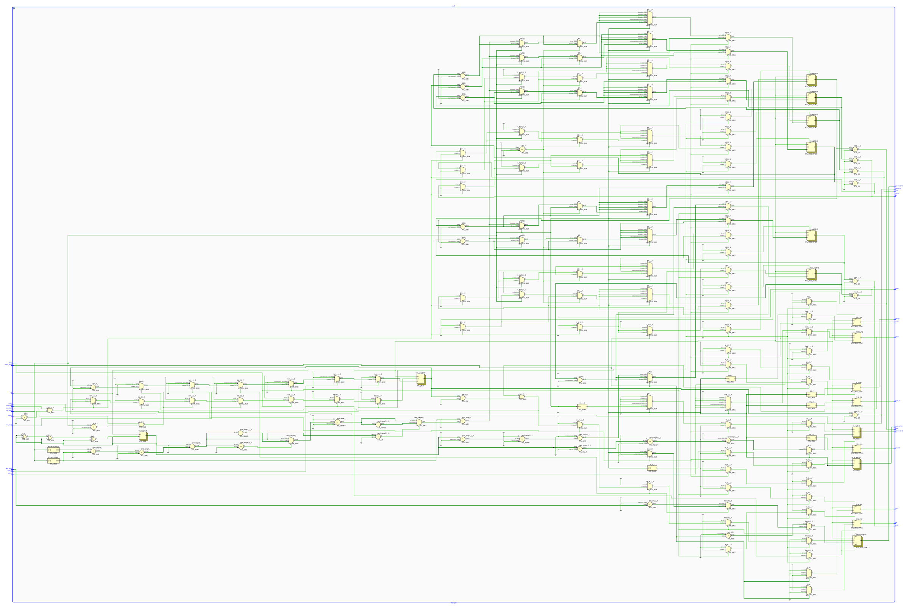

#### 4.7.10 `text_multi`: ข้อความหลายบรรทัดด้วย ROM ฟอนต์ตัวเดียว

ข้อความบนจอทั้งหมด (NEXT, LEVEL, LINES, RIVAL, LINKED, WIN!, ข้อความภารกิจ, แบนเนอร์) ใช้ฟอนต์ 5 × 7 พิกเซลที่ออกแบบเอง
(`text_pkg`, ตัวอักษร 64 ตัว แต่ละตัว 35 บิต) วาดแบบขยาย 2 หรือ 4 เท่า (`SHIFTS`)

**ปัญหา**: เดิมแต่ละบรรทัดมี ROM ฟอนต์ของตัวเอง 12 ชุด ใช้ LUT มากจนวงจรใส่ชิปไม่ได้
**วิธีแก้**: พิกเซลหนึ่งจุดอยู่ในข้อความได้แค่บรรทัดเดียว จึง (1) หาว่า (x, y) อยู่บรรทัดไหน ตัวอักษรตัวที่เท่าไร คอลัมน์/แถวไหนของตัวอักษร
แล้ว (2) เปิดฟอนต์ **ครั้งเดียว** ได้บิตเดียวว่าพิกเซลนี้เป็นส่วนของตัวอักษรหรือไม่ ใช้ 1 รอบนาฬิกา

<!-- CODE: src/game/text_multi.vhd | -- 1. which line | pix_r\(line\) <= -->

#### 4.7.11 `chaos_render`: ภาพของโหมด CHAOS

วาดเป็น **overlay** (ภาพซ้อน): ทุกพิกเซลบอกว่า "ทับด้วยสีนี้" (`ov_on = '1'`, `ov_rgb`) หรือ "ไม่มีอะไร" แล้ว `tetris_render` วางทับภาพเกม

* **แผงภารกิจ** (x 428-627, y 284-467): ข้อความ 2 บรรทัด, สวิตช์ 8 ตัวตามตำแหน่งบนบอร์ด, ไฟเป้าหมาย (MATCH),
  แถบมิเตอร์และโซนเขียว (HOLD, TIMING), แถบความคืบหน้า, แถบเวลา กรอบเป็นสีแดงเมื่อโดน LOCK
* **แบนเนอร์** ใต้กระดาน (x 176-423, y 444-467)
* **ลูกบอลเด้ง** 5-10 ลูก ขนาด 32 × 32 แต่ละลูกมีความเร็ว x, y ของตัวเอง ชนขอบกระดานแล้วเด้งกลับ
  ลูกบอลขยับ **ทีละลูก ลูกละ 1 รอบนาฬิกา** ใน 10 รอบหลัง `frame_tick` (ช่วงที่จอไม่ได้วาด) จึงใช้วงจรบวก/เทียบชุดเดียวแทน 10 ชุด
* **หน้าเพื่อน**: ถ้ามีไฟล์สื่อ ลูกบอลลูกที่ i ใส่หน้าที่ (i mod 4 + foff) mod 4 (`foff` สุ่มใหม่ทุกครั้งที่โดนโจมตี)
  โมดูลนี้ส่งที่อยู่พิกเซล (หน้า × 1024 + แถว × 32 + คอลัมน์) ไปให้ `media_engine` อ่านสีจาก block RAM

<!-- CODE: src/game/chaos_render.vhd | -- ------------------------------------------ bouncers | r_faddr <= -->

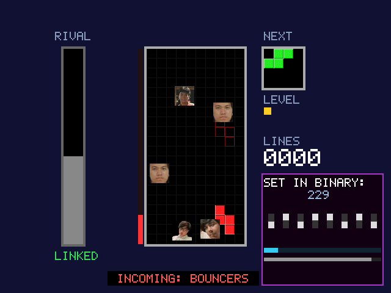

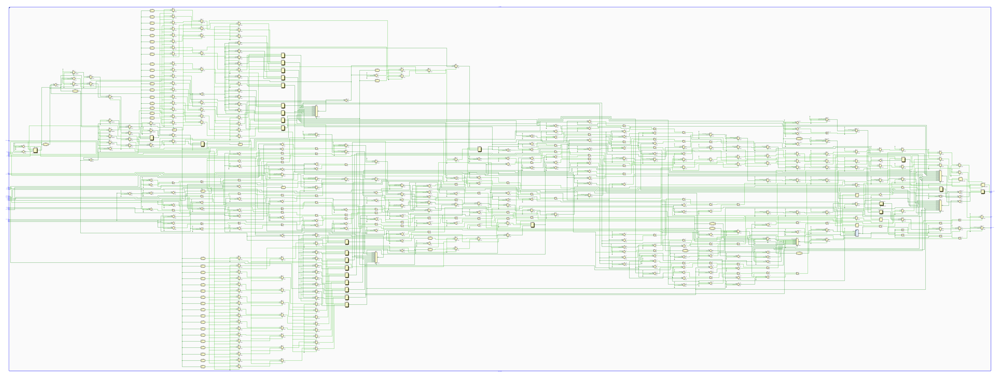

#### 4.7.12 `tetris_render`: วาดเกมทุกพิกเซล

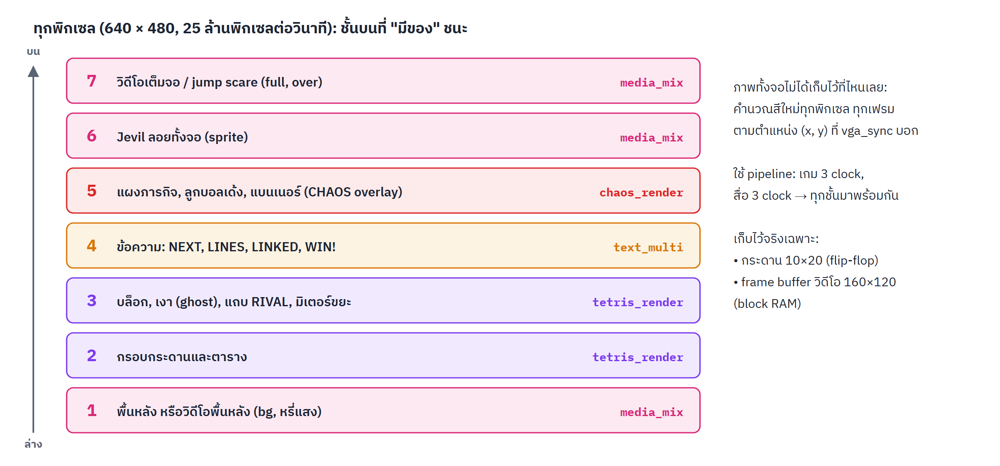

**ไม่มี frame buffer สำหรับภาพเกม**: สำหรับทุกพิกเซลที่ (x, y) วงจรคำนวณว่า "ตรงนี้คืออะไร" ใหม่ทุกครั้ง (25 ล้านครั้งต่อวินาที)
เช่น ถ้า (x, y) อยู่ในกระดาน (x 240-399, y 80-399) ก็หาช่อง: คอลัมน์ = (x − 240) / 16, แถว = (y − 80) / 16
(หารด้วย 16 = ตัดบิตล่าง 4 บิต ไม่ต้องมีวงจรหาร) แล้วอ่านบิตจาก `occ` และสีจาก `colf` ของแถวนั้น
ถ้าโดน FLIP ใช้แถว 19 − แถว (อ่านจากล่างขึ้นบน) ถ้าโดน BLIND ไม่วาดบล็อกที่วางแล้ว

**pipeline 2 ขั้น**: การคำนวณสีหนึ่งพิกเซลยาวเกินกว่าจะเสร็จใน 1 รอบนาฬิกา (20 ns) จึงแบ่ง:

1. **ขั้นที่ 1**: จาก (x, y) หาช่อง อ่านแถวของกระดาน ตรวจว่าบล็อกที่ตก/เงา/บล็อกถัดไปครอบช่องนี้หรือไม่ → เก็บใน `s1_*`
2. **ขั้นที่ 2**: เลือกสีตามลำดับชั้น (ข้อความ > บล็อกที่ตก > บล็อกที่วาง > เงา > ช่องว่างมีเส้นตารางจางๆ) บล็อกมีขอบสว่างบน-ซ้าย
   และขอบมืดล่าง-ขวาให้ดูนูน

hsync, vsync, video_on ถูกหน่วงผ่านรีจิสเตอร์ 2 ชั้นเดียวกัน ภาพจึงไม่เลื่อน ยังส่ง `see_bg` (พิกเซลนี้เป็นพื้นหลัง วิดีโอแสดงผ่านได้)
และ `keep` (แถบผลแพ้ชนะ ต้องอยู่บนสุด) ให้ `media_mix`

<!-- CODE: src/game/tetris_render.vhd | -- which field cell | s1_piece <= cur_shape -->

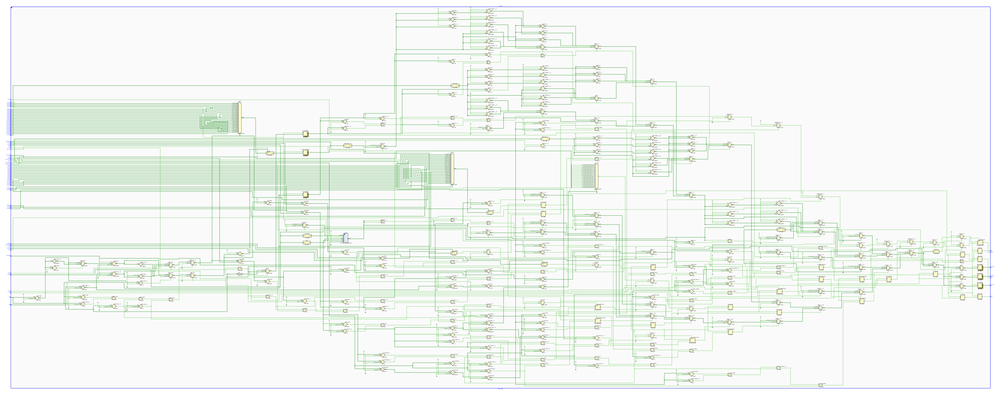

#### 4.7.13 รูปแบบไฟล์สื่อ "TDM2" (ออกแบบเอง)

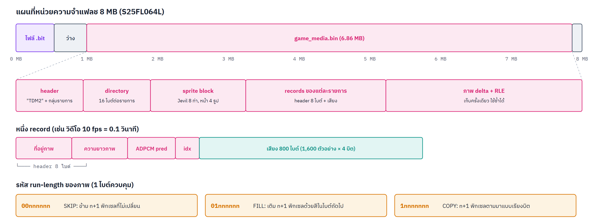

ไฟล์ `media/game_media.bin` สร้างด้วย `tools/make_game_media.py` จากรายการใน `tools/media_plan.py`
และเขียนลงแฟลชที่ที่อยู่ **0x100000** (1 MB แรกเว้นไว้ให้ไฟล์ .bit) ทุกตัวเลขเก็บแบบ little-endian (ไบต์ต่ำก่อน)

**ลำดับในไฟล์ (ตามที่อยู่จริง)**:

| ที่อยู่ในแฟลช | ส่วน | ขนาด |
|---|---|---|
| 0x100000 | header: "TDM2", เวอร์ชัน, จำนวนรายการ (17), รายการแรก/จำนวนของแต่ละกลุ่ม (เพลง 0-1, โจมตี 2-4, แพ้ 5-12, ชนะ 13-16), ที่อยู่ sprite block | 16 ไบต์ |
| 0x100010 | directory: 16 ไบต์ต่อรายการ (bpp, ความเร็ว, โหมด, จำนวน record, ไบต์เสียงต่อ record, ที่อยู่ palette, ที่อยู่ record 0, ระดับเติม) | 17 × 16 ไบต์ |
| 0x100200 - 0x2BB1FF | รายการ 0-1: เพลง 2 เพลง (เสียงอย่างเดียว) | 1.73 MB |
| 0x2BB200 - 0x5DF2FF | รายการ 2-4: วิดีโอโจมตี Bad Apple!!, OIIA OIIA, Jevil | 3.14 MB |
| 0x5DF300 - 0x6E6BFF | รายการ 5-12: คลิป/รูปตอนแพ้ (rickroll, jump scare 2 แบบ, รูป 5 แบบ) | 1.03 MB |
| 0x6E6C00 - 0x7881FF | รายการ 13-16: คลิป/รูปตอนชนะ | 0.63 MB |
| **0x788200 - 0x78B97F** | **sprite block (อยู่ท้ายสุด)**: palette 256 สี (0x788200), Jevil 8 ท่า (0x788400), หน้าเพื่อน 4 รูป (0x78A980) | 14,208 ไบต์ |

แต่ละรายการเก็บเป็น **palette → records → ภาพ** และเริ่มที่ที่อยู่ที่หาร 256 ลงตัว

* **record** = ข้อมูล 1 ช่วงเวลา (วิดีโอ 10 ภาพต่อวินาที = 0.1 วินาที): header 8 ไบต์ (ที่อยู่ภาพ 3, ความยาวภาพ 2,
  ADPCM pred 2, idx 1) + เสียง 800 ไบต์ (1,600 ตัวอย่าง × 4 บิต) record ที่ r อยู่ที่ record0 + r × (8 + ไบต์เสียง)
  จึงกระโดดไปเล่นต่อกลางรายการได้ทันที (ใช้ตอนเพลงเล่นต่อหลังโดนโจมตี)
* **ภาพ** เก็บแยกจาก record และใช้ซ้ำได้ (เช่น ฉากหลัง Jevil 34 ภาพวนซ้ำ แต่เสียงยาว 40 วินาที)
* ภาพเก็บแบบ **palette + delta + run-length**: ภาพแรกเก็บทั้งภาพ ภาพต่อไปเก็บเฉพาะพิกเซลที่เปลี่ยน ด้วยไบต์ควบคุม 3 แบบ:
  `00nnnnnn` = SKIP ข้าม n+1 พิกเซล (frame buffer ยังมีภาพก่อนหน้าอยู่ จึงไม่ต้องทำอะไร),
  `01nnnnnn c` = FILL เติม n+1 พิกเซลด้วยสี c, `1nnnnnnn ...` = COPY n+1 พิกเซลตามมา (1/2/4/8 บิตต่อพิกเซลตาม palette)

#### 4.7.14 `spi_flash` และ `STARTUPE2`: อ่านแฟลช

**ขานาฬิกาของแฟลชเป็นขาพิเศษ**: ชิปแฟลชตัวเดียวกันนี้ FPGA ใช้โหลดตัวเองตอนเปิดเครื่อง ขานาฬิกาของมัน (CCLK)
จึงไม่ใช่ขา I/O ธรรมดา หลังโหลดเสร็จ วงจรของผู้ใช้เข้าถึงขานี้ได้ทางเดียวคือ primitive **STARTUPE2** ของ Xilinx:
สัญญาณที่ต่อเข้า `USRCCLKO` จะออกที่ขา CCLK (จึงไม่มีขานี้ในไฟล์ xdc) STARTUPE2 ไม่สนใจขอบนาฬิกา 3 ขอบแรก
`spi_flash` จึงส่งนาฬิกาเปล่า 8 ครั้งก่อนเริ่มใช้งาน (สถานะ S_WAKE)

<!-- CODE: game/top_tetris.vhd | g_startup : if USE_STARTUP | end generate; -->

**การอ่าน**: CS_N = 0 → ส่ง `03h` + ที่อยู่ 24 บิตทาง MOSI (บิตสูงก่อน, เปลี่ยนบิตตอน SCLK ขาลง ชิปอ่านตอนขาขึ้น)
→ อ่าน MISO ทีละบิต ครบ 8 บิตส่งไบต์ออก (`dout_valid`) ชิปเพิ่มที่อยู่เองจึงอ่านต่อเนื่องได้ → ครบตามจำนวนแล้ว CS_N = 1
SCLK = 25 MHz (ครึ่งคาบ = 1 รอบนาฬิกา) ได้ 1 ไบต์ทุก 16-17 รอบ = 3.1 MB ต่อวินาที
สัญญาณ `hold` ให้ผู้ใช้หยุดก่อนไบต์ถัดไปได้ (SCLK ค้างที่ 0 ชิป SPI รอได้)

<!-- CODE: src/media/spi_flash.vhd | when S_SEND => | when S_END => -->

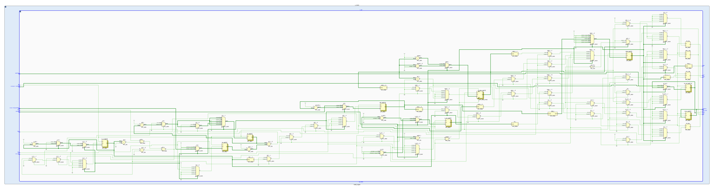

#### 4.7.15 `media_engine`: เครื่องเล่นสื่อ

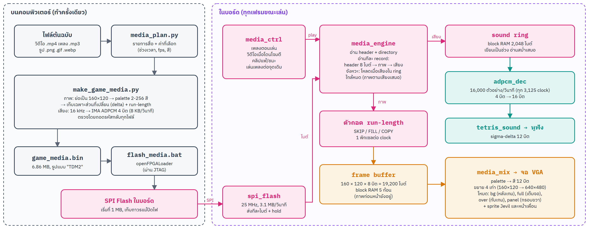

**ข้างในมี block RAM**: frame buffer 160 × 120 × 8 บิต (5 ก้อน × 4,096 ไบต์), palette 512 สี × 12 บิต (0-255 ของรายการที่เล่น,
256-511 ของ sprite), sound ring 2,048 ไบต์, Jevil 8 ท่า (4 บิตต่อพิกเซล), หน้าเพื่อน 4 รูป

**ตอนเปิดเครื่อง** (E_HDR, E_SPR): อ่าน header 16 ไบต์ ถ้าเป็น "TDM2" อ่าน sprite block จากที่อยู่ใน header (0x788200) ครั้งเดียว
แล้วรอคำสั่ง (ถ้าไม่มีไฟล์สื่อ เกมยังเล่นได้ตามปกติ แค่ไม่มีสื่อ)

**เมื่อได้คำสั่ง `play`** (รายการ, record เริ่มต้น): อ่าน directory 16 ไบต์ของรายการ → อ่าน palette → อ่านทีละ record:
header 8 ไบต์ → ภาพ (ถ้ามี) เข้า frame buffer → เสียงเข้า sound ring

**จังหวะการโหลด (pacing)**: record ถัดไปโหลดเมื่อ **ต้นเฟรมใหม่ และ เสียงใน ring ต่ำกว่าระดับที่กำหนด** (low water)
เสียงจึงเป็นตัวกำหนดความเร็ว ภาพตามเสียงเสมอ ไม่มีวันเลื่อนห่างกัน (วิดีโอ 10 ภาพ/วินาที โหลดทุก 6 เฟรมจอ บางครั้ง 5)
รายการที่มีแต่เสียงโหลดทันทีที่ ring มีที่ว่าง รายการที่มีแต่ภาพโหลดตามจำนวนเฟรมที่กำหนด

<!-- CODE: src/media/media_engine.vhd | -- pacing \(see the header\) | state <= E_RH; -->

**ตัวถอดภาพ**: ไบต์ภาพจากแฟลชเข้ามาทีละไบต์ ตัวถอดเขียน frame buffer **1 พิกเซลต่อรอบนาฬิกา**
แต่ FILL/COPY หนึ่งครั้งยาวได้ 64-128 พิกเซล ขณะที่ไบต์จากแฟลชมาทุก 17 รอบ จึงใช้ `hold` หยุดแฟลชไว้ก่อนจนตัวถอดตามทัน

<!-- CODE: src/media/media_engine.vhd | -- the picture decoder | if cnt = 1 then dst <= D_OP; elsif nb = 1 -->

**เสียงออก**: ทุก 3,125 รอบนาฬิกา (16,000 ครั้งต่อวินาที) ส่งรหัส 4 บิตจาก ring ไปที่ `adpcm_dec` (nibble ล่างของไบต์ก่อน)

<!-- CODE: src/media/media_engine.vhd | -- sound out, 16,000 codes a second | dfill := dfill - 1; -->

**ส่งภาพให้จอ**: ให้ (x, y) แล้วอีก 3 รอบนาฬิกาได้สีของภาพที่ตำแหน่งนั้น ภาพปกติขยาย 4 เท่า (160 × 120 → 640 × 480:
ที่อยู่ใน frame buffer = (y / 4) × 160 + (x / 4)) ภาพแบบ panel 96 × 88 ขยาย 2 เท่าในกรอบด้านขวา

**frame buffer 5 ก้อน**: 19,200 ไบต์ ถ้าเขียนเป็น array เดียว Vivado ใช้ block RAM 8 ก้อน (ขนาดต้องเป็นกำลังสอง)
จึงแบ่งเองเป็น 5 ก้อนก้อนละ 4,096 ไบต์ (ที่อยู่บิตบนเลือกก้อน) + attribute `ram_style = "block"`

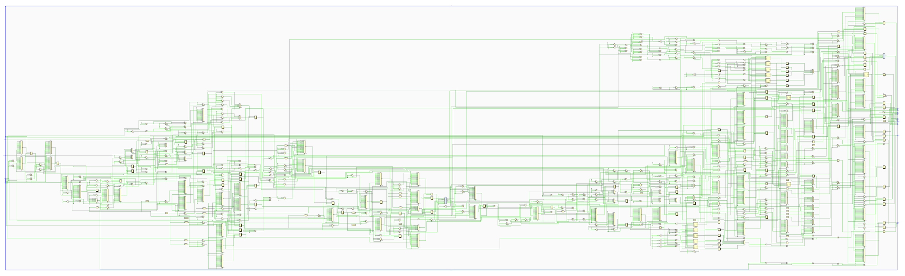

#### 4.7.16 `adpcm_dec`: ถอดรหัสเสียง IMA ADPCM

**ทำไม ADPCM**: เสียง 16 บิต 16,000 ตัวอย่างต่อวินาที = 32 KB ต่อวินาที แฟลชมีที่ 7 MB สำหรับทุกอย่าง
ADPCM เก็บแค่ "การขยับ" 4 บิตต่อตัวอย่าง (8 KB ต่อวินาที เล็กลง 4 เท่า) เสียงยังใกล้ต้นฉบับ

**วิธีถอด**: เก็บค่าเสียงที่ทายไว้ `pred` (16 บิต) และขนาดก้าว `step` (จากตาราง 89 ค่า เลือกด้วย `idx`)
รหัส 4 บิตแต่ละตัวบอกว่าจะขยับ `pred` เท่าไร:

* บิต 3 = ทิศ (1 = ลง)
* ระยะ = step/8 + (บิต 2 ? step) + (บิต 1 ? step/2) + (บิต 0 ? step/4)
* แล้วปรับก้าว: รหัส 4-7 (ขยับมาก) → `idx` + 2/4/6/8 ก้าวโตขึ้น, รหัส 0-3 (ขยับน้อย) → `idx` − 1 ก้าวเล็กลง
  เสียงดังเปลี่ยนเร็วจึงได้ก้าวใหญ่ เสียงเบาได้ก้าวละเอียด

ตัวเข้ารหัสใน `make_game_media.py` ใช้สูตรเดียวกันทุกบิต ทั้งสองฝั่งจึงได้ `pred` และ `idx` เท่ากันเสมอ
วงจรแบ่งเป็น 3 ขั้น (3 รอบนาฬิกา) เพื่อให้แต่ละรอบสั้นพอสำหรับ 50 MHz ตาราง step อยู่ใน block RAM ครึ่งก้อน (RAMB18 1 ตัว)

<!-- CODE: src/media/adpcm_dec.vhd | case ph is | ph <= 0; -->

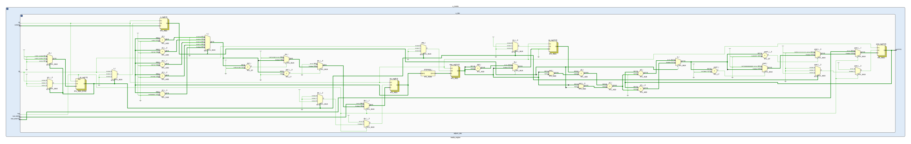

#### 4.7.17 `media_ctrl`: เลือกว่าจะเล่นอะไร

state machine 4 สถานะ: **C_IDLE** (ไม่เล่น), **C_MUSIC** (เพลง), **C_ATTACK** (วิดีโอโจมตี), **C_END** (คลิปแพ้/ชนะ)

| เหตุการณ์ | สิ่งที่ทำ |
|---|---|
| เกมเริ่ม (`playing` 0 → 1) | เล่นเพลง (สลับ 2 เพลงทีละเพลง) → C_MUSIC |
| โดนโจมตีวิดีโอ (`media_hit`) | จำตำแหน่งเพลง = record ถัดไป − 2 แล้วเล่นวิดีโอ → C_ATTACK (Jevil: เปิด sprite ลอย) |
| วิดีโอโจมตีจบ | เล่นเพลงเดิม **ต่อจากจุดที่จำไว้** → C_MUSIC |
| เกมจบ (`result` ≠ 0) | ชนะ: สุ่ม 1 ใน 4 รายการชนะ, แพ้ (หรือจบเกมคนเดียว): สุ่ม 1 ใน 8 รายการแพ้, เสมอ: ไม่เล่น → C_END |

**ทำไมถอยหลัง 2 record**: ตอนโดนโจมตี เสียง 2 record สุดท้ายที่โหลดแล้วยังรออยู่ใน ring และจะถูกทิ้ง
จึงเริ่มใหม่ก่อนหน้านั้น 2 record (ได้ยินซ้ำนิดหน่อยดีกว่าขาดหาย) สถานะ ADPCM ที่ต้นของทุก record อยู่ใน header ของ record
เสียงจึงต่อได้ถูกต้อง

<!-- CODE: src/media/media_ctrl.vhd | elsif media_hit = '1' | gap <= 7; -->

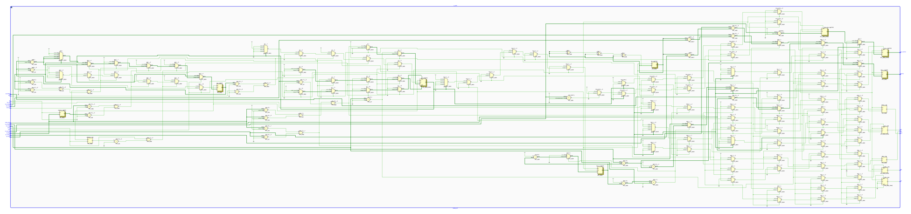

#### 4.7.18 `media_mix`: รวมภาพเกมกับสื่อ

ขั้นสุดท้ายของภาพก่อนออกขา VGA: สีเกมจาก `tetris_render` มาถึงหลัง (x, y) 2 รอบนาฬิกา ส่วนสีสื่อจาก `media_engine` มาถึงหลัง 3 รอบ
**ขั้น A** จึงหน่วงสีเกมไว้ 1 รอบให้ตรงกัน แล้ว **ขั้น B** เลือกสีตามโหมดของรายการที่เล่น:

| โหมด | ใช้กับ | วิธีผสม |
|---|---|---|
| bg | การโจมตีวิดีโอ | วิดีโอหรี่แสง (1/2 หรือ 3/4) แสดงเฉพาะจุดที่เป็นพื้นหลังหรือช่องว่าง (`see_bg`) บล็อกและข้อความยังทึบ |
| full | คลิปชนะ/แพ้ | วิดีโอเต็มจอ ยกเว้นแถบผลการแข่ง (`keep`) |
| over | jump scare | สี palette 0 = โปร่งใส (ฉากเขียวของคลิป) ที่เหลือทับเกม |
| panel | รูปตอนชนะ/แพ้ | รูป 96 × 88 ขยาย 2 เท่าในกรอบด้านขวา กรอบทอง (ชนะ) หรือแดง (แพ้) |
| sprite | Jevil, หน้าเพื่อน | อยู่บนสุดเสมอ |

**Jevil ลอยเป็นเส้นโค้ง Lissajous**: x = 272 + 230 sin(2πt / 6.1 วินาที), y = 190 + 150 sin(2πt / 3.7 วินาที + 0.6)
แต่ละแกนมีเฟส 16 บิตที่เพิ่มทุกเฟรม (65,536 = 1 รอบ: +179 ต่อเฟรม = 1 รอบใน 366 เฟรม = 6.1 วินาที)
ค่า sine อ่านจากตาราง 1/4 รอบ (128 ค่า อีก 3/4 ได้จากการสะท้อน) เปลี่ยนท่าทุก 4 เฟรม Jevil ขนาด 48 × 50 วาด 2 เท่า

<!-- CODE: src/media/media_mix.vhd | -- B: choose | vga_vs <= a_vs; -->

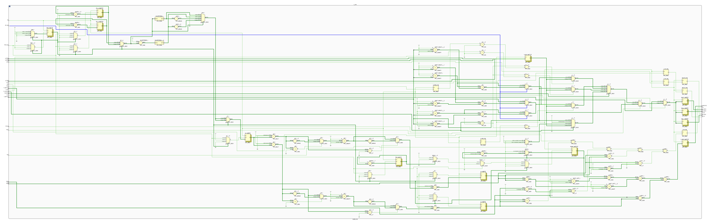

#### 4.7.19 `tetris_sound`: เสียงเอฟเฟกต์ + sigma-delta

**เสียงเอฟเฟกต์**: คลื่นสี่เหลี่ยม (chiptune) ความถี่ f สร้างจากตัวนับที่กลับบิตทุก 25,000,000 / f รอบนาฬิกา
แต่ละเอฟเฟกต์มีโน้ตไม่เกิน 4 ตัว (โน้ต, จำนวนเฟรม) เริ่มเมื่อมีเหตุการณ์: ล็อก, ล้างแถว, Tetris, ขยะเข้า, เริ่ม, ชนะ, แพ้,
ภารกิจเริ่ม/สำเร็จ/ล้มเหลว, ส่งการโจมตี, โดนโจมตี (เปิดด้วย SW5) บัซเซอร์เล่นเฉพาะเสียงเอฟเฟกต์

**ผสมเสียงลงขาเดียว (sigma-delta)**:

1. `loudness` (0-4,095) = ความดังที่ขาควรเป็นตอนนี้ = 1,536 (กึ่งกลาง) + เสียงจากสื่อ / 32 (−1,024..+1,023, ถ้าเปิด SW4)
   + 1,024 ขณะคลื่นสี่เหลี่ยมของเอฟเฟกต์เป็น 1
2. **"ถัง" (bucket) 12 บิต**: ทุกรอบนาฬิกาเท `loudness` ลงถังที่จุ 4,096 ทุกครั้งที่ล้น (บิตที่ 12 = 1) ขาออกเป็น 1 รอบนั้น
   และทิ้ง 4,096 ออก ใน 4,096 รอบถังล้นพอดี `loudness` ครั้ง ค่าเฉลี่ยของขา = loudness / 4,096
   สลับเร็ว 50 ล้านครั้งต่อวินาที หูฟังจึงได้ยินเป็นระดับเสียงต่อเนื่อง ไม่ต้องมีวงจร DAC

<!-- CODE: src/game/tetris_sound.vhd | -- 1. how loud should the pin be | audio <= bucket -->

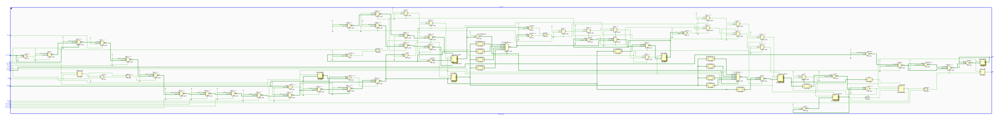

#### 4.7.20 `seg7_scan`: 7-segment 4 หลัก

4 หลักใช้สาย segment 8 เส้นร่วมกัน จึงเปิดทีละหลักวนไปเร็วๆ (หลักละ 1.3 ms ประมาณ 190 รอบต่อวินาที) ตาเห็นเป็นภาพนิ่ง
ตัวเลือกหลักคือบิตบน 2 บิตของตัวนับ 18 บิต (ยังใช้นาฬิกา 50 MHz ตัวเดียว) และมีช่วง "ปิดทุกหลัก" สั้นๆ ตอนเปลี่ยนหลัก
กันเงาของหลักก่อนหน้า (ghosting) ใน `top_tetris` มีตัวเลือก: ขณะมีภารกิจแสดง `--` + วินาทีที่เหลือ นอกนั้นแสดงจำนวนแถวที่ล้าง (BCD)

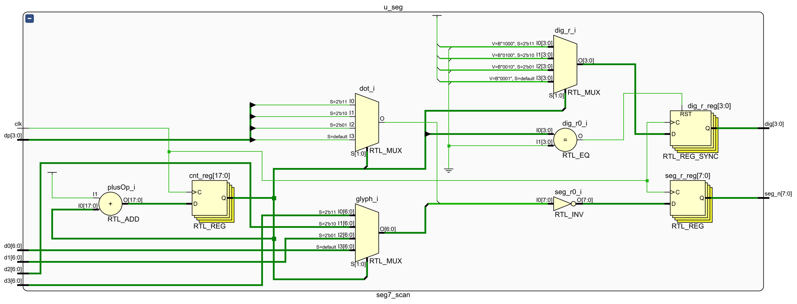

### 4.8 การจัดสรรทรัพยากร

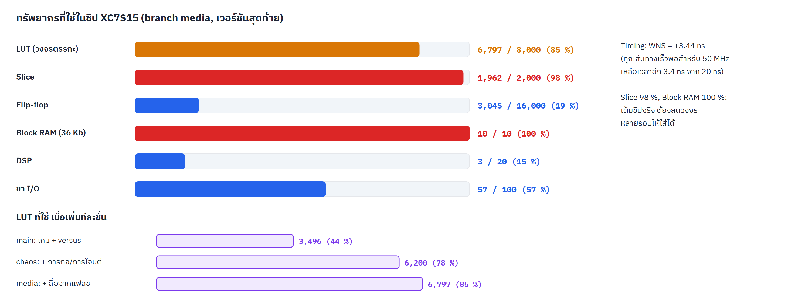

**LUT แยกตามโมดูล** (จากรายงาน `utilization_by_block.txt` ของ build สุดท้าย):

| โมดูล | LUT | Flip-flop | Block RAM | DSP |
|---|---|---|---|---|
| `tetris_core` | 2,882 | 1,048 | - | - |
| `vga_sync` + วงจรที่ Vivado ย้ายมารวม | 1,112 | 25 | - | - |
| `media_engine` (รวม `spi_flash` 176, `adpcm_dec` 123) | 870 | 815 | 6 × RAMB36 + 8 × RAMB18 | 1 |
| `chaos_task` | 642 | 129 | - | 1 |
| `chaos_render` (รวม `text_multi`) | 434 | 265 | - | - |
| `chaos_fx` | 242 | 100 | - | 1 |
| `media_mix` | 230 | 119 | - | - |
| `versus_link` (รวม `uart_tx`, `uart_rx`) | 125 | 105 | - | - |
| `tetris_render` (รวม `text_multi` 53) | 113 | 51 | - | - |
| `switch_filter` | 87 | 107 | - | - |
| `tetris_sound` | 70 | 53 | - | - |
| `tetris_input` | 59 | 130 | - | - |
| `media_ctrl` | 54 | 69 | - | - |
| **รวมทั้งชิป** | **6,797 / 8,000** | **3,045 / 16,000** | **10 / 10 ก้อน** | **3 / 20** |

(Vivado ปรับวงจรข้ามขอบโมดูลได้ ตัวเลขของ `vga_sync` จึงรวมวงจรเปรียบเทียบตำแหน่งบางส่วนของโมดูลวาดภาพที่ถูกย้ายมาไว้ที่นี่)

**Block RAM (10 ก้อน = 20 ครึ่งก้อน) ใช้ครบทุกก้อน**:

| ใช้ทำอะไร | ขนาด | จำนวน |
|---|---|---|
| frame buffer วิดีโอ | 5 × 4,096 × 8 บิต | 5 × RAMB36 |
| หน้าเพื่อน 4 รูป | 4,096 × 8 บิต | 1 × RAMB36 |
| Jevil 8 ท่า | 5 × 4,096 × 4 บิต | 5 × RAMB18 |
| sound ring | 2,048 × 8 บิต | 1 × RAMB18 |
| palette | 512 × 12 บิต | 1 × RAMB18 |
| ตาราง step ของ ADPCM | 89 × 15 บิต | 1 × RAMB18 |
| **รวม** | | **6 × RAMB36 + 8 × RAMB18 = 20 / 20 ครึ่งก้อน** |

## 5. การพัฒนา

### 5.1 เครื่องมือและสคริปต์

กลุ่มเขียนสคริปต์ให้ทุกขั้นตอนสั่งจาก Command Prompt ได้ด้วยคำสั่งเดียว (ไม่ต้องคลิกในหน้าต่าง Vivado จึงทำซ้ำได้เหมือนเดิมทุกครั้ง):

| คำสั่ง | ทำอะไร |
|---|---|
| `tools\build.bat game` | สร้าง `game\build\top_tetris.bit` (synthesis, place, route) และพิมพ์ WNS, รายงานทรัพยากร |
| `tools\program.bat game` | โหลดบิตลงบอร์ด (ชั่วคราว หายเมื่อปิดไฟ) |
| `tools\sim.bat tb_versus` | รัน testbench แล้วดูผล TEST PASSED |
| `python tools\make_game_media.py` | สร้างไฟล์สื่อ `media\game_media.bin` จากรายการใน `tools\media_plan.py` |
| `tools\flash_media.bat media\game_media.bin` | เขียนไฟล์สื่อลงแฟลชที่ 0x100000 (ครั้งเดียวต่อบอร์ด) |
| `tools\load_into_builder.bat game` | ใส่รายชื่อไฟล์และขาลงใน FPGA Builder ของ TA |
| `tools\vivado_gui.bat game` | สร้างโปรเจกต์ Vivado แล้วเปิดหน้าต่าง (ใช้ดู schematic) |
| `python tools\fake_opponent.py COM3` | ให้คอมพิวเตอร์เล่นเป็นบอร์ดคู่แข่งผ่าน USB (SW7 ขึ้น) |

ทุกการออกแบบ (ตัวเกมและวงจรทดสอบแต่ละชุด) อธิบายด้วยไฟล์ข้อความ 2 ไฟล์: `project.txt` (entity บนสุด + ไฟล์ VHDL ตามลำดับ compile)
และ `pins.xdc` (ขาของแต่ละ port) สคริปต์ทุกตัวอ่านจากไฟล์ชุดเดียวกัน ใช้ git เก็บประวัติทุกการแก้ไข

### 5.2 พัฒนาเป็นชั้น

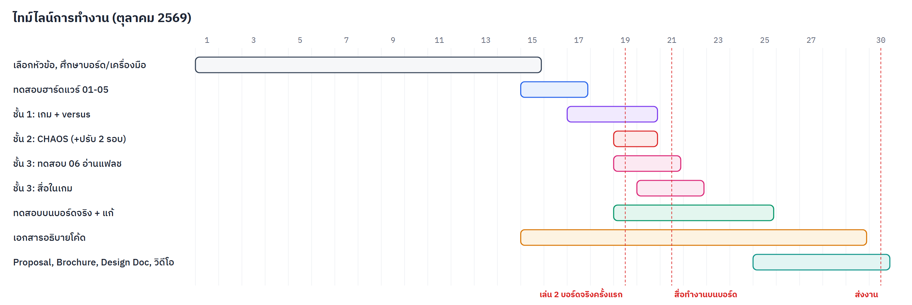

| ชั้น | เพิ่มอะไร | LUT | ผลบนบอร์ดจริง |
|---|---|---|---|
| 0. วงจรทดสอบ | VGA, หาขา J5, UART, เชื่อมบอร์ด, ตรวจขา UART | - | ผ่าน (15-16 ต.ค.) |
| 1. main | เกม + โหมดต่อสู้ | 3,496 (44 %) | เล่น 2 บอร์ดกับเพื่อนได้ (19 ต.ค.) |
| 2. chaos | ภารกิจ, การโจมตี, โบนัส | 6,200 (78 %) | เล่นได้ ปรับตามความเห็น 2 รอบ |
| 3. media | ทดสอบ 06 อ่านแฟลช → สื่อในเกม | 6,797 (85 %) | ทำงานครบ (21 ต.ค.) |

แต่ละชั้นทำเสร็จและทดสอบบนบอร์ดก่อนเริ่มชั้นถัดไป ถ้าชั้นใหม่มีปัญหาก็ยังมีชั้นก่อนหน้าที่ใช้งานได้เสมอ
(เก็บแยกเป็น branch ของ git: `main`, `chaos`, `media`)

### 5.3 ปัญหาที่พบและวิธีแก้

| ปัญหา | สาเหตุ | วิธีแก้ |
|---|---|---|
| UART จาก PC ไม่ทำงานตามคู่มือ | ขา TX/RX ในคู่มือสลับกัน | สร้างวงจรทดสอบ 05 ลองทั้งสองแบบ → สลับขา |
| สวิตช์โยกครั้งเดียวนับหลายครั้ง และค่าเปลี่ยนเองเมื่อโยกค้างครึ่งทาง | สวิตช์เด้ง, ขาลอย | `switch_filter` แบบ integrator + PULLDOWN ทุกขา |
| เริ่มเกมใหม่ทันทีโดยไม่ตั้งใจหลังจบเกม | ยังกดปุ่มค้างจากเกมก่อน | เวลาพัก 1.5 วินาทีหลังจบเกม (`can_start`) |
| ใส่สื่อแล้ววงจรวางไม่ลงชิป (7,566 LUT = 95 %) | ข้อความแต่ละบรรทัดมี ROM ฟอนต์ของตัวเอง | `text_multi`: ROM ฟอนต์ตัวเดียวต่อตัววาด, ลูกบอลขยับทีละลูก → 6,972 LUT |
| frame buffer 19,200 ไบต์ ใช้ block RAM 8 ก้อน | Vivado แบ่ง array ขนาดนี้ไม่ประหยัด | แบ่งเป็น 5 ก้อนก้อนละ 4,096 ไบต์ด้วยมือ + attribute `ram_style = block` |
| ภาพวิดีโอขาดเป็นช่วง | run ยาว 128 พิกเซลแต่ไบต์มาทุก 17 รอบนาฬิกา | สัญญาณ `hold` หยุดแฟลชระหว่างที่ตัวถอดยังไม่ว่าง |
| testbench ของวงจรทั้งหมดรันไม่จบ | โมเดลจำลองของ `STARTUPE2` ไม่หยุดเอง | generic `USE_STARTUP => false` ใน testbench |
| สคริปต์เขียนแฟลชเงียบและไม่ทำอะไร | วงเล็บในข้อความ echo ภายใน `if ( ... )` ของ batch file | escape เป็น `^(` `^)` |
| Jump scare Foxy เล็กกลางจอ | วิดีโอ 4:3 อยู่ในกรอบ 16:9 | ตั้งค่า `crop` ตัดเฉพาะส่วน 4:3 ก่อนย่อ |
| เต็มชิปอีกครั้งหลังแก้หลายรอบ | ฟีเจอร์ที่ไม่ใช้แล้วยังกินวงจร | ลบการโจมตีแมว ROM เดิม และโน้ตที่ไม่ใช้ → 6,797 LUT (85 %) |

### 5.4 การปรับตามความเห็นของผู้เล่น

หลังเล่น CHAOS บนบอร์ดจริงรอบแรก กลุ่มรวบรวมความเห็นแล้วแก้:

| ความเห็น | สิ่งที่เปลี่ยน |
|---|---|
| ตัวนับเวลา "ภารกิจถัดไป" ทำให้ไม่ลุ้น | ซ่อนแผงจนกว่าจะมีภารกิจ ไม่แสดงเวลานับถอยหลัง |
| อยากได้ภารกิจเลขฐานสิบหกด้วย | เพิ่มภารกิจ HEX |
| โซนเขียวกว้างเท่าเดิมทุกครั้ง | สุ่มความกว้างทุกภารกิจ |
| ทุกอย่างที่มีเวลาควรสุ่ม | ทุกระยะเวลาเป็นช่วงสุ่ม (`rand_range`) |
| ไม่ทำภารกิจเลย เล่นเตตริสอย่างเดียวก็ได้ | เพิ่มการโจมตี LOCK: ล็อกปุ่มจนกว่าจะทำภารกิจ |
| ขยะเข้ามา 8 แถวพร้อมกันโหดเกิน | รับได้ครั้งละ 3-5 แถว |
| FREEZE นานเกิน, ลูกบอลน้อยเกิน, BLIND ยังเห็นบล็อกสีเทา | ปรับเวลา 3-5 วิ, ลูกบอล 5-10 ลูก, ไม่วาดบล็อกเลย |
| SINK เกิดตอนบล็อกถัดไปล็อก ช้าเกิน | SINK ทันทีจาก S_PLAY (เพิ่ม S_SINK_CHK) |

## 6. การทดสอบ

### 6.1 แนวทาง: ออกแบบจากบนลงล่าง ทดสอบจากล่างขึ้นบน

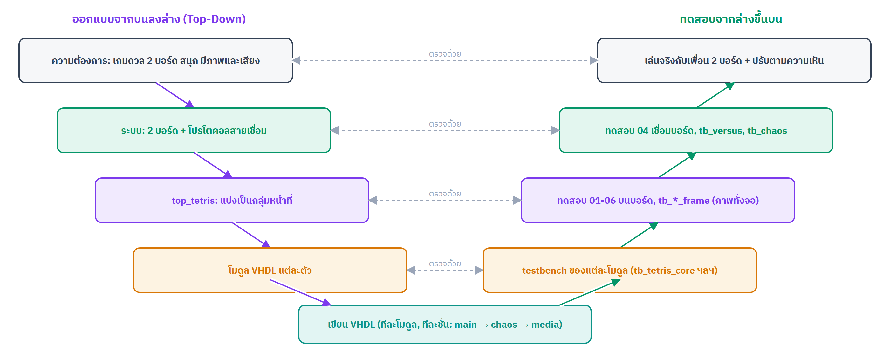

ทุกโมดูลถูกทดสอบด้วย **simulation** ก่อนโหลดลงบอร์ดเสมอ (การ build หนึ่งครั้งใช้หลายนาที
แต่ simulation เห็นสัญญาณทุกเส้นในทุกรอบนาฬิกา) จากนั้นทดสอบฮาร์ดแวร์ทีละส่วนด้วยวงจรทดสอบเล็กๆ
และสุดท้ายเล่นจริงกับเพื่อน

### 6.2 Testbench (การจำลอง)

testbench ทุกตัว **ตรวจผลเอง** และพิมพ์ `TEST PASSED` หรือบอกว่าผิดตรงไหน (ไม่ต้องนั่งดูกราฟสัญญาณ) รันด้วย `tools\sim.bat <ชื่อ>`

| testbench | ทดสอบอะไร | ผล |
|---|---|---|
| `tb_uart_loop` | uart_tx ส่งเข้า uart_rx: ทุกไบต์ที่ส่งกลับออกมาเหมือนเดิม | ผ่าน |
| `tb_vga_frame` | จังหวะ VGA ครบเฟรม + บันทึกภาพเป็น PNG | ผ่าน |
| `tb_uart_probe` | วงจรทดสอบ 05 กับการต่อสายทั้งสองแบบ | ผ่าน |
| `tb_switch_filter` | ตัวกรองสวิตช์กับสัญญาณเด้ง | ผ่าน |
| `tb_tetris_core` | หุ่นยนต์เล่นทั้งเกมจนแพ้; ตรวจว่าจำนวนช่องบนกระดานไม่หาย/ไม่เกินทุกครั้งที่ล็อกและล้าง | ผ่าน |
| `tb_versus` | สองบอร์ด (core + link) เล่นกันโดยหุ่นยนต์สองตัว: START ข้ามบอร์ด, ขยะ, WIN/LOSE, LINKED, เวลาพักหลังจบเกม | ผ่าน |
| `tb_tetris_frame` | วงจรทั้งหมด; บันทึกภาพหน้าจอเกมและหน้าจอ WIN! | ผ่าน |
| `tb_chaos` | ทำภารกิจ → การโจมตีข้ามสาย → ผลบนอีกบอร์ด, LOCK | ผ่าน |
| `tb_chaos_core` | FREEZE, SPEED, CURSED, I-PIECE, SINK | ผ่าน |
| `tb_chaos_frame` | ภาพหน้าจอ: CHAOS เปิด + ขยะรอ, แผงภารกิจ + BLIND, FLIP + ลูกบอล | ผ่าน |
| `tb_flash_read` | วงจรทดสอบ 06 กับแฟลชจำลอง | ผ่าน |
| `tb_media_engine` | เครื่องเล่นสื่อ: เสียงทุกตัวอย่าง, ภาพ delta, โหมด panel, over, sprite | ผ่าน |
| `tb_media_ctrl` | ลำดับการเล่น: เพลง, การโจมตี, ชนะ/แพ้, เล่นเพลงต่อ | ผ่าน |

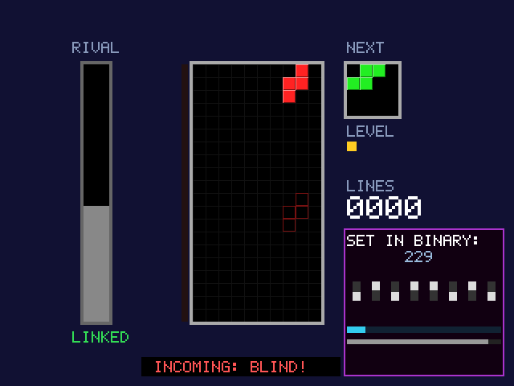

### 6.3 วงจรทดสอบฮาร์ดแวร์

ก่อนเขียนเกม กลุ่มสร้างวงจรเล็กๆ 6 ชุด (โฟลเดอร์ `tests\`) แต่ละชุดทดสอบฮาร์ดแวร์อย่างเดียว ถ้าเกมมีปัญหาภายหลัง
ก็รู้ว่าไม่ใช่ที่ขาหรือสาย

| วงจรทดสอบ | ทดสอบอะไร | ผลบนบอร์ดจริง |
|---|---|---|
| 01 vga_bars | แถบสี, ไล่ระดับสี, ตาราง, สี่เหลี่ยมเด้ง | ผ่าน: สีครบ 4,096 สี, ขอบภาพตรง |
| 02 j5_pin_finder | ขา FPGA ใดอยู่ที่ขาไหนของ J5 | ผ่าน: แผนที่ขา J5 ครบ 16 ขา |
| 03 uart_echo | คุยกับ PC ผ่าน USB | ผ่าน (หลังสลับขา) |
| 04 board_link | สองบอร์ดคุยกันผ่านสายจัมเปอร์ | ผ่าน (เป็นพื้นฐานของ versus_link) |
| 05 uart_probe | ขา USB-UART ขาไหน TX ขาไหน RX | พบว่าคู่มือสลับขา |
| 06 flash_read | อ่านภาพ แอนิเมชัน และเสียงจากแฟลช | ผ่าน: อ่าน ID ได้, ตรวจข้อมูล 0 ไบต์ผิด ใน 83 ms, เสียงไม่ขาด, ภาพกับเสียงตรงกัน |

### 6.4 การทดสอบเล่นจริง

| วันที่ | ทดสอบ | ผล |
|---|---|---|
| 19 ต.ค. 2569 | โหมดต่อสู้บน 2 บอร์ดกับเพื่อน | เชื่อมต่อทันที (LINKED), ขยะ/ชนะ/แพ้ถูกต้อง |
| 19 ต.ค. 2569 | CHAOS รอบ 1 และ 2 | เล่นได้ทุกภารกิจ ปรับตามความเห็น (ข้อ 5.4) |
| 20 ต.ค. 2569 | วงจรทดสอบ 06 | ผ่านทุกข้อ |
| 21 ต.ค. 2569 | สื่อในเกม | เพลง, วิดีโอโจมตี, ฉากแพ้ชนะ, sprite ทำงานครบ; แก้ 4 จุด (ข้อ 5.3) |

[ใส่รูปถ่ายจริง: บอร์ดสองบอร์ดต่อสาย, จอขณะเล่น, จอขณะวิดีโอโจมตี]

### 6.5 ผลการ build สุดท้าย

* **ทรัพยากร**: LUT 6,797 / 8,000 (85 %), Slice 1,962 / 2,000 (98 %), flip-flop 3,045 (19 %),
  Block RAM 10 / 10 (100 %), DSP 3 / 20, ขา I/O 57
* **Timing**: WNS = +3.441 ns, TNS = 0: ทุกเส้นทางทำงานได้ที่ 50 MHz และยังเหลือเวลาอีก 3.4 ns จาก 20 ns
* **ไฟล์สื่อ**: 6,863,360 ไบต์ จากที่ว่าง 7 MB, โปรแกรมสร้างไฟล์ถอดรหัสทุกรายการกลับมาตรวจก่อนเขียนแฟลช

## 7. วิธีสร้างชิ้นงานซ้ำทีละขั้น

บทนี้เขียนให้คนที่มีแค่อุปกรณ์และไฟล์ในสื่อบันทึกข้อมูล ทำตามแล้วได้ชิ้นงานที่เล่นได้

### 7.1 อุปกรณ์

| อุปกรณ์ | จำนวน |
|---|---|
| บอร์ด EDGE Spartan-7 (XC7S15) พร้อมสาย USB | 2 |
| จอที่มีช่อง VGA + สาย VGA | 2 |
| หูฟังหรือลำโพงแบบมีไฟเลี้ยง (แจ็ค 3.5 มม.) | 2 (ไม่บังคับ) |
| สายจัมเปอร์ตัวเมีย-ตัวเมีย | 3 เส้น |
| ฝาครอบบอร์ดและปุ่มกดพิมพ์ 3 มิติ (ดูหัวข้อ 9.1) | 2 ชุด (ไม่บังคับ: กดง่ายขึ้นและมีป้ายบอกปุ่ม) |
| คอมพิวเตอร์ Windows | 1 |

### 7.2 ติดตั้งโปรแกรม

1. **Vivado 2025.2** (ฟรี, รุ่น Standard) จาก AMD ติดตั้งที่ `D:\AMDDesignTools\2025.2` หรือใช้ Vivado ใน FPGA Builder ของ TA
   (สคริปต์หาทั้งสองที่)
2. **FPGA Builder ของ TA** (`D:\setup\FPGA_Builder_Package_V9`): มี openFPGALoader สำหรับโหลดบิตและเขียนแฟลช
3. **Python 3** + แพ็กเกจ: `python -m pip install numpy pillow pyserial`
4. **ffmpeg** (เฉพาะถ้าจะสร้างไฟล์สื่อใหม่จากวิดีโอต้นฉบับ)
5. คัดลอกโฟลเดอร์ซอร์สโค้ดไปไว้ในที่ที่ **ไม่มีช่องว่างหรือภาษาไทยในชื่อ path** (เช่น `D:\setup\assignment`)

### 7.3 สร้างไฟล์ .bit

```
cd D:\setup\assignment
tools\build.bat game
```

ใช้เวลาประมาณ 3-5 นาที เมื่อเสร็จจะพิมพ์ WNS (ต้องไม่ติดลบ) และได้ `game\build\top_tetris.bit`
(ในสื่อบันทึกข้อมูลมีไฟล์นี้ที่ build เสร็จแล้ว ข้ามขั้นนี้ได้)

ทางเลือก: ใช้ FPGA Builder ของ TA: ปิด Builder → `tools\load_into_builder.bat game` → เปิด Builder → กด Build แล้ว Program

### 7.4 สร้างและเขียนไฟล์สื่อลงแฟลช (ครั้งเดียวต่อบอร์ด)

1. ไฟล์ `media\game_media.bin` ที่สร้างเสร็จแล้วอยู่ในสื่อบันทึกข้อมูล (ถ้าจะสร้างใหม่: ใส่ไฟล์วิดีโอ/เพลง/รูปต้นฉบับตามรายการใน
   `tools\media_plan.py` ไว้ในโฟลเดอร์ `media\` แล้วรัน `python tools\make_game_media.py`)
2. ต่อบอร์ดกับคอมพิวเตอร์ ปิด FPGA Builder แล้วรัน:

```
tools\flash_media.bat media\game_media.bin
```

ใช้เวลาไม่กี่นาที ข้อมูลอยู่ในแฟลชถาวรแม้ปิดไฟ (ไม่ต้องทำซ้ำ) ทำกับทั้งสองบอร์ด
(ถ้าไม่ได้เขียนไฟล์สื่อ เกมยังเล่นได้ แค่ไม่มีเพลงและวิดีโอ)

### 7.5 โหลดเกมลงบอร์ด

```
tools\program.bat game
```

ทำกับทั้งสองบอร์ด (ไฟล์ `.bit` เดียวกัน) หรือใช้ปุ่ม Program ใน FPGA Builder
ถ้าต้องการให้บอร์ดจำเกมไว้แม้ปิดไฟ: `tools\program.bat game flash`

### 7.6 ต่อสายและเล่น

1. ต่อจอ VGA และหูฟังที่แต่ละบอร์ด
2. ต่อสายจัมเปอร์ 3 เส้นที่หัวต่อ J5 (ตรงจากขาถึงขา ไม่มีอะไรคั่น):
   บอร์ด A ขา 5 → บอร์ด B ขา 6, บอร์ด A ขา 6 → บอร์ด B ขา 5, ขา 2 ของทั้งสองบอร์ดต่อกัน (GND)
3. สวิตช์ SW7 ลง (ใช้สาย J5) SW4, SW5 ขึ้น (เพลง, เสียงเอฟเฟกต์) SW6 ขึ้นถ้าจะเล่นโหมด CHAOS (ทั้งสองบอร์ด)
4. ภายในครึ่งวินาทีทั้งสองจอขึ้น **LINKED**
5. กด **SW18** (ปุ่มกลาง) ที่บอร์ดไหนก็ได้ ทั้งสองบอร์ดเริ่มพร้อมกัน

### 7.7 ทดสอบด้วยบอร์ดเดียว (คอมพิวเตอร์เล่นเป็นคู่แข่ง)

1. SW7 ขึ้น (ใช้ USB แทนสาย J5) แล้วรัน `python tools\fake_opponent.py COM3` (COM ตามที่ Device Manager แสดง)
2. จอขึ้น LINKED พิมพ์ `s` = START, `g 3` = ขยะ 3 แถว, `l` = คู่แข่งแพ้, `x 8` / `x 9` / `x 10` = โจมตีด้วยวิดีโอ Bad Apple / OIIA / Jevil

### 7.8 แก้ปัญหา

| อาการ | สาเหตุที่เป็นไปได้ | วิธีแก้ |
|---|---|---|
| จอไม่ขึ้นภาพ | ยังไม่ได้โหลดบิต, สาย VGA หลวม | โหลดใหม่, เสียบสายแน่น |
| ไม่ขึ้น LINKED | สายไม่ไขว้ TX → RX, ไม่ได้ต่อ GND, SW7 ขึ้นอยู่ | ตรวจสาย, SW7 ลง |
| ไม่มีเพลง/วิดีโอ | ยังไม่ได้เขียนไฟล์สื่อลงแฟลช, SW4 ลง | `flash_media.bat`, SW4 ขึ้น |
| ไม่มีภารกิจ CHAOS | SW6 ลง หรือยังไม่ได้เริ่มเกม | SW6 ขึ้นทั้งสองบอร์ด แล้วเริ่มเกม |
| เขียนแฟลชไม่ได้ | FPGA Builder เปิดอยู่ (ใช้สาย USB ร่วมกัน) | ปิด Builder ก่อน |
| build ไม่ผ่าน | path มีช่องว่าง/ภาษาไทย | ย้ายโฟลเดอร์ |

## 8. วิธีเล่น

| ปุ่ม | หน้าที่ |
|---|---|
| SW14 / SW20 | เลื่อนซ้าย / ขวา (กดค้างได้) |
| SW16 | หมุน |
| SW23 | ตกช้า (กดค้าง) |
| SW18 | ตกทันที / เริ่มเกม |

| สวิตช์เลื่อน (ขึ้น = เปิด) | หน้าที่ |
|---|---|
| SW2 | พักเกม |
| SW4 | เพลงและเสียงของสื่อ |
| SW5 | เสียงเอฟเฟกต์ |
| SW6 | เปิดโหมด CHAOS (เปิดทั้งสองบอร์ด) |
| SW7 | เชื่อมกับ PC ผ่าน USB แทนสาย J5 |
| SW22 SW21 SW19 SW17 SW15 SW13 SW12 SW11 | สวิตช์ภารกิจ 8 ตัว (ซ้ายสุด, บิต 7 → บิต 0) |

7-segment แสดงจำนวนแถวที่ล้าง หรือวินาทีที่เหลือขณะมีภารกิจ
บนฝาครอบที่พิมพ์ 3 มิติมีป้ายบอกปุ่มและสวิตช์เหล่านี้ทั้งหมด (ภาพในหัวข้อ 9.1)

**กติกา**: ล้าง 2 / 3 / 4 แถวพร้อมกัน ส่งขยะ 1 / 2 / 4 แถวไปหาคู่แข่ง (หักกับขยะที่รอเข้ามาหาเราก่อน) คนที่ถูกดันล้นจอแพ้
ในโหมด CHAOS ภารกิจโผล่ด้านขวาทุก 10-17 วินาที ทำด้วยสวิตช์ภารกิจให้ทันเวลา แล้วสุ่มได้การโจมตี (62.5 %) หรือโบนัส (37.5 %)

## 9. สรุปผล

### 9.1 ชิ้นงานที่เสร็จแล้ว

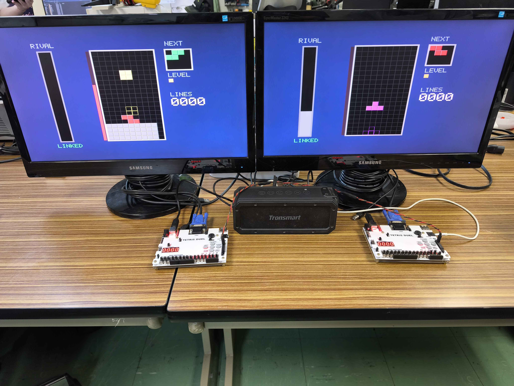

เพื่อให้กดง่ายและรู้ทันทีว่าปุ่มไหนทำอะไร กลุ่มจึง **ออกแบบและพิมพ์ 3 มิติ ฝาครอบบอร์ดพร้อมปุ่มกด** ครอบทับบอร์ด EDGE ทั้งสองบอร์ด
ปุ่มพิมพ์ 3 มิติมีขนาดใหญ่กว่าปุ่มเล็กบนบอร์ด จึงกดได้สบายกว่ามากระหว่างเล่นเร็วๆ และบนฝาครอบมีป้ายบอกหน้าที่ของทุกส่วน:

* ปุ่ม **ROTATE / LEFT / RIGHT / HARD DROP / SOFT DROP**
* **LINES** เหนือ 7-segment (จำนวนแถวที่ล้าง หรือวินาทีที่เหลือของภารกิจ)
* **TASK SWITCHES** เหนือสวิตช์ภารกิจ 8 ตัวทางซ้าย
* สัญลักษณ์เหนือสวิตช์ตั้งค่าทางขวา: **PC** (เชื่อมกับคอมพิวเตอร์), **♦** (โหมด CHAOS), **ลำโพง** (เสียงเอฟเฟกต์), **โน้ตดนตรี** (เพลง), **II** (พักเกม)
* ช่องเปิดตรงขั้วต่อทุกจุด (USB, VGA, ช่องหูฟัง, J5) จึงต่อสายได้โดยไม่ต้องถอดฝาครอบ

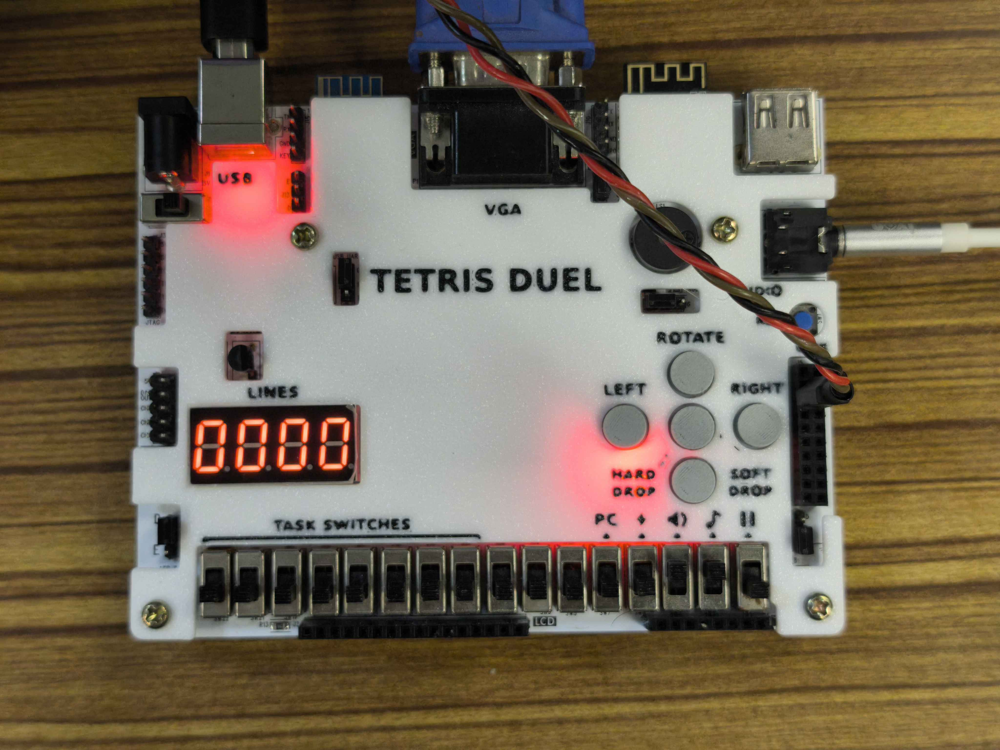

### 9.2 ผลที่ได้เทียบกับข้อกำหนด

| ข้อกำหนด | ผล |
|---|---|
| R1 เตตริสครบกติกา | ทำได้: 7-bag, ghost, wall kick, lock delay, เลเวล, เลื่อนค้าง |
| R2 ต่อสู้ 2 บอร์ด | ทำได้: ขยะ, แถบ RIVAL, เริ่มพร้อมกัน, ชนะ/แพ้/เสมอตรงกัน |
| R3 รู้สถานะการเชื่อมต่อ | ทำได้: LINKED ภายใน 0.5 วินาที, เล่นคนเดียวได้ |
| R4 CHAOS | ทำได้: ภารกิจ 7 แบบ, การโจมตี 11 แบบ, โบนัส 3 แบบ |
| R5 เพลงและเสียง | ทำได้: เพลง 2 เพลง, เสียงเอฟเฟกต์ 12 แบบ |
| R6 วิดีโอจากแฟลช | ทำได้: วิดีโอโจมตี 3 แบบ, คลิป/รูปแพ้ 8 แบบ ชนะ 4 แบบ, sprite 2 แบบ |
| R7 ใส่ชิปได้และผ่าน timing | ทำได้: 85 % LUT, 100 % block RAM, WNS +3.4 ns |

### 9.3 สิ่งที่ได้เรียนรู้

* การออกแบบแบบ Top-Down ทำให้แบ่งงานได้ชัด และเมื่อมีปัญหาก็ไล่หาได้ทีละระดับ
* simulation ที่ตรวจผลเองช่วยประหยัดเวลามาก เพราะการ build หนึ่งครั้งใช้หลายนาที
* ฮาร์ดแวร์จริงไม่ตรงกับเอกสารเสมอไป ต้องมีวงจรทดสอบเล็กๆ เพื่อยืนยัน
* ทรัพยากรของ FPGA มีจำกัดจริง ต้องเลือกโครงสร้างที่ประหยัด (ใช้วงจรร่วมกัน, ทำงานทีละขั้นแทนพร้อมกัน)

### 9.4 ข้อจำกัดและแนวทางพัฒนาต่อ

* ชิปเต็มแล้ว (slice 98 %, block RAM 100 %): ฟีเจอร์ใหม่ต้องลดของเดิมก่อน หรือใช้ชิปที่ใหญ่กว่า
* วิดีโอมีความละเอียดเพียง 160 × 120 เพราะไม่มี RAM ภายนอก
* แนวทางต่อไป: มินิเกมเพิ่ม, เล่นได้มากกว่า 2 คน (ต่อสายแบบวง), ใช้คีย์บอร์ด PS/2

## เอกสารอ้างอิง

1. EDGE Spartan 7 FPGA Development Board User Manual
2. AMD/Xilinx, *7 Series FPGAs Memory Resources User Guide* (UG473): block RAM
3. AMD/Xilinx, *7 Series FPGAs Configuration User Guide* (UG470): STARTUPE2 และการบูตจากแฟลช
4. Infineon (Cypress), *S25FL064L 64-Mbit SPI Flash Datasheet*
5. Interactive Multimedia Association, *Recommended Practices for Enhancing Digital Audio Compatibility* (IMA ADPCM), 1992
6. VGA Signal 640 × 480 @ 60 Hz Timing (tinyvga.com)
7. Tetris Guideline: 7-bag, lock delay, garbage (tetris.wiki)
8. เอกสารและแลปของรายวิชา Digital System Fundamentals in Practice

**สื่อที่ใช้ในเกม** (ใช้เพื่อการศึกษาเท่านั้น ลิขสิทธิ์เป็นของเจ้าของ):
[รายการเพลงและวิดีโอพร้อมเจ้าของ: TETORIS (Hiiragi Magnetite), Tetris theme (Korobeiniki), Bad Apple!! (Touhou / Alstroemeria Records), OIIA OIIA cat, Jevil / THE WORLD REVOLVING (Toby Fox, Deltarune), Rick Astley - Never Gonna Give You Up, FNaF 2 (Scott Cawthon), yippee cat ฯลฯ]

## ภาคผนวก ก. รายชื่อไฟล์

| โฟลเดอร์ | ไฟล์ |
|---|---|
| `game\` | `top_tetris.vhd` (บนสุด), `project.txt`, `pins.xdc`, `build\top_tetris.bit` |
| `src\common\` | `common_pkg`, `debounce`, `switch_filter`, `seg7_scan`, `vga_sync`, `uart_tx`, `uart_rx` |
| `src\game\` | `tetris_pkg`, `text_pkg`, `chaos_pkg`, `tetris_input`, `tetris_core`, `versus_link`, `chaos_task`, `chaos_fx`, `text_multi`, `chaos_render`, `tetris_render`, `tetris_sound` |
| `src\media\` | `spi_flash`, `adpcm_dec`, `media_engine`, `media_ctrl`, `media_mix` |
| `tests\01..06\` | วงจรทดสอบฮาร์ดแวร์ 6 ชุด |
| `sim\` | testbench 13 ชุด |
| `tools\` | สคริปต์ build / program / sim / flash และโปรแกรม Python สร้างไฟล์สื่อ |
| `docs\learn\` | เอกสารอธิบายโค้ดทุกบรรทัด 9 บท (ภาษาอังกฤษ) + หน้าเว็บอธิบายแบบโต้ตอบ |
| `submission\figures\vivado_png\` | schematic จาก Vivado ทุกโมดูล (PNG หมุนแล้ว; PDF ต้นฉบับอยู่ใน `submission\figures\vivaldo generated schematics\`) |

**ซอร์สโค้ดทั้งหมด**: https://github.com/anakom-suvonvorn/FPGA-Tetris

* branch `media` คือชิ้นงานฉบับสมบูรณ์ตามเอกสารนี้ (เตตริส + CHAOS + สื่อจากแฟลช)
* branch `main` คือชั้นที่ 1 (เตตริสต่อสู้อย่างเดียว) และ branch `chaos` คือชั้นที่ 2 (ยังไม่มีสื่อ) ตามลำดับการพัฒนาในบทที่ 5
* ไฟล์ชุดเดียวกันอยู่ในสื่อบันทึกข้อมูล โฟลเดอร์ `Source_Code` ไฟล์ VHDL ทั้ง 25 ไฟล์เรียงตามลำดับ compile อยู่ใน `game/project.txt`

<!-- PAGEBREAK -->

## ภาคผนวก ข. schematic จาก Vivado ของทุกโมดูล

สร้างด้วย Vivado: Open Elaborated Design → Schematic แล้วเลือกแต่ละ instance → Export to PDF (หมุนภาพแล้ว)
ภาพในเอกสารย่อลงเพื่อให้พอดีหน้า ไฟล์ PNG ความละเอียดสูงและ PDF ต้นฉบับ (ซูมได้ไม่จำกัด) อยู่ในโฟลเดอร์ `vivado_schematics` ของสื่อบันทึกข้อมูล
และบน GitHub ที่ `submission/figures/` ชื่อไฟล์คือชื่อ instance ในโค้ด (`u_core` = `tetris_core` เป็นต้น) ภาพของโมดูลย่อยชั้นที่สองมีกรอบสีน้ำเงินของโมดูลแม่ล้อมอยู่


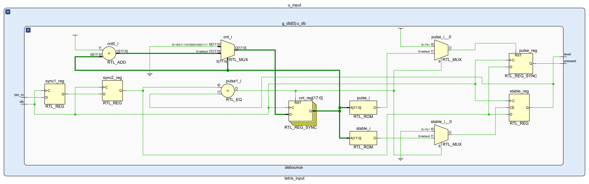


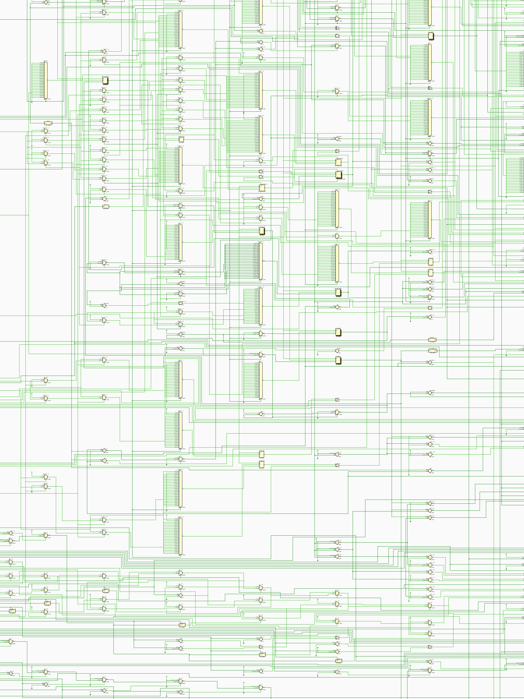


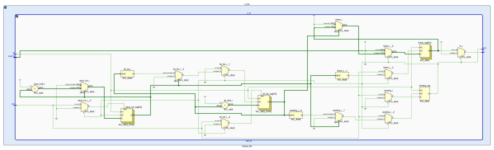


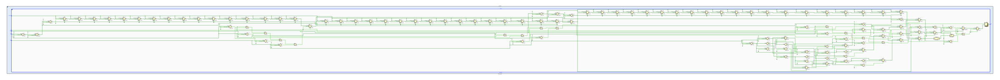


